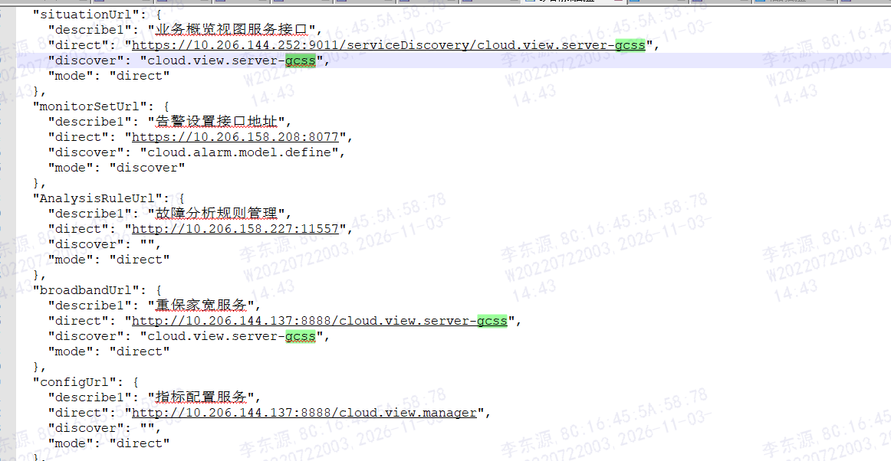
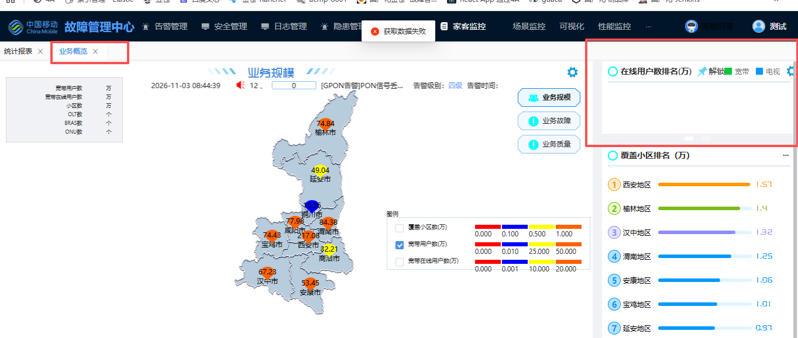
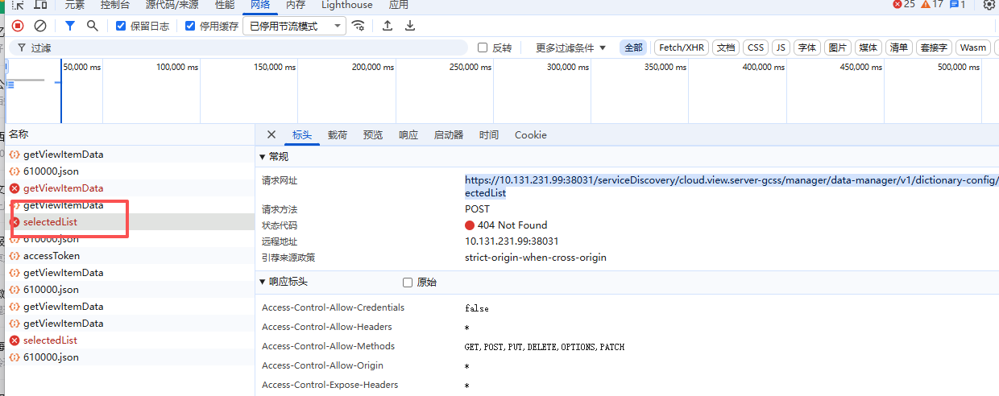
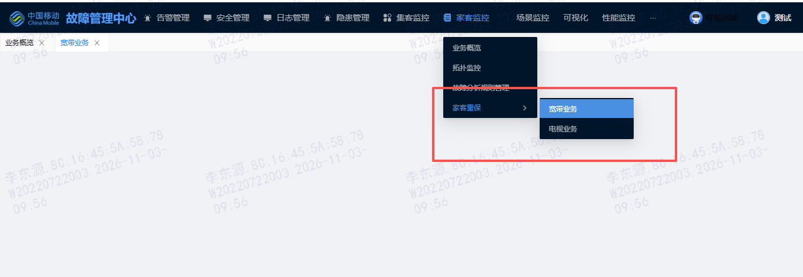
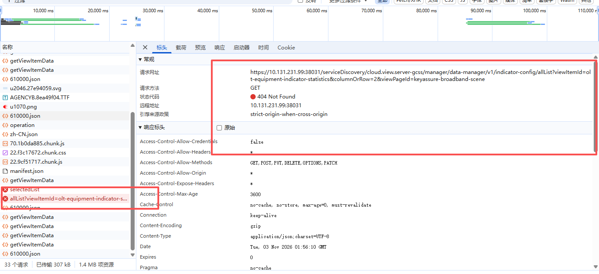

# 故障中心家客监控后端接口地址调整（前端 oss-hwms-monitor 适配）

## 背景与总体要求

由于故障中心家客监控后端服务有几个接口位置发生变化，前端服务 oss-hwms-monitor 调用接口也需要调整。

当前在 k8s 部署的版本为 oss-hwms-monitor:1.0.0-20240320084444.A2，发包版本不清楚。

目前拼接接口的地址均是从 `"serviceDiscovery": "/serviceDiscovery/cloud.view.server-gcss"` 取值的，从测试结果来看并未走下方截图中具体配置。



要求：`"serviceDiscovery"` 只需要配置服务发现的地址即可，具体请求走上方截图中的这些具体服务的路径。

调整后前 3 个要从 cloud.view.manager 取值，第 4 个要从 cloud-diagnose 服务取值，其他保持不变。

---

## 1. 业务概览（右上角区域）

菜单：`https://10.131.231.99:38031/main/hwms/situation`

调用接口：`https://10.131.231.99:38031/serviceDiscovery/cloud.view.server-gcss/manager/data-manager/v1/dictionary-config/selectedList`

参数：

```json
{
  "userId": "3606",
  "data": {
    "firstModule": "业务规模-右上",
    "secondModule": ""
  }
}
```





---

## 2. 集客重保 ——》 宽带业务

菜单：`https://10.131.231.99:38031/main/hwms/broadband-service`

### 2.1 指标配置全量列表

接口：`https://10.131.231.99:38031/serviceDiscovery/cloud.view.server-gcss/manager/data-manager/v1/indicator-config/allList?viewItemId=olt-equipment-indicator-statistics&columnOrRow=2&viewPageId=keyassure-broadband-scene`

### 2.2 指标配置选中列表

接口：`https://10.131.231.99:38031/serviceDiscovery/cloud.view.server-gcss/manager/data-manager/v1/indicator-config/selectedList`

参数：

```json
{
  "viewItemId": "olt-equipment-indicator-statistics",
  "columnOrRow": 2,
  "indicatorGroup": "",
  "viewPageId": "keyassure-broadband-scene"
}
```

---

## 3. 集客重保 ——》 电视业务

菜单：`https://10.131.231.99:38031/main/hwms/television-service`

接口和 2 中的一样，只是参数不一样。

### 3.1 指标配置全量列表

接口：`https://10.131.231.99:38031/serviceDiscovery/cloud.view.server-gcss/manager/data-manager/v1/indicator-config/allList?viewItemId=region-indicator-statistics&columnOrRow=2&viewPageId=keyassure-tv-scene`

### 3.2 指标配置选中列表

接口：`https://10.131.231.99:38031/serviceDiscovery/cloud.view.server-gcss/manager/data-manager/v1/indicator-config/selectedList`

参数：

```json
{
  "viewItemId": "region-indicator-statistics",
  "columnOrRow": 2,
  "indicatorGroup": "",
  "viewPageId": "keyassure-tv-scene"
}
```





---

## 4. 故障分析管理规则

接口：`https://10.131.231.99:38031/serviceDiscovery/cloud.view.server-gcss/cloud-diagnose/circuitinterrupttitle/list?page=1&limit=20`
