# 网络操作预约模块优化提升需求 V4.1 · 前端精简版

> 来源：[network-appointment-optimization-requirement-v4.1.md](./network-appointment-optimization-requirement-v4.1.md)（原需求规格说明书 V4.1，2026-07-02）
> 本文档仅保留前端（页面开发）相关内容，剔除接口同步、能力开放、数据处理等纯后端章节。接口字段仅在页面需要消费/展示时保留。

## 1. 背景与目标（前端视角）

> 原始章节：2.1 背景说明 / 2.2 需求目标 / 2.3 用户描述 / 2.4 软硬件环境需求

针对网络操作预约流程分散在集团、省内多套系统的问题，在故障能力中心建设**统一的工程预约界面**：

- 无线、动环工程预约新建工单界面改造，适配 NCDP 网络割接方案管理流程，实现"一起割接一次预约"。
- 统一承载割接预约生产流程，专业工作台推送的割接单在本系统统一展示。
- 集成各专业工作台跳转入口，支持免密单点登录直通。

用户角色：省公司监控人员、地市各专业预约人员。客户端：Google Chrome（B/S）。

## 2. 前端功能总览（对应用例）

> 原始章节：3.1 概述 / 4.1 用例概述

| 功能点 | 对应用例 | 前端工作 |
| --- | --- | --- |
| 网络割接新建工单 | UC-001 | 页面开发 |
| 网络割接取消工单 | UC-002 | 页面开发 |
| 网络割接修改工单 | UC-003 | 页面开发 |
| 网络割接详情呈现 | UC-004 | 页面开发 |
| 工单检测（规范性稽核/冲突检测/业务影响分析） | UC-005 | 页面开发（检测逻辑后端） |
| 网络操作预约统一入口（跳转专业工作台） | UC-008 部分 | 页面开发 |

> UC-006/007/009（接口类、能力开放）不含前端页面工作，不在本文档范围。

## 3. 新增网络操作预约统一入口

> 原始章节：3.2 新增网络操作预约统一入口场景（3.2.2.1 新增网络操作预约统一入口）

页面配置外部系统跳转按钮，点击后新开页签免密跳转至专业工作台（传输/IP/核心网工作台）。

前端交互流程：

1. 配置各专业工作台提供的跳转链接，拼接系统 ID（appKey）和 token 信息。
2. 打开浏览器新页签访问拼接后的链接，样例：
   `http://172.24.123.244:19011/unicom/homeunicom?appKey=IDC&thirdToken=XXXXXXXXXXXXXX`
3. NCDP 系统登录页面也集成到故障管理中心。

参考界面：

前端需消费的接口：根据 token 获取用户信息（响应 `code` 200/500，`data.userName` 为集中权限用户账号）。

## 4. 无线接入网、动环新建工单改造（分步向导）

> 原始章节：3.3.2.1 无线接入网、动环新建工单改造

### 4.1 第一步：基础信息

> 原始章节：3.3.2.1.1 基础信息

支持三种创建方式：模板下载、模板导入、手动填报。**新增/变更字段：**

| 字段 | 前端规则 | 备注 |
| --- | --- | --- |
| NCDP工单号 / 工单编号 | 不呈现 | NCDP 回传 / 系统自动生成 |
| 工单主题 | 自动填充：选专业→"福建+专业"；选计划开始时间→追加"计划于MM月DD日"；勾选测试工单→前缀【测试】；支持人工编辑 | 利旧工程名称 |
| 状态 | 填报页不呈现 | 由状态接口回填（创建工单/方案制定/方案会审/割接审批/工程预约等） |
| 计划开始/结束时间 | YYYY-MM-DD | 利旧 |
| 专业 | 下拉：无线接入网、动环 | 利旧 |
| 申请人/所在部门/联系电话 | 默认填充当前登录账号信息（需账号关系映射） | 利旧 |
| 方案制定人 | 默认当前账号，可选择其他用户，仅一人 | 新增 |
| 工单备注 | 非必填 | 利旧 |
| 是否参与冲突检测 | 是/否 | 新增 |
| 是否测试工单 | 单选框 | 新增 |
| 割接主题 | 默认"福建+专业名称+计划" | 新增 |
| 省份/地市 | 福建固定；九地市下拉 | 利旧 |
| 割接专业 | 继承基础信息专业字段 | 利旧 |
| 割接子专业 | 无线/动环非必填，仅展示 | 新增（核心网特有：CS域、分组域、IMS域、智能网及彩铃、信令网、国际国漫系统） |
| 割接类型 | 下拉字典：工程割接、网络变更、故障管理系统梳理表版本升级、主用光缆一般割接、备用光缆一般割接、备用光缆紧急割接、波道一般割接、波道紧急割接、深度巡检 | 新增 |
| 操作类型 | 下拉字典：设备入网、业务上线、硬件扩容、软件扩容、版本升级、补丁装载、倒换及应急演练、设备下线、业务下线、板卡调整、模板调整、接口调整、系统优化、安全加固、容量及资源调整、业务调整、计费优化调整、架构调整、功能部署、配合周边、其他、漏洞扫描、设备替换、机房/设备搬迁、硬件更换、链路扩容、路由调整、参数调整、局数据制作/修改、故障处理、设备加电、设备下电、安全漏扫、深度巡检 | 新增 |
| 割接级别 | A/B/C/D 类 | 利旧 |
| 割接开始/结束时间 | YYYY-MM-DD HH:MM:SS | 利旧 |
| 割接描述 | 必填 | 新增 |
| 割接层级/版本号/环网割接类型/是否CUCD | 无线/动环非必填，保留字段 | 新增 |
| 是否影响业务 | 是/否 | 利旧 |
| 割接影响说明、影响业务时长（小时） | 影响=是时必填 | 新增 |
| 影响业务类型 | 影响=是时才呈现。下拉：集团短彩信、MPLS-VPN专线、数据专业、5G行业专网、物联网业务 | 新增 |
| 业务影响范围 | 影响=是时才呈现 | 利旧 |
| 影响专业公司 | 影响=是时才呈现。下拉：咪咕公司、移动IT公司、中移互联网、中移金科、上研院、杭研、在线服务公司、国际公司、中移物联网、成研院、政企事业部 | 新增 |
| 影响专业 | 影响=是时才呈现。下拉：传统核心网、核心网_5G专网、IP承载网、CMNET、传输网、动环、无线接入网、集客、家宽 | 新增 |
| 割接地市、割接区县、告警专业 | — | 新增 |

参考界面：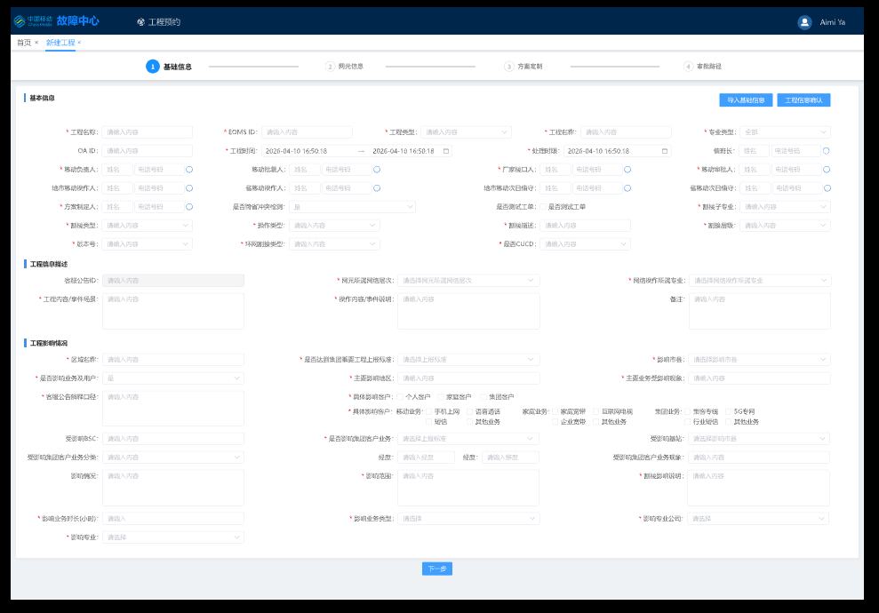

### 4.2 第二步：网元信息

> 原始章节：3.3.2.1.2 网元信息

点击下一步弹出网元信息填报界面。支持手动添加、选择添加、模板导入（支持模板下载），支持已选网元清除。

字段：网元名称、所属省份、割接地市、网元类型、设备厂家、工程网元类型、工程类型、工程预约时间、是否周期性预约、周期预约开始时间、周期预约结束时间、是否割接网元、是否为物联网专网网元（核心网特有）。

参考界面：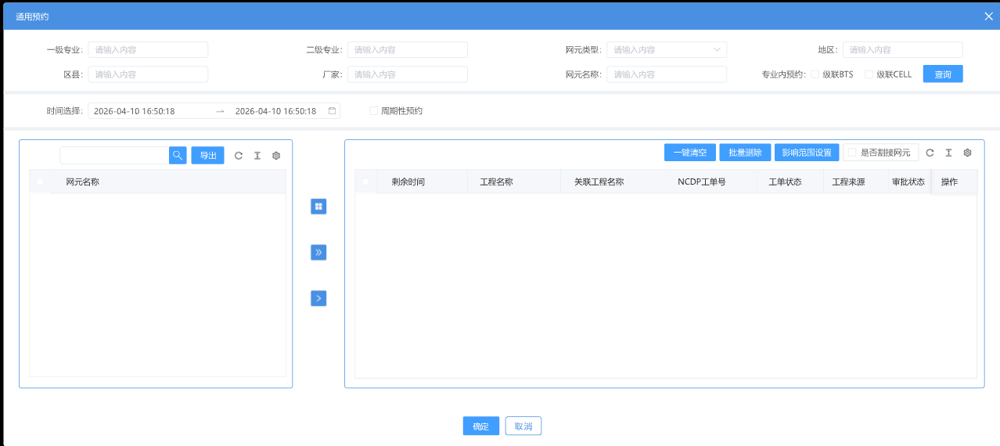

### 4.3 第三步：方案制定

> 原始章节：3.3.2.1.3 方案制定

对已新建工单绑定关联方案：

- **方案模板**：支持模板导入、从方案模板库/方案历史库选择；选择后界面加载结果；可手动编辑割接内容、关键点信息；支持导入后修改人员信息；支持一键转为方案模板。模板库/历史库支持查询清单、引入模板、下载到本地。
- **文件**：点击上传按钮，可上传多个割接工单相关附件。
- **拓扑图**：上传拓扑图附件，支持拓扑模板库选择。
- **割接管理三张表**：界面可下载模板，点击上传三张表附件。

参考界面：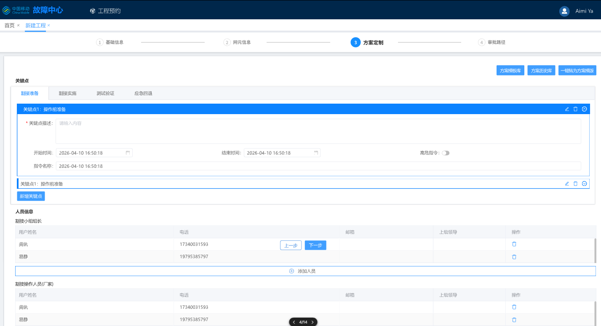 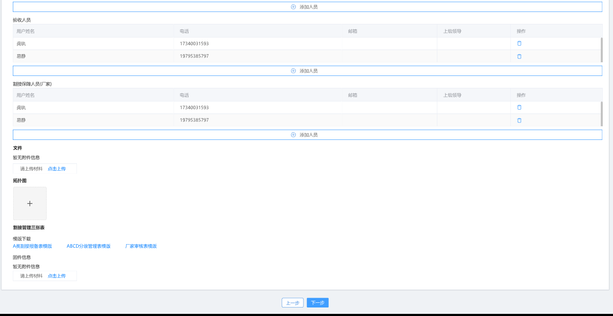 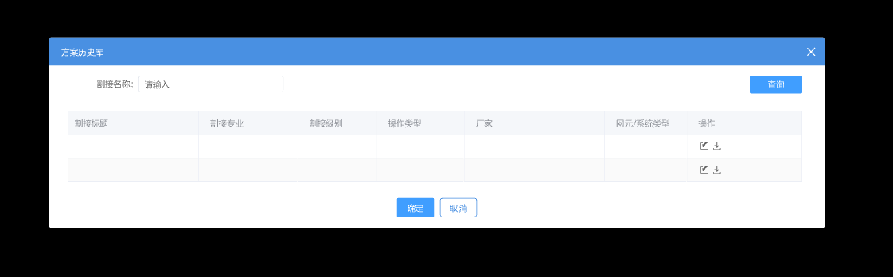 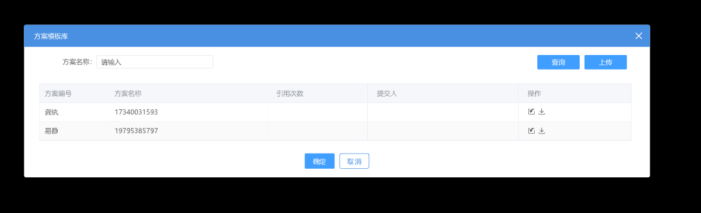

### 4.4 第四步：审批路径

> 原始章节：3.3.2.1.4 审批路径

- 默认显示：会审人员、一级审批人员、二级审批人员；系统默认推荐适配当前专业的会审及审批人员（自动推荐）。
- 添加人员按钮：弹窗选择人员名单，支持多选。
- 添加路径按钮：可扩展三级～六级审批人员。
- 默认到二级审批，最多六级；非 A/B 类割接最少一级审批人。

参考界面：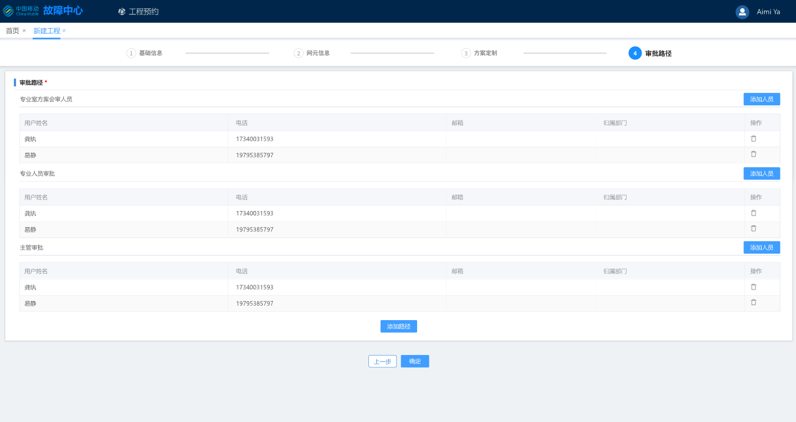 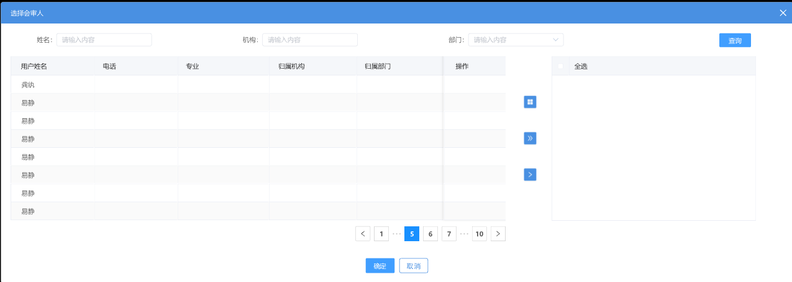

### 4.5 第五步：工单检测结果

> 原始章节：3.3.2.1.5 工单检测结果

呈现工单检测结果（检测规则见第 7 节）：

- 检测**通过** → 用户可点击"确定"提交工单。
- 检测**不通过** → 可选"取消"或"保存草稿"。

参考界面：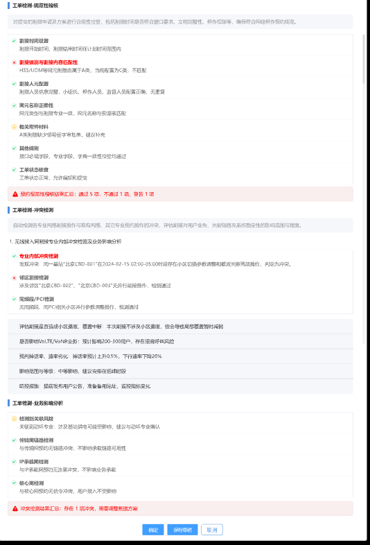

## 5. 首页工单列表界面

> 原始章节：3.3.2.2.1 首页工单列表界面

- 列表包含：系统自建无线及动环工单 + 专业工作台推送工单。
- **查询条件新增**：NCDP 工单号。
- **列表列新增**：专业类型、NCDP 工单号；工程来源（区分自建/接口推送）。
- **操作列**：
  - 自建工单（无线/动环）：查看、工单检测查看、导出、编辑、删除。
  - 接口推送工单：仅查看、工单检测查看、导出。
- 编辑界面复用新建工单分步向导（第 4 节）。
- 新增**批量导入**按钮，批量导入工单基础信息。

参考界面：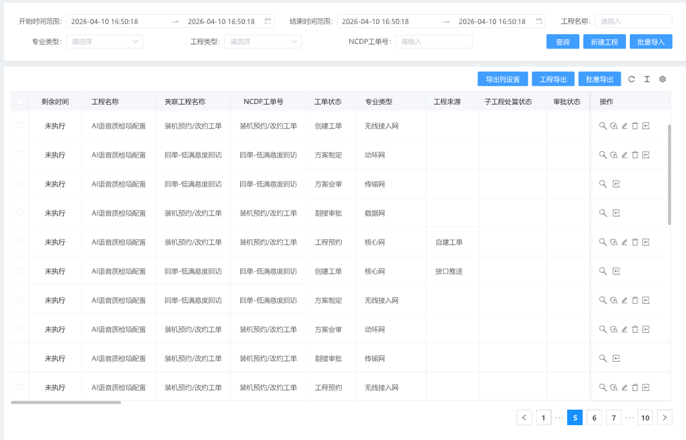

## 6. 网络割接工单详情查看

> 原始章节：3.3.2.2.2 网络割接工单详情查看

点击列表"查看"弹出详情，含以下区块，工单流程环节更新后动态更新状态：

### 6.1 基本信息

> 原始章节：3.3.2.2.2 基本信息

字段同新建工单基础信息（见 4.1），详情页 NCDP工单号、工单编号、状态均展示（回填值）。

参考界面：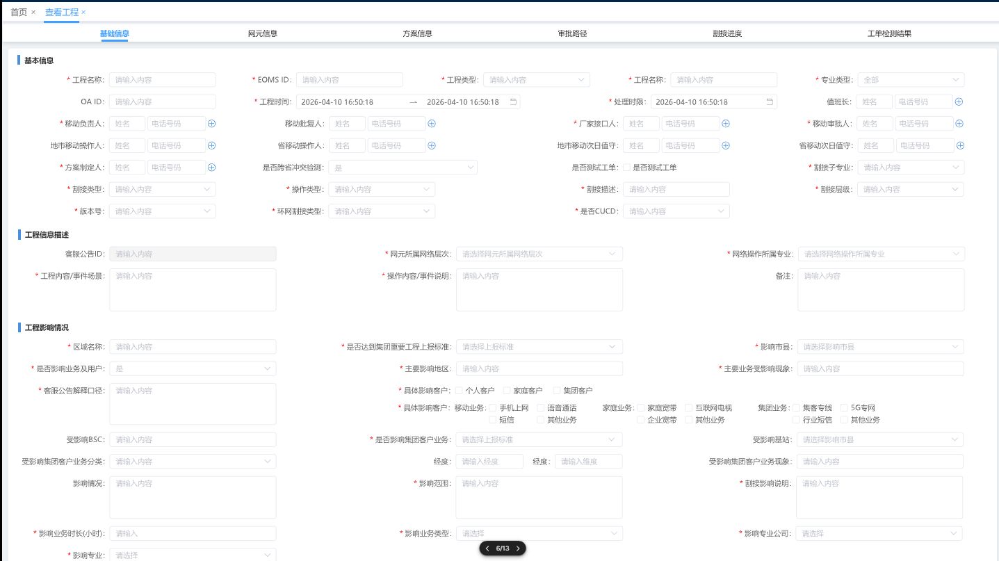

### 6.2 网元信息

> 原始章节：3.3.2.2.2 网元信息

- 呈现割接网元及影响网元信息：是否生效、操作实际、工程预约时间、网元名称、所属省份、割接地市、网元类型、设备厂家、工程网元类型、工程类型、是否周期性预约、周期预约开始/结束时间、是否割接网元、是否为物联网专网网元等。
- **专业工作台特有字段**（展示其他专业详情）：
  - 政企影响（IP承载网特有）：设备名称、设备名称2、IP、端口、VPN名称、业务名称。
  - 影响系统（传输网特有）：光缆名称、DWDM中断段、影响的电路、客户名称、影响环网、周期名称、网管标识1、网管标识2、受影响的系统。
  - 割接影响（影响业务=是时呈现）：两个单选——是否影响行业网关、是否影响SMSC（IP承载网）。
  - 割接影响网元：根据"割接影响"及"割接影响AG058项目/HC客户"选择联动显示【SMSC】【行业网关】【影响HC客户】【AG058项目】。

参考界面：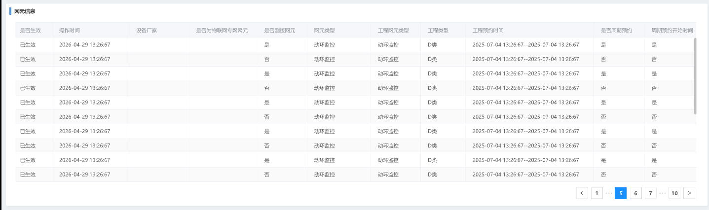 

### 6.3 方案信息

> 原始章节：3.3.2.2.2 方案信息

- 方案信息：加载方案模板导入的内容。
- 附件信息：附件、拓扑图（展示上传的图片）、人员信息（解析方案模板中的人员信息）、割接管理三张表。

参考界面：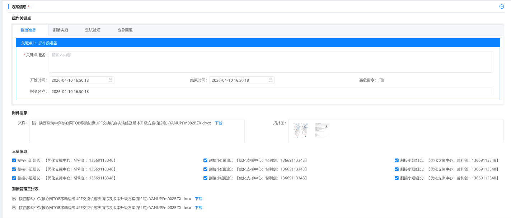

### 6.4 审批路径

> 原始章节：3.3.2.2.2 审批路径

呈现审批人基本信息：用户姓名、电话、邮箱、归属部门。

参考界面：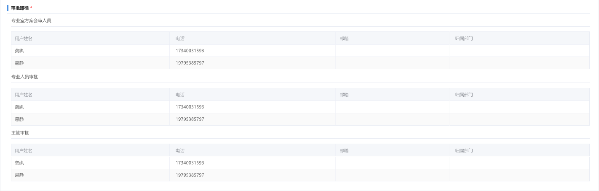

### 6.5 割接进度（进度打点）

> 原始章节：3.3.2.2.2 割接进度

- 分 **NCDP 系统流程**和**省内流程**两段；NCDP 流程默认折叠。
- NCDP 流程节点：创建工单、方案制定、方案会审、割接审批、工程预约、割接准备（默认灰）、割接实施（默认灰）、割接验证（默认灰）、结果反馈（默认灰）、运行观察（默认灰）、割接完成（默认灰）。实际执行时间根据 NCDP 同步的工单状态和时间打点。
- 省内流程（无线接入网、动环、核心网才有）：创建工单、添加方案、工单检测、工程审批、客服公告、工程预约。按省内流程实际状态打点。

参考界面：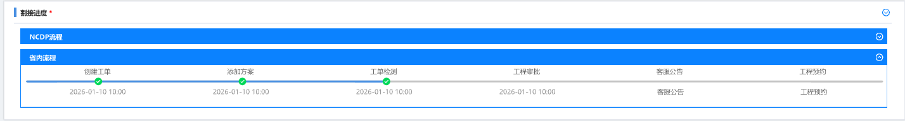

### 6.6 工单检测结果

> 原始章节：3.3.2.2.2 工单检测结果

呈现最新的工单检测规则及结果。参考界面：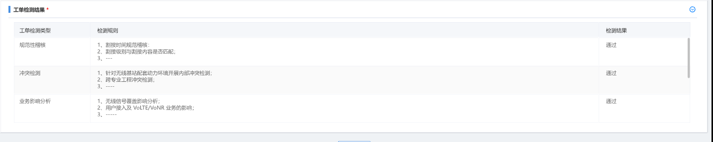

## 7. 工单检测结果查看（独立入口）

> 原始章节：3.3.2.2.3 网络割接工单检测结果查看 / 3.5.2.1 预约规范性稽核 / 3.5.2.2 冲突检测及业务影响分析

点击列表"工单检测查看"弹出：

- 查询条件：检测开始时间、检测结束时间。
- 查询后列表呈现结果数据，支持数据导出。

参考界面：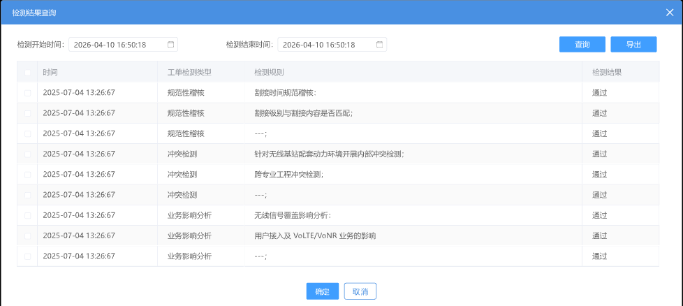

**检测类型**（按钮触发，前端展示结果，检测逻辑在后端）：

1. 预约规范性稽核：输出规范性稽核结果、详情字段。
2. 冲突检测及业务影响分析：输出跨专业冲突检测结果/详情、业务影响分析结果/详情字段。

## 8. 详细功能点清单（源自第 5 章功能需求，前端相关）

> 原始章节：5.1 网络操作 / 5.1.1 工程预约 / 5.1.1.1 网络割接单管理

### 新建工单（5.1.1.1.1）

工单模板下载 / 模板导入 / 批量导入；新增基本信息 / 业务影响信息；工程信息确认；割接网元及影响网元：查询、导出、添加、影响范围设置、是否影响网元标记、周期性预约时间范围、级联关系、模板下载/导入/批量导入、一键清空；会审人员自动推荐适配 / 添加 / 查询；审批路径添加、审批人员查询 / 自动推荐适配、添加一级～六级审批人员；方案模板导入 / 导出 / 查询 / 引用、历史方案模板查询 / 导出 / 引用、一键转为方案模板；附件上传、拓扑图上传、割接管理三张表模板下载 / 上传；工单检测结果确认。

### 取消工单（5.1.1.1.2）

取消网络割接工单（列表"取消"按钮）。

### 修改工单（5.1.1.1.3）

修改：基本信息、业务影响信息、网元及影响网元信息、会审人员、审批人员、审批路径、方案关键点信息、方案人员信息、方案附件信息、拓扑图信息、三张表信息。

### 详情呈现（5.1.1.1.4）

工单信息查询 / 导出 / 批量导出、网元信息导出；详情查看：基本信息、业务影响、网元及影响网元、政企影响、割接影响、方案信息、审批路径；割接进度集中调度环节打点、省内环节打点；工单检测结果查看。

### 工单检测（5.1.1.1.5）

各专业（IP承载网/核心网/传输网）规范性稽核及结果查看；无线接入网/动环网专业内冲突检测及结果查看；跨专业冲突检测（传输→无线/IP承载网、动环→无线）及结果查看；各专业业务影响分析及结果查看。

## 9. 不做清单（非前端范围）

> 原始章节：3.4 网络割接信息同步场景 / 3.6 网络割接工单状态同步场景 / 3.7 网络割接跨专业影响网元信息同步场景 / 3.4.2.7 动网割接工程信息查询能力开放 / 5.2 接口

- 专业工作台 → 故障中心：新建/撤销/编辑网络割接工单信息接口（UC-006）。
- 故障中心 → 全网调度/专业工作台：工单信息、检测结果、工单状态、跨专业影响网元推送接口（UC-007/008 接口部分）。
- 动网割接工程信息查询能力开放（UC-009，能力网关）。
- 预约规范性稽核、冲突检测、业务影响分析的**检测逻辑本身**（前端仅触发与展示）。
- 数据库设计、内部/外部逻辑文件。
