**关于集中故障管理系统网络操作预约模块优化提升需求**

**需求规格说明书**

|  |  |  |
| --- | --- | --- |
| 文件状态：  [ ] 草稿  [√] 正式发布  [ ] 正在修改 | 当前版本： | V4.1 |
| 作 者： | 江泽能 |
| 完成日期： | 2026-07-02 |

版 本 历 史

|  |  |  |  |  |
| --- | --- | --- | --- | --- |
| 版本 | 作者 | 参与者 | 日期 | 备注 |
| V4.1 | 江泽能 | 陈文建、黄子群、韩德玉、包烜濚 | 2026-07-02 | 新建 |

# 1.文档介绍

## 1.1. 文档目的

本文档根据关于集中故障管理系统网络操作预约模块优化提升需求进行整理分析，作为用户和软件开发人员之间相互了解的基础，并作为《软件需求规格说明书》以及项目规划、软件开发与测试的依据。

## 1.2. 读者对象

本文档读者对象为预期的系统使用者、专业负责人、IT支撑人员及集成商项目经理、系统分析师、软件设计师、程序员、测试人员等。

## 1.3. 术语与缩写解释

|  |  |  |
| --- | --- | --- |
| **序号** | **术语、缩略语** | **术语、缩略语定义** |
|  |  |  |
|  |  |  |
|  |  |  |

## 1.4. 编写说明

1）第四章用例概述应逐一明确描述每个用例的测试步骤、输入数据和期望的输出结果，保证相关角色（用户、测试人员等能对标测试）、测试概述中的功能类型需逐一明确，不得遗漏；涉及页面开发类的需求需提供原型设计相关文档、接口类需提供能力或者数据表、数据处理类需详细描述数据处理的逻辑

2）第五章原型清单说明，描述本需求涉及的相关原型信息并上传每个原型对应的原型文档

# 2.总体需求概述

## 2.1. 背景说明

针对网络操作预约事前预约方面，操作审批、工程预约流程分散割裂至集团、省内多套系统，冲突检测能力不足，预约规范性稽核能力缺失等问题进行处理，集中承载割接预约生产流程，系统自动同步信息至集团NCDP、专业工作台等多个系统，减轻预约工作量。

## 2.2. 需求目标

完善网络操作预约事前管控：在故障能力中心建设统一的工程预约界面，向各专业工作台提供网络操作预约统一入口；统一新建工程合规性稽核、客服公告、跨专业冲突检测等通用能力，提升割接规范性；拉通专业工作台网络变更点金场景流程及网元预约能力，做到一起割接一次预约；拉通集团割接审批系统与省内网元预约系统，确保动网操作预约规范、准确。

## 2.3. 用户描述

|  |  |  |
| --- | --- | --- |
| **用户** | **角色（系统侧）** | **工作职责** |
| 省级管理人员 | 省公司监控人员 | 网络运行管理、网络监控 |
| 地市运维人员 | 地市各专业预约人员 | 网络运行管理、网络监控 |

## 2.4. 软硬件环境需求

|  |  |  |
| --- | --- | --- |
| **需求名称** | **详细要求** | **优先级** |
| 软件系统架构 | 该系统采用 B/S 结构实现 | 高 |
| 数据库 | Oracle 19c | 高 |
| 客户端 | Google Chrome | 中 |
| IE版本 | 主流浏览器如谷歌等 | 中 |

# 3.应用场景描述

## 3.1. 概述

|  |  |  |
| --- | --- | --- |
| 应用场景名称 | 描述 | 对应用例 |
| 新增网络操作预约统一入口场景 | 用户登录故障管理中心系统后，点击页面外部系统跳转按钮，系统将自动携带合法身份信息并新开页面跳转至专业工作台，通过跨系统身份校验机制实现免密直通访问。 | UC-008 |
| 新增网络割接单管理场景 | 目前的无线、动环工程预约只涉及工程预约环节的相关信息，未包含网络割接新建工单、制定方案、方案审批、所需的关键信息，需对前后端进行功能改造，适配NCDP方案管理流程。各专业工作台推送的网络割接信息需进行详情展示。 | UC-001、UC-002、UC-003、UC-004、UC-005 |
| 网络割接信息同步场景 | 专业工作台通过接口将网络割接信息，包括包含的基础信息、计划割接列表、审批信息、方案信息、工程预约等环节信息推送至故障管理中心。故障管理中心把无线接入网、动环网络割接单及专业工作台通过接口推送的网络割接单再同步到全网调度系统。开放动网割接工程信息查询能力。 | UC-006、UC-007、UC-009 |
| 网络割接网络割接工单检测场景 | 主要对工单进行规范性稽核、跨专业冲突检测、业务影响分析。并把网络割接工单检测结果回传给专业工作台及全网调度系统 | UC-005、UC-007、UC-008 |
| 网络割接工单状态同步场景 | 故障管理中心接收到NCDP反馈的网络割接工单的状态后，包括，新建工单是否成功，方案制定是否成功，方案会审是否通过，割接审批是否通过，工程预约、割接取消是否成功等状态，调用该接口把工单的状态同步到各专业工作台及全网调度。 | UC-007、UC-008 |
| 网络割接跨专业影响网元信息同步场景 | 针对存在跨专业影响的工程单，故障中心负责把工程信息推送到各专业工作台，由专业工作台决策及执行后续针对影响网元的告警标工工作。 | UC-008 |

## 3.2. 新增网络操作预约统一入口场景

### 3.2.1.新增网络操作预约统一入口应用场景描述

用户在故障管理中心系统已完成登录，页面配置外部系统跳转按钮。用户点击按钮后，系统自动携带合法身份信息，新开页面跳转至专业工作台系统，依托跨系统身份校验机制，无需手动输入账号密码，实现两系统间快速免密直通访问。

其中NCDP系统登录页面也集成到故障管理中心，用户登录故障管理中心系统后，可访问NCDP登录页面。

### 3.2.2.新增网络操作预约统一入口应用场景方案设计

#### 3.2.2.1. 新增网络操作预约统一入口

集中故障管理系统提供网络操作预约页面开放接口，并支持单点登录，可与传输工作台、IP工作台、核心网工作台进行对接。

* 各专业工作台提供跳转链接，用于接收故障管理系统ID和token信息
* 故障管理系统添加各专业工作台提供的跳转链接，并拼接上系统ID和token信息。
* 打开浏览器新页签访问拼接后的跳转链接
* 各专业工作台获取地址栏拼接的系统ID和token信息
* 各专业工作台系统根据获取的token调用故障管理系统获取用户信息，确认用户权限的合法性，并登录系统。

浏览器打开地址样例：

<http://172.24.123.244:19011/unicom/homeunicom?appKey=IDC&thirdToken=XXXXXXXXXXXXXX>，appKey嵌入系统方简称，系统双方联调时定义；thirdToken第三方系统token信息，可以根据此信息调用接口获取用户信息

请求消息

|  |  |  |  |
| --- | --- | --- | --- |
| **字段名** | **中文名称** | **字段类型** | **是否必填** |
| token | 第三方系统token | varchar2(255) | 是 |

响应消息

|  |  |  |  |
| --- | --- | --- | --- |
| 字段名 | 字段类型 | 字段说明 | 限定 |
| code | 字符串 | 500为失败，200为成功 | M |
| message | 字符串 |  | M |
| data | 对象 | 获取成功为用户信息，获取失败为null | M |

返回样例：

成功：

{

"code": 200,

"message": "SUCCESS"

"data": {

"userName":"CJ-zhangsan"--集中权限用户账号

}

}

失败：

{

    "code": 500,

    "message": "token无效",

    "data": null

}

## 3.3. 新增网络割接单管理场景

### 3.3.1.新增网络割接单管理应用场景描述

目前的无线、动环工程预约只涉及工程预约环节的操作信息，未包含网络割接新建工单、制定方案、方案审批环节所需的关键信息。为避免地市人员一次割接登录多套系统操作，需对前后端进行功能改造，适配NCDP网络割接工单方案管理流程

### 3.3.2.新增网络割接单管理应用场景方案设计

#### 3.3.2.1. 无线接入网、动环新建工单改造

对无线、动环工程预约新建工单界面进行改造，添加NCDP管理流程中的关键信息，打破网络割接流程管控和实际工程预约操作的壁垒，实现无线、动环专业的一键预约。

##### 3.3.2.1.1. 基础信息

**支持模板下载及模板导入方式创建。支持手动填写信息，打开填报主界面，进行数据填报。**

新增字段描述如下：

NCDP工单号：由NCDP侧新建工单成功后回传，填报界面不呈现。

工单编号：由系统自动生成，填报界面不呈现。

工单主题：主题根据选择字段，可默认填充，比如选择完专业，自动填充“福建+专业“，选择完计划开始时间后，自动继续填充”计划于+MM月DD日”，如果点击是否测试工单单选框，则在工单主题最前面填充【测试】，也可人工继续编辑完整工单主题。(利旧工程名称)

状态：初始为草稿状态，后续根据工单状态接口的同步，会更新为：创建工单、方案制定、方案会审、割接审批、工程预约等不同状态。（回填状态，填报页面不呈现，不需要人工填写）

计划开始时间：YYYY-MM-DD，(利旧工程时间)

计划结束时间：YYYY-MM-DD，(利旧工程时间)

专业：下拉为无线接入网、动环两种枚举(利旧专业类型)

申请人：默认填充当前登录账号（利旧当前工程创建人信息，但是需要账号关系映射）

申请人所在部门：默认填充当前登录账号所在部门（同上）

联系电话：默认填充当前登录账号的电话（同上）

方案制定人：默认填充当前登录账号，支持选择其他用户，只能选择一个人。（新增）

工单备注：非必填（利旧备注字段）

是否参与冲突检测：是/否（新增）

是否测试工单：单选框（新增）

割接主题：默认填充“福建+专业名称+计划”（新增）

省份：福建（利旧）

地市：福建九地市下拉选择（利旧）

割接专业：继承基础信息中的专业字段选择（利旧）

割接子专业：不是无线接入网、动环专业的必填字段，核心网需要该字段(CS域、分组域、IMS域、智能网及彩铃、信令网、国际国漫系统)。仅保留字段用来展示其他专业的详情（新增）

割接类型：下拉字典值（工程割接、网络变更、故障管理系统梳理表版本升级、主用光缆一般割接、备用光缆一般割接、备用光缆紧急割接、波道一般割接、波道紧急割接、深度巡检）（新增）

操作类型：下拉字典值（设备入网、业务上线、硬件扩容、软件扩容、版本升级、补丁装载、倒换及应急演练、设备下线、业务下线、板卡调整、模板调整、接口调整、系统优化、安全加固、容量及资源调整、业务调整、计费优化调整、架构调整、功能部署、配合周边、其他、漏洞扫描、设备替换、机房/设备搬迁、硬件更换、链路扩容、路由调整、参数调整、局数据制作/修改、故障处理、设备加电、设备下电、安全漏扫、深度巡检）（新增）

割接级别：A类、B类、C类、D类（利旧工程类型）

割接开始时间：YYYY-MM-DD HH:MM:SS (利旧工程时间)

割接结束时间：YYYY-MM-DD HH:MM:SS (利旧工程时间)

割接描述：必填（新增）

割接层级：不是无线接入网、动环专业的必填字段，保留字段（新增）

版本号：不是无线接入网、动环专业的必填字段，保留字段（新增）

环网割接类型：不是无线接入网、动环专业的必填字段，保留字段（新增）

是否CUCD：不是无线接入网、动环专业的必填字段，保留字段。（新增）

是否影响业务：是/否(利旧是否影响业务及用户)

割接影响说明：如果是否影响业务，为是，此字段必填。（新增）

影响业务时长（小时）：如果是否影响业务，为是，此字段必填。（新增）

影响业务类型：如果是否影响业务，为是，才呈现该字段。（下拉枚举，集团短彩信、MPLS-VPN专线、数据专业、5G行业专网、物联网业务）（新增）

业务影响范围：如果是否影响业务，为是，才呈现该字段。（利旧影响范围字段）

影响专业公司：如果是否影响业务，为是，才呈现该字段。（下拉枚举，咪咕公司、移动IT公司、中移互联网、中移金科、上研院、杭研、在线服务公司、国际公司、中移物联网、成研院、政企事业部）（新增）

影响专业：如果是否影响业务，为是，才呈现该字段。（下拉枚举，传统核心网、核心网\_5G专网、IP承载网、CMNET、传输网、动环、无线接入网、集客、家宽）（新增）

割接地市（新增）

割接区县（新增）

告警专业（新增）

参考界面如下：

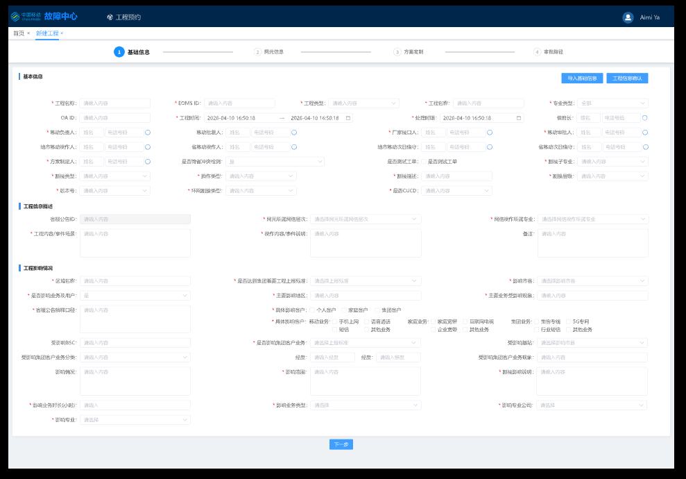

##### 3.3.2.1.2. 网元信息

点击下一步按钮，弹出网元信息填报界面。

可通过手动添加、选择添加或者模板导入方式，对割接网元及割接影响网元信息进行填报，支持模板下载。支持选择后网元清除。

包含字段有：网元名称、所属省份、割接地市、网元类型、设备厂家、工程网元类型、工程类型、工程预约时间、是否周期性预约、周期预约开始时间、周期预约结束时间、是否割接网元、是否为物联网专网网元（核心网特有网元属性）。

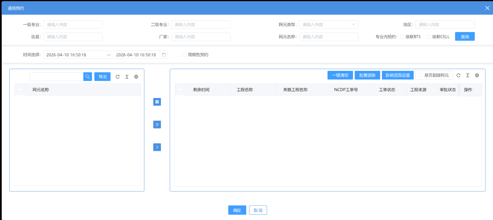

##### 3.3.2.1.3. 方案制定

对已经完成新建的无线、动环网络割接工单，绑定关联方案，添加方案模板、文件、拓扑图、割接管理三张表等信息，完善网络割接工单信息。

* **方案模板导入**

支持方案模板导入及人工选择方案模板库或者方案历史库。导入或者人工选择后，界面加载方案模板选择或者导入结果。可手动编辑割接内容、关键点信息字段。支持方案模板导入后修改人员信息。也可以一键转为方案模板。

* **文件导入**

点击上传按钮，可上传多个割接工单相关附件信息。

* **拓扑图**

点击拓扑图上传按钮，可上传本次割接工单对应的拓扑图附件。支持拓扑模板库选择。

* **割接管理三张表**

界面可下载割接管理三张表模板

点击上传按钮，可上传三张表附件模板

参考界面如下：

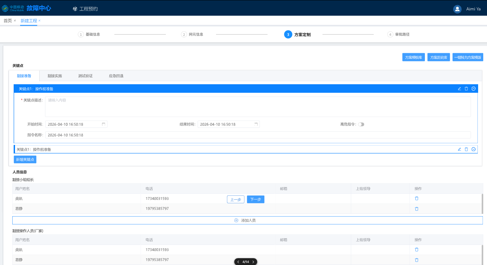

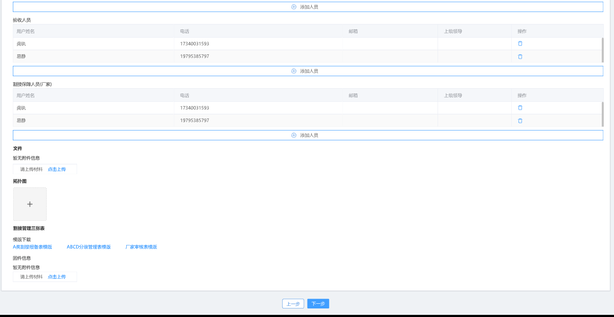

人工选择方案历史库，可查询模板清单，或者引入模板或者下载到本地。

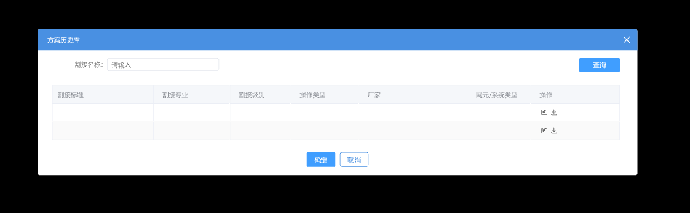

人工选择方案模板库，可查询模板清单，或者引入模板或者下载到本地。

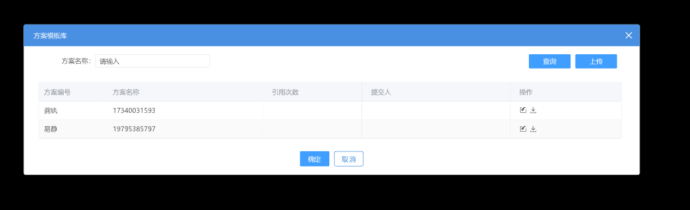

##### 3.3.2.1.4. 审批路径

默认显示会审人员选、一级审批人员、二级审批人员，可通过添加人员按钮，选择人员名单，支持多个人员选择。系统会默认推荐适配当前网络割接专业的会审人员及一级、二级审批人员。

可通过添加路径按钮，添加三级审批人员、四级审批人员、五级审批人员、六级审批人员。

参考界面如下：

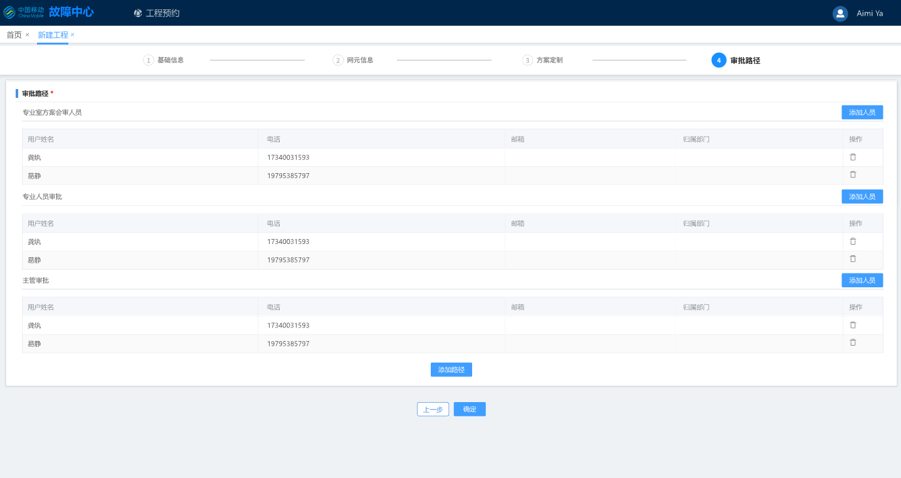

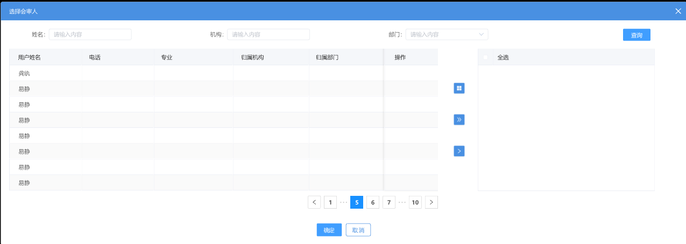

##### 3.3.2.1.5. 工单检测结果

根据工单检测规则（详情参考3.5章节），呈现工单检测结果页面，如果检测结果通过，用户可直接点击确定按钮提交工单。如果检测结果不通过，可选择取消或者保存草稿。参考界面如下：

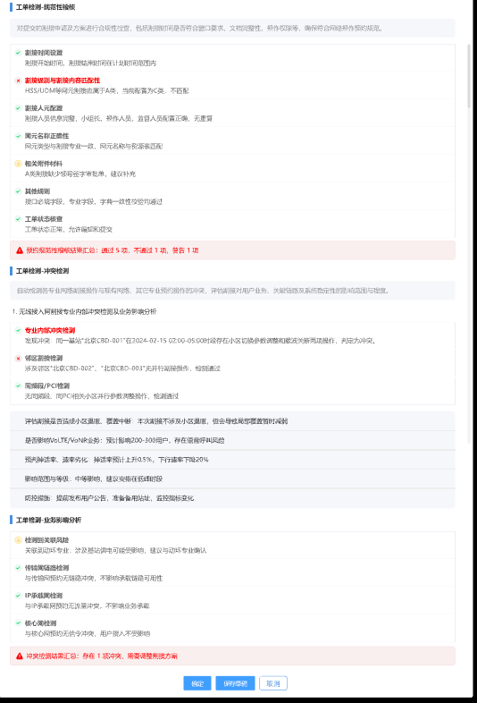

#### 3.3.2.2. 网络割接工单信息呈现

对已经完成新建的无线、动环网络割接工单或者接口推送的专业工作台网络割接工单，可以查看具体工单详情信息，后续流程环节更新后，可动态更新工单状态。

##### 3.3.2.2.1. 首页工单列表界面

点击首页，页面显示网络割接工单列表，包含系统自建无线及动环专业工单，及专业工作台推送工单。

查询条件增加：NCDP工单号。

列表清单中增加：专业类型、NCDP工单号；工程来源区分自建工单或者接口推送。

操作列中，系统自建无线及动环专业包含查看、工单检测查看、导出、编辑、删除功能。接口推送工单，只有查看、工单检测查看、及导出功能。

无线及动环专业的编辑界面参考3.3.2.1章节的新建工单界面设计。

增加批量导入按钮，可批量导入网络割接工单基础信息。

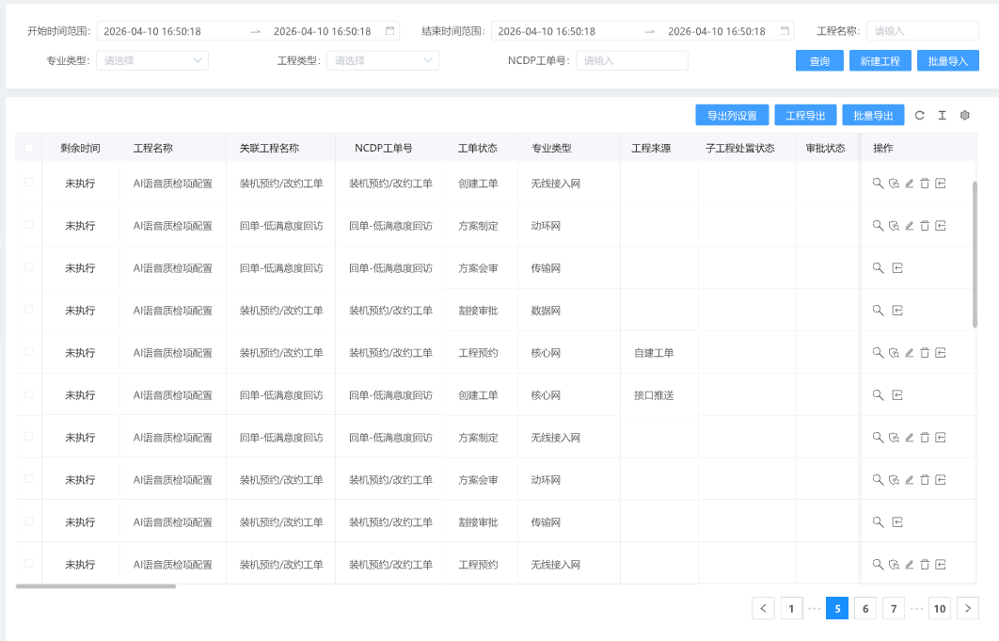

##### 3.3.2.2.2. 网络割接工单详情查看

点击首页列表中操作列的查看按钮，弹出网络割接工单详情查看界面

1. **基本信息**

呈现割接工单的基本信息。新增字段描述如下：

NCDP工单号：由NCDP侧新建工单成功后回传。

工单编号：由系统自动生成。

工单主题：主题根据选择字段，可默认填充，比如选择完专业，自动填充“福建+专业“，选择完计划开始时间后，自动继续填充”计划于+MM月DD日”，如果点击是否测试工单单选框，则在工单主题最前面填充【测试】，也可人工继续编辑完整工单主题。(利旧工程名称)

状态：初始为草稿状态，后续根据工单状态接口的同步，会更新为：创建工单、方案制定、方案会审、割接审批、工程预约等不同状态。（回填状态）

计划开始时间：YYYY-MM-DD，(利旧工程时间)

计划结束时间：YYYY-MM-DD，(利旧工程时间)

专业：下拉为无线接入网、动环两种枚举(利旧专业类型)

申请人：默认填充当前登录账号（利旧当前工程创建人信息，但是需要账号关系映射）

申请人所在部门：默认填充当前登录账号所在部门（同上）

联系电话：默认填充当前登录账号的电话（同上）

方案制定人：默认填充当前登录账号，支持选择其他用户，只能选择一个人。（新增）

工单备注：非必填（利旧备注字段）

是否参与冲突检测：是/否（新增）

是否测试工单：单选框（新增）

割接主题：默认填充“福建+专业名称+计划”（新增）

省份：福建（利旧）

地市：福建九地市下拉选择（利旧）

割接专业：继承基础信息中的专业字段选择（利旧）

割接子专业：不是无线接入网、动环专业的必填字段，核心网需要该字段(CS域、分组域、IMS域、智能网及彩铃、信令网、国际国漫系统)。仅保留字段用来展示其他专业的详情（新增）

割接类型：下拉字典值（工程割接、网络变更、故障管理系统梳理表版本升级、主用光缆一般割接、备用光缆一般割接、备用光缆紧急割接、波道一般割接、波道紧急割接、深度巡检）（新增）

操作类型：下拉字典值（设备入网、业务上线、硬件扩容、软件扩容、版本升级、补丁装载、倒换及应急演练、设备下线、业务下线、板卡调整、模板调整、接口调整、系统优化、安全加固、容量及资源调整、业务调整、计费优化调整、架构调整、功能部署、配合周边、其他、漏洞扫描、设备替换、机房/设备搬迁、硬件更换、链路扩容、路由调整、参数调整、局数据制作/修改、故障处理、设备加电、设备下电、安全漏扫、深度巡检）（新增）

割接级别：A类、B类、C类、D类（利旧工程类型）

割接开始时间：YYYY-MM-DD HH:MM:SS (利旧工程时间)

割接结束时间：YYYY-MM-DD HH:MM:SS (利旧工程时间)

割接描述：必填（新增）

割接层级：不是无线接入网、动环专业的必填字段，保留字段（新增）

版本号：不是无线接入网、动环专业的必填字段，保留字段（新增）

环网割接类型：不是无线接入网、动环专业的必填字段，保留字段（新增）

是否CUCD：不是无线接入网、动环专业的必填字段，保留字段。（新增）

是否影响业务：是/否(利旧是否影响业务及用户)

割接影响说明：如果是否影响业务，为是，此字段必填。（新增）

影响业务时长（小时）：如果是否影响业务，为是，此字段必填。（新增）

影响业务类型：如果是否影响业务，为是，才呈现该字段。（下拉枚举，集团短彩信、MPLS-VPN专线、数据专业、5G行业专网、物联网业务）（新增）

业务影响范围：如果是否影响业务，为是，才呈现该字段。（利旧影响范围字段）

影响专业公司：如果是否影响业务，为是，才呈现该字段。（下拉枚举，咪咕公司、移动IT公司、中移互联网、中移金科、上研院、杭研、在线服务公司、国际公司、中移物联网、成研院、政企事业部）（新增）

影响专业：如果是否影响业务，为是，才呈现该字段。（下拉枚举，传统核心网、核心网\_5G专网、IP承载网、CMNET、传输网、动环、无线接入网、集客、家宽）（新增）

割接地市（新增）

割接区县（新增）

告警专业（新增）

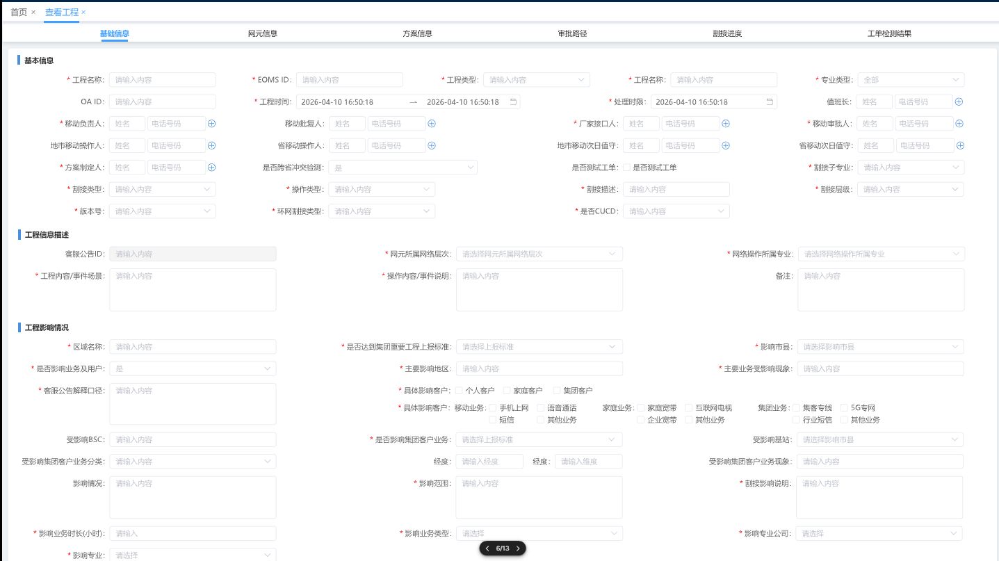

1. **网元信息**

* 呈现网络割接工单填报的割接网元信息及影响网元信息

包含是否生效、操作实际、工程预约时间、网元名称、所属省份、割接地市、网元类型、设备厂家、工程网元类型、工程类型、工程预约时间、是否周期性预约、周期预约开始时间、周期预约结束时间、是否割接网元、是否为物联网专网网元等

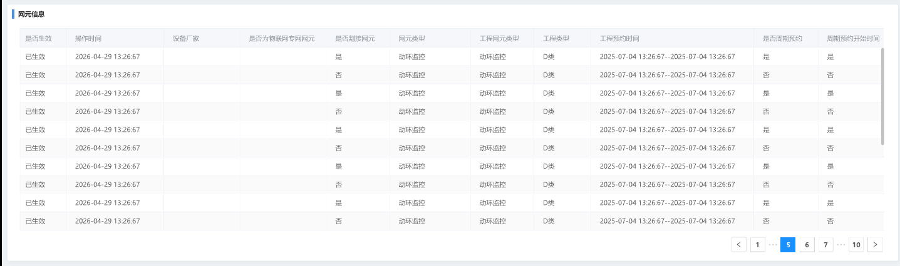

* 专业工作台特有影响网元字段呈现

**政企影响**（IP承载网特有）。

包含字段有：设备名称、设备名称2、IP、端口、VPN名称、业务名称

**影响系统**（传输网特有）。

包含字段有：光缆名称、DWDM中断段、影响的电路、客户名称、影响环网、周期名称、网管标识1、网管标识2、受影响的系统

割接影响：如果是否影响业务，为是，才呈现该字段。该字段是两个单选框：是否影响行业网关、是否影响SMSC（IP承载网）。

割接影响网元：1、如果“割接影响”两个复选框都选择了是，则此处显示为【SMSC】；【行业网关】2、如果“割接影响AG058项目”和“割接影响HC客户”选择了影响，此处显示：【影响HC客户】；【AG058项目】；（不是无线接入网、动环专业的必填字段，仅保留字段用来展示其他专业的详情）。

割接影响AG058项目：单选框，影响AG058项目、不影响AG058项目（传输网特有）。

割接影响HC客户：单选框，影响HC客户、不影响HC客户（传输网特有）。

1. **方案信息**

呈现割接工单方案相关信息。包括字段如下：

**方案信息：**加载方案模板导入的内容。

**附件信息**：包括附件信息、拓扑图、人员信息、割接管理三张表

附件包括上传的方案或者其他附件

拓扑图即展示用户上传的图片附件

人员信息，解析方案模板中的人员信息进行呈现

割接管理三张表，即呈现用户上传的三张表附件。

参考界面如下：

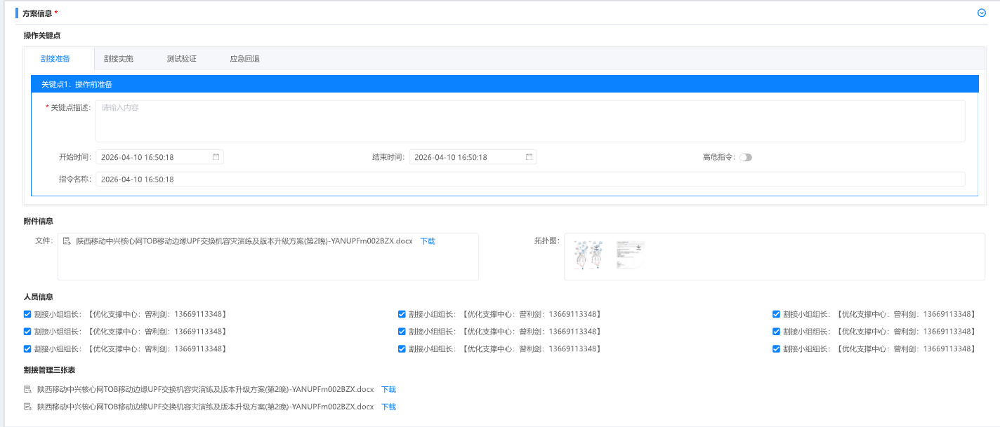

1. **审批路径**

呈现割接工单填报的审批人基本信息，包含用户姓名、电话、邮箱、归属部门信息。

1. **割接进度**

呈现割接工单工程预约相关信息及各环节状态打点信息。

割接进度，使用进度打点方式，呈现割接工单的环节状态。分NCDP系统流程和省内流程。默认NCDP流程折叠显示。

NCDP流程：

创建工单、方案制定、方案会审、割接审批、工程预约、割接准备（默认灰色）、割接实施（默认灰色）、割接验证（默认灰色）、结果反馈（默认灰色）、运行观察（默认灰色）、割接完成（默认灰色）

实际执行时间，根据NCDP同步的工单状态和时间进行打点。

省内流程（无线接入网、动环、核心网才有）：

创建工单、添加方案、工单检测、工程审批、客服公告、工程预约

实际执行时间，根据省内工单流程的实际状态进行进度打点。

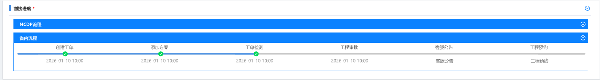

1. **工单检测结果**

根据工单检测规则（详情参考3.5章节），呈现最新的工单检测规则及结果

##### 3.3.2.2.3. 网络割接工单检测结果查看

点击首页列表中操作列的工单检测查看按钮，弹出网络割接工单检测结果查看界面

查询条件：检测开始时间、检测结束时间

输入查询条件，点击查询按钮列表呈现符合条件的结果数据，支持数据导出

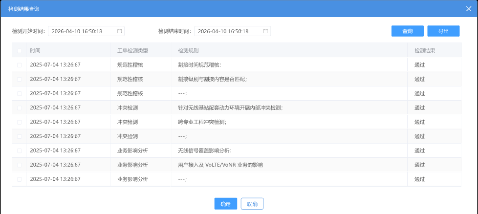

## 3.4. 网络割接信息同步场景

### 3.4.1.网络割接信息同步应用场景描述

专业工作台(核心网工作台、IP工作台、传输工作台)调用新建网络割接工单信息接口、撤销网络割接工单信息接口、编辑网络割接工单信息接口，把网络割接操作包含的基础信息、计划割接列表、审批信息、方案信息、工程预约等环节信息，推送到故障管理中心，故障管理中心进行网络割接工单的统一管理。

故障管理中心把无线接入网、动环网络割接单及专业工作台通过接口推送的网络割接单再同步到全网调度系统。

其中编辑接口仅限定为工作台提交的新建网络割接工单在规范性稽核、跨专业冲突检测不通过。或者新建工单、方案制定、方案会审、割接审批环节不通过场景下，调用该接口进行网络割接工单信息的修订。故障中心在接收编辑接口请求时会进行工单环节状态校验，不在以上场景下的校验不通过，也不会推送到全网调度系统。

### 3.4.2.网络割接信息同步应用场景方案设计

#### 3.4.2.1. 新建网络割接工单信息接口

工作台调用此服务，向故障中心推送工单基础信息、计划割接列表、方案、审批信息等

|  |  |  |  |  |  |
| --- | --- | --- | --- | --- | --- |
| **字段名** | **中文名称** | **字段类型** | **是否必填** | **备注** | |
| work\_order\_id | 工单编号 | varchar2(255) | 是 |  |  |
| work\_order\_subject | 工单主题 | varchar2(255) | 是 |  |  |
| status | 状态 | varchar2(64) | 否 |  |  |
| planned\_start\_time | 计划开始时间 | date | 是 |  |  |
| planned\_end\_time | 计划结束时间 | date | 是 |  |  |
| specialty | 专业 | varchar2(64) | 是 | 传统核心网 核心网\_5G专网 IP承载网 CMNET 传输网 云平台 动环 无线接入网 安全 内容网 数据业务平台 网管网 IDC 物联网 集客 家宽 虚拟化核心网（含U面） 新业务 其他 网络云 移动边缘云 网络边缘云 |  |
| applicant | 申请人 | varchar2(64) | 否 |  |  |
| applicant\_department | 申请人所在部门 | varchar2(64) | 否 |  |  |
| contact\_phone | 联系电话 | varchar2(64) | 否 |  |  |
| solution\_owner | 方案制定人 | varchar2(64) | 是 |  |  |
| work\_order\_remark | 工单备注 | varchar2(255) | 否 |  |  |
| is\_conflict\_detection\_enabled | 是否参与冲突检测 | varchar2(64) | 是 |  |  |
| is\_test\_work\_order | 是否测试工单 | varchar2(64) |  | 如果勾选，标题会自动带着【测试】关键字 |  |
| cloud\_network\_coordination | 云网协同 | varchar2(64) | 否 | 不协同 通告云能 云能联合评审 | IP承载网独有 |
| cutover\_subject | 割接主题 | varchar2(255) | 是 | NCDP自动生成 |  |
| province | 省份 | varchar2(64) | 是 |  |  |
| city | 地市 | varchar2(64) | 是 |  |  |
| cutover\_specialty | 割接专业 | varchar2(64) | 是 | 继承基础信息中专业字段 |  |
| cutover\_sub\_specialty | 割接子专业 | varchar2(64) | 是 | 传统核心网： CS域 分组域 IMS域 智能网及彩铃 信令网 国际国漫系统 | 传统核心网独有 |
| cutover\_type | 割接类型 | varchar2(64) | 是 | 工程割接 网络变更 故障管理系统梳理表版本升级 主用光缆一般割接 备用光缆一般割接 备用光缆紧急割接 波道一般割接 波道紧急割接 深度巡检 |  |
| operation\_type | 操作类型 | varchar2(64) | 是 | 设备入网 业务上线 硬件扩容 软件扩容 版本升级 补丁装载 倒换及应急演练 设备下线 业务下线 板卡调整 模板调整 接口调整 系统优化 安全加固 容量及资源调整 业务调整 计费优化调整 架构调整 功能部署 配合周边 其他 漏洞扫描 设备替换 机房/设备搬迁 硬件更换 链路扩容 路由调整 参数调整 局数据制作/修改 故障处理 设备加电 设备下电 安全漏扫 深度巡检 | 各专业字典不太一样，待补充 |
| cutover\_level | 割接级别 | varchar2(64) | 是 | A类 B类 C类 D类 |  |
| cutover\_start\_time | 割接开始时间 | date | 是 | 2026-03-30 00:00:00 |  |
| cutover\_end\_time | 割接结束时间 | date | 是 | 2026-03-30 05:00:00 |  |
| cutover\_description | 割接描述 | varchar2(255) | 是 |  |  |
| cutover\_hierarchy | 割接层级 | varchar2(64) | 是 | 一干 二干 本地网 其他 | 传输网独有 |
| version\_number | 版本号 | varchar2(64) | 是 |  | 传输网独有、传统核心网独有 |
| ring\_cutover\_type | 环网割接类型 | varchar2(64) | 是 | 破环加点 破环减点 环网迁移 | 传输网独有、传统核心网独有 |
| is\_cucd | 是否CUCD | varchar2(64) | 是 |  | 传统核心网独有 |
| network\_element\_info | 计划割接网元信息 | list | 是 |  |  |
| government\_enterprise\_impact | 政企影响 | list | 否 |  | IP承载网独有 |
| affected\_system | 影响系统 | list | 否 |  | 传输网独有 |
| affected\_network\_element\_info | 割接影响网元信息 | list | 是 |  |  |
| is\_service\_affected | 是否影响业务 | varchar2(64) | 是 | 是/否 |  |
| cutover\_impact\_description | 割接影响说明 | varchar2(255) | 是 | 如果是否影响业务为是，此字段必填 |  |
| service\_impact\_duration\_hours | 影响业务时长（小时） | varchar2(64) | 是 |  |  |
| service\_impact\_type | 影响业务类型 | varchar2(64) | 否 | 集团短彩信 MPLS-VPN专线 数据专业 5G行业专网 物联网业务 |  |
| service\_impact\_scope | 业务影响范围 | varchar2(255) | 否 |  |  |
| affected\_specialty\_company | 影响专业公司 | varchar2(64) | 否 | 咪咕公司 移动IT公司 中移互联网 中移金科 上研院 杭研 在线服务公司 国际公司 中移物联网 成研院 政企事业部 |  |
| affected\_specialty | 影响专业 | varchar2(64) | 否 | 传统核心网 核心网\_5G专网 IP承载网 CMNET 传输网 云平台 动环 无线接入网 安全 内容网 数据业务平台 网管网 IDC 物联网 集客 家宽 虚拟化核心网（含U面） 新业务 其他 网络云 移动边缘云 网络边缘云 |  |
| cutover\_impact | 割接影响 | varchar2(64) | 否 | 是否影响行业网关 是否影响SMSC | IP承载网、CMNET、传输网独有 |
| cutover\_affected\_network\_element | 割接影响网元 | varchar2(64) | 否 | 1、如果“割接影响”两个复选框都选择了是，则此处显示为【SMSC】；【行业网关】 2、如果“割接影响AG058项目”和“割接影响HC客户”选择了影响，此处显示：【影响HC客户】；【AG058项目】； |  |
| cutover\_affected\_ag058\_project | 割接影响AG058项目 | varchar2(64) | 否 | 影响AG058项目 不影响AG058项目 | 传输网独有 |
| cutover\_affected\_hc\_customer | 割接影响HC客户 | varchar2(64) | 否 | 影响HC客户 不影响HC客户 |  |
| joint\_reviewer\_selection | 会审人员 | list | 是 | 用户姓名 电话 专业 归属机构 归属部门 |  |
| level\_1\_approver | 一级审批人员 | list | 是 | 默认到二级审批，最多可添加到六级审批 非 A，B 类割接最少一级审批人 |  |
| level\_2\_approver | 二级审批人员 | list | 是 |  |  |
| level\_3\_approver | 三级审批人员 | list | 是 |  |  |
| level\_4\_approver | 四级审批人员 | list | 是 |  |  |
| level\_5\_approver | 五级审批人员 | list | 是 |  |  |
| level\_6\_approver | 六级审批人员 | list | 是 |  |  |
| local\_discipline\_conflict\_result | 本专业冲突检测结果 | varchar2(255) | 是 | 是否通过：XXXX。 检测结果：XXXX。 |  |
| local\_discipline\_impact\_analysis | 本专业影响分析 | varchar2(255) | 是 |  |  |
| cutover\_content | 割接内容 | varchar2(255) | 是 |  |  |
| solution\_template | 方案模板 | list | 是 |  |  |
| attachment | 文件 | list | 否 |  |  |
| topology\_map | 拓扑图 | list | 否 |  |  |
| cutover\_management\_tables | 割接管理三张表 | list | 否 |  |  |
| scheduled\_start\_time | 预约开始时间 | date | 是 |  |  |
| scheduled\_end\_time | 预约结束时间 | date | 是 |  |  |
| alarmProfession | 告警专业 | date | 是 |  |  |
| cutoverDistrict | 割接区县 | date | 是 |  |  |

#### 3.4.2.2. 撤销网络割接工单信息接口

工作台调用此服务，对网络割接工单进行撤销操作。

|  |  |  |  |  |
| --- | --- | --- | --- | --- |
| **字段名** | **中文名称** | **字段类型** | **是否必填** | **备注** |
| work\_order\_id | 工单编号 | varchar2(255) | 是 |  |  |
| ncdp\_work\_order\_id | NCDP工单编号 | varchar2(255) | 是 |  |
| cancelReason | 割接取消原因 | varchar2(255) | 是 |  |
| cancelTime | 割接取消时间 | varchar2(255) | 是 |  |
| canceller | 割接取消人 | varchar2(255) | 是 |  |

#### 3.4.2.3. 编辑网络割接工单信息接口

工作台调用此服务，对割接工单的基础信息、计划割接列表、方案、审批等信息进行编辑。

|  |  |  |  |  |  |
| --- | --- | --- | --- | --- | --- |
| **字段名** | **中文名称** | **字段类型** | **是否必填** | **备注** | |
| work\_order\_id | 工单编号 | varchar2(255) | 是 |  |  |
| ncdp\_work\_order\_id | NCDP工单编号 | varchar2(255) | 是 |  |  |
| work\_order\_subject | 工单主题 | varchar2(255) | 是 |  |  |
| status | 状态 | varchar2(64) | 否 |  |  |
| planned\_start\_time | 计划开始时间 | date | 是 |  |  |
| planned\_end\_time | 计划结束时间 | date | 是 |  |  |
| specialty | 专业 | varchar2(64) | 是 | 传统核心网 核心网\_5G专网 IP承载网 CMNET 传输网 云平台 动环 无线接入网 安全 内容网 数据业务平台 网管网 IDC 物联网 集客 家宽 虚拟化核心网（含U面） 新业务 其他 网络云 移动边缘云 网络边缘云 |  |
| applicant | 申请人 | varchar2(64) | 否 |  |  |
| applicant\_department | 申请人所在部门 | varchar2(64) | 否 |  |  |
| contact\_phone | 联系电话 | varchar2(64) | 否 |  |  |
| solution\_owner | 方案制定人 | varchar2(64) | 是 |  |  |
| work\_order\_remark | 工单备注 | varchar2(255) | 否 |  |  |
| is\_conflict\_detection\_enabled | 是否参与冲突检测 | varchar2(64) | 是 |  |  |
| is\_test\_work\_order | 是否测试工单 | varchar2(64) |  | 如果勾选，标题会自动带着【测试】关键字 |  |
| cloud\_network\_coordination | 云网协同 | varchar2(64) | 否 | 不协同 通告云能 云能联合评审 | IP承载网独有 |
| cutover\_subject | 割接主题 | varchar2(255) | 是 | NCDP自动生成 |  |
| province | 省份 | varchar2(64) | 是 |  |  |
| city | 地市 | varchar2(64) | 是 |  |  |
| cutover\_specialty | 割接专业 | varchar2(64) | 是 | 继承基础信息中专业字段 |  |
| cutover\_sub\_specialty | 割接子专业 | varchar2(64) | 是 | 传统核心网： CS域 分组域 IMS域 智能网及彩铃 信令网 国际国漫系统 | 传统核心网独有 |
| cutover\_type | 割接类型 | varchar2(64) | 是 | 工程割接 网络变更 故障管理系统梳理表版本升级 主用光缆一般割接 备用光缆一般割接 备用光缆紧急割接 波道一般割接 波道紧急割接 深度巡检 |  |
| operation\_type | 操作类型 | varchar2(64) | 是 | 设备入网 业务上线 硬件扩容 软件扩容 版本升级 补丁装载 倒换及应急演练 设备下线 业务下线 板卡调整 模板调整 接口调整 系统优化 安全加固 容量及资源调整 业务调整 计费优化调整 架构调整 功能部署 配合周边 其他 漏洞扫描 设备替换 机房/设备搬迁 硬件更换 链路扩容 路由调整 参数调整 局数据制作/修改 故障处理 设备加电 设备下电 安全漏扫 深度巡检 | 各专业字典不太一样，待补充 |
| cutover\_level | 割接级别 | varchar2(64) | 是 | A类 B类 C类 D类 |  |
| cutover\_start\_time | 割接开始时间 | date | 是 | 2026-03-30 00:00:00 |  |
| cutover\_end\_time | 割接结束时间 | date | 是 | 2026-03-30 05:00:00 |  |
| cutover\_description | 割接描述 | varchar2(255) | 是 |  |  |
| cutover\_hierarchy | 割接层级 | varchar2(64) | 是 | 一干 二干 本地网 其他 | 传输网独有 |
| version\_number | 版本号 | varchar2(64) | 是 |  | 传输网独有、传统核心网独有 |
| ring\_cutover\_type | 环网割接类型 | varchar2(64) | 是 | 破环加点 破环减点 环网迁移 | 传输网独有、传统核心网独有 |
| is\_cucd | 是否CUCD | varchar2(64) | 是 |  | 传统核心网独有 |
| network\_element\_info | 计划割接网元信息 | list | 是 |  |  |
| government\_enterprise\_impact | 政企影响 | list | 否 |  | IP承载网独有 |
| affected\_system | 影响系统 | list | 否 |  | 传输网独有 |
| affected\_network\_element\_info | 割接影响网元信息 | list | 是 |  |  |
| is\_service\_affected | 是否影响业务 | varchar2(64) | 是 | 是/否 |  |
| cutover\_impact\_description | 割接影响说明 | varchar2(255) | 是 | 如果是否影响业务为是，此字段必填 |  |
| service\_impact\_duration\_hours | 影响业务时长（小时） | varchar2(64) | 是 |  |  |
| service\_impact\_type | 影响业务类型 | varchar2(64) | 否 | 集团短彩信 MPLS-VPN专线 数据专业 5G行业专网 物联网业务 |  |
| service\_impact\_scope | 业务影响范围 | varchar2(255) | 否 |  |  |
| affected\_specialty\_company | 影响专业公司 | varchar2(64) | 否 | 咪咕公司 移动IT公司 中移互联网 中移金科 上研院 杭研 在线服务公司 国际公司 中移物联网 成研院 政企事业部 |  |
| affected\_specialty | 影响专业 | varchar2(64) | 否 | 传统核心网 核心网\_5G专网 IP承载网 CMNET 传输网 云平台 动环 无线接入网 安全 内容网 数据业务平台 网管网 IDC 物联网 集客 家宽 虚拟化核心网（含U面） 新业务 其他 网络云 移动边缘云 网络边缘云 |  |
| cutover\_impact | 割接影响 | varchar2(64) | 否 | 是否影响行业网关 是否影响SMSC | IP承载网、CMNET、传输网独有 |
| cutover\_affected\_network\_element | 割接影响网元 | varchar2(64) | 否 | 1、如果“割接影响”两个复选框都选择了是，则此处显示为【SMSC】；【行业网关】 2、如果“割接影响AG058项目”和“割接影响HC客户”选择了影响，此处显示：【影响HC客户】；【AG058项目】； |  |
| cutover\_affected\_ag058\_project | 割接影响AG058项目 | varchar2(64) | 否 | 影响AG058项目 不影响AG058项目 | 传输网独有 |
| cutover\_affected\_hc\_customer | 割接影响HC客户 | varchar2(64) | 否 | 影响HC客户 不影响HC客户 |  |
| joint\_reviewer\_selection | 会审人员 | list | 是 | 用户姓名 电话 专业 归属机构 归属部门 |  |
| level\_1\_approver | 一级审批人员 | list | 是 | 默认到二级审批，最多可添加到六级审批 非 A，B 类割接最少一级审批人 |  |
| level\_2\_approver | 二级审批人员 | list | 是 |  |  |
| level\_3\_approver | 三级审批人员 | list | 是 |  |  |
| level\_4\_approver | 四级审批人员 | list | 是 |  |  |
| level\_5\_approver | 五级审批人员 | list | 是 |  |  |
| level\_6\_approver | 六级审批人员 | list | 是 |  |  |
| local\_discipline\_conflict\_result | 本专业冲突检测结果 | varchar2(255) | 是 | 是否通过：XXXX。 检测结果：XXXX。 |  |
| local\_discipline\_impact\_analysis | 本专业影响分析 | varchar2(255) | 是 |  |  |
| cutover\_content | 割接内容 | varchar2(255) | 是 |  |  |
| solution\_template | 方案模板 | list | 是 |  |  |
| attachment | 文件 | list | 否 |  |  |
| topology\_map | 拓扑图 | list | 否 |  |  |
| cutover\_management\_tables | 割接管理三张表 | list | 否 |  |  |
| scheduled\_start\_time | 预约开始时间 | date | 是 |  |  |
| scheduled\_end\_time | 预约结束时间 | date | 是 |  |  |
| alarmProfession | 告警专业 | date | 是 |  |  |
| cutoverDistrict | 割接区县 | date | 是 |  |  |

#### 3.4.2.4. 新建网络割接工单信息推送到全网调度接口

故障中心调用此服务，向全网调度中心推送割接工单的基础信息、计划割接列表、方案、审批等编辑信息。

|  |  |  |  |  |  |
| --- | --- | --- | --- | --- | --- |
| **字段名** | **中文名称** | **字段类型** | **是否必填** | **备注** | |
| work\_order\_id | 工单编号 | varchar2(255) | 是 |  |  |
| work\_order\_subject | 工单主题 | varchar2(255) | 是 |  |  |
| status | 状态 | varchar2(64) | 否 |  |  |
| planned\_start\_time | 计划开始时间 | date | 是 |  |  |
| planned\_end\_time | 计划结束时间 | date | 是 |  |  |
| specialty | 专业 | varchar2(64) | 是 | 传统核心网 核心网\_5G专网 IP承载网 CMNET 传输网 云平台 动环 无线接入网 安全 内容网 数据业务平台 网管网 IDC 物联网 集客 家宽 虚拟化核心网（含U面） 新业务 其他 网络云 移动边缘云 网络边缘云 |  |
| applicant | 申请人 | varchar2(64) | 否 |  |  |
| applicant\_department | 申请人所在部门 | varchar2(64) | 否 |  |  |
| contact\_phone | 联系电话 | varchar2(64) | 否 |  |  |
| solution\_owner | 方案制定人 | varchar2(64) | 是 |  |  |
| work\_order\_remark | 工单备注 | varchar2(255) | 否 |  |  |
| is\_conflict\_detection\_enabled | 是否参与冲突检测 | varchar2(64) | 是 |  |  |
| is\_test\_work\_order | 是否测试工单 | varchar2(64) |  | 如果勾选，标题会自动带着【测试】关键字 |  |
| cloud\_network\_coordination | 云网协同 | varchar2(64) | 否 | 不协同 通告云能 云能联合评审 | IP承载网独有 |
| cutover\_subject | 割接主题 | varchar2(255) | 是 | NCDP自动生成 |  |
| province | 省份 | varchar2(64) | 是 |  |  |
| city | 地市 | varchar2(64) | 是 |  |  |
| cutover\_specialty | 割接专业 | varchar2(64) | 是 | 继承基础信息中专业字段 |  |
| cutover\_sub\_specialty | 割接子专业 | varchar2(64) | 是 | 传统核心网： CS域 分组域 IMS域 智能网及彩铃 信令网 国际国漫系统 | 传统核心网独有 |
| cutover\_type | 割接类型 | varchar2(64) | 是 | 工程割接 网络变更 故障管理系统梳理表版本升级 主用光缆一般割接 备用光缆一般割接 备用光缆紧急割接 波道一般割接 波道紧急割接 深度巡检 |  |
| operation\_type | 操作类型 | varchar2(64) | 是 | 设备入网 业务上线 硬件扩容 软件扩容 版本升级 补丁装载 倒换及应急演练 设备下线 业务下线 板卡调整 模板调整 接口调整 系统优化 安全加固 容量及资源调整 业务调整 计费优化调整 架构调整 功能部署 配合周边 其他 漏洞扫描 设备替换 机房/设备搬迁 硬件更换 链路扩容 路由调整 参数调整 局数据制作/修改 故障处理 设备加电 设备下电 安全漏扫 深度巡检 | 各专业字典不太一样，待补充 |
| cutover\_level | 割接级别 | varchar2(64) | 是 | A类 B类 C类 D类 |  |
| cutover\_start\_time | 割接开始时间 | date | 是 | 2026-03-30 00:00:00 |  |
| cutover\_end\_time | 割接结束时间 | date | 是 | 2026-03-30 05:00:00 |  |
| cutover\_description | 割接描述 | varchar2(255) | 是 |  |  |
| cutover\_hierarchy | 割接层级 | varchar2(64) | 是 | 一干 二干 本地网 其他 | 传输网独有 |
| version\_number | 版本号 | varchar2(64) | 是 |  | 传输网独有、传统核心网独有 |
| ring\_cutover\_type | 环网割接类型 | varchar2(64) | 是 | 破环加点 破环减点 环网迁移 | 传输网独有、传统核心网独有 |
| is\_cucd | 是否CUCD | varchar2(64) | 是 |  | 传统核心网独有 |
| network\_element\_info | 计划割接网元信息 | list | 是 |  |  |
| government\_enterprise\_impact | 政企影响 | list | 否 |  | IP承载网独有 |
| affected\_system | 影响系统 | list | 否 |  | 传输网独有 |
| affected\_network\_element\_info | 割接影响网元信息 | list | 是 |  |  |
| is\_service\_affected | 是否影响业务 | varchar2(64) | 是 | 是/否 |  |
| cutover\_impact\_description | 割接影响说明 | varchar2(255) | 是 | 如果是否影响业务为是，此字段必填 |  |
| service\_impact\_duration\_hours | 影响业务时长（小时） | varchar2(64) | 是 |  |  |
| service\_impact\_type | 影响业务类型 | varchar2(64) | 否 | 集团短彩信 MPLS-VPN专线 数据专业 5G行业专网 物联网业务 |  |
| service\_impact\_scope | 业务影响范围 | varchar2(255) | 否 |  |  |
| affected\_specialty\_company | 影响专业公司 | varchar2(64) | 否 | 咪咕公司 移动IT公司 中移互联网 中移金科 上研院 杭研 在线服务公司 国际公司 中移物联网 成研院 政企事业部 |  |
| affected\_specialty | 影响专业 | varchar2(64) | 否 | 传统核心网 核心网\_5G专网 IP承载网 CMNET 传输网 云平台 动环 无线接入网 安全 内容网 数据业务平台 网管网 IDC 物联网 集客 家宽 虚拟化核心网（含U面） 新业务 其他 网络云 移动边缘云 网络边缘云 |  |
| cutover\_impact | 割接影响 | varchar2(64) | 否 | 是否影响行业网关 是否影响SMSC | IP承载网、CMNET、传输网独有 |
| cutover\_affected\_network\_element | 割接影响网元 | varchar2(64) | 否 | 1、如果“割接影响”两个复选框都选择了是，则此处显示为【SMSC】；【行业网关】 2、如果“割接影响AG058项目”和“割接影响HC客户”选择了影响，此处显示：【影响HC客户】；【AG058项目】； |  |
| cutover\_affected\_ag058\_project | 割接影响AG058项目 | varchar2(64) | 否 | 影响AG058项目 不影响AG058项目 | 传输网独有 |
| cutover\_affected\_hc\_customer | 割接影响HC客户 | varchar2(64) | 否 | 影响HC客户 不影响HC客户 |  |
| joint\_reviewer\_selection | 会审人员 | list | 是 | 用户姓名 电话 专业 归属机构 归属部门 |  |
| level\_1\_approver | 一级审批人员 | list | 是 | 默认到二级审批，最多可添加到六级审批 非 A，B 类割接最少一级审批人 |  |
| level\_2\_approver | 二级审批人员 | list | 是 |  |  |
| level\_3\_approver | 三级审批人员 | list | 是 |  |  |
| level\_4\_approver | 四级审批人员 | list | 是 |  |  |
| level\_5\_approver | 五级审批人员 | list | 是 |  |  |
| level\_6\_approver | 六级审批人员 | list | 是 |  |  |
| local\_discipline\_conflict\_result | 本专业冲突检测结果 | varchar2(255) | 是 | 是否通过：XXXX。 检测结果：XXXX。 |  |
| local\_discipline\_impact\_analysis | 本专业影响分析 | varchar2(255) | 是 |  |  |
| cutover\_content | 割接内容 | varchar2(255) | 是 |  |  |
| solution\_template | 方案模板 | list | 是 |  |  |
| attachment | 文件 | list | 否 |  |  |
| topology\_map | 拓扑图 | list | 否 |  |  |
| cutover\_management\_tables | 割接管理三张表 | list | 否 |  |  |
| scheduled\_start\_time | 预约开始时间 | date | 是 |  |  |
| scheduled\_end\_time | 预约结束时间 | date | 是 |  |  |
| alarmProfession | 告警专业 | date | 是 |  |  |
| cutoverDistrict | 割接区县 | date | 是 |  |  |

#### 3.4.2.5. 撤销网络割接工单信息推送到全网调度接口

故障中心调用此服务，向全网调度中心推送网络割接工单撤销操作信息。

|  |  |  |  |  |
| --- | --- | --- | --- | --- |
| **字段名** | **中文名称** | **字段类型** | **是否必填** | **备注** |
| work\_order\_id | 工单编号 | varchar2(255) | 是 |  |  |
| ncdp\_work\_order\_id | NCDP工单编号 | varchar2(255) | 是 |  |
| cancelReason | 割接取消原因 | varchar2(255) | 是 |  |
| cancelTime | 割接取消时间 | varchar2(255) | 是 |  |
| canceller | 割接取消人 | varchar2(255) | 是 |  |

#### 3.4.2.6. 编辑网络割接工单信息推送到全网调度接口

故障中心调用此服务，向全网调度中心推送割接工单的基础信息、计划割接列表、方案、审批等编辑信息。

|  |  |  |  |  |  |
| --- | --- | --- | --- | --- | --- |
| **字段名** | **中文名称** | **字段类型** | **是否必填** | **备注** | |
| work\_order\_id | 工单编号 | varchar2(255) | 是 |  |  |
| ncdp\_work\_order\_id | NCDP工单编号 | varchar2(255) | 是 |  |  |
| work\_order\_subject | 工单主题 | varchar2(255) | 是 |  |  |
| status | 状态 | varchar2(64) | 否 |  |  |
| planned\_start\_time | 计划开始时间 | date | 是 |  |  |
| planned\_end\_time | 计划结束时间 | date | 是 |  |  |
| specialty | 专业 | varchar2(64) | 是 | 传统核心网 核心网\_5G专网 IP承载网 CMNET 传输网 云平台 动环 无线接入网 安全 内容网 数据业务平台 网管网 IDC 物联网 集客 家宽 虚拟化核心网（含U面） 新业务 其他 网络云 移动边缘云 网络边缘云 |  |
| applicant | 申请人 | varchar2(64) | 否 |  |  |
| applicant\_department | 申请人所在部门 | varchar2(64) | 否 |  |  |
| contact\_phone | 联系电话 | varchar2(64) | 否 |  |  |
| solution\_owner | 方案制定人 | varchar2(64) | 是 |  |  |
| work\_order\_remark | 工单备注 | varchar2(255) | 否 |  |  |
| is\_conflict\_detection\_enabled | 是否参与冲突检测 | varchar2(64) | 是 |  |  |
| is\_test\_work\_order | 是否测试工单 | varchar2(64) |  | 如果勾选，标题会自动带着【测试】关键字 |  |
| cloud\_network\_coordination | 云网协同 | varchar2(64) | 否 | 不协同 通告云能 云能联合评审 | IP承载网独有 |
| cutover\_subject | 割接主题 | varchar2(255) | 是 | NCDP自动生成 |  |
| province | 省份 | varchar2(64) | 是 |  |  |
| city | 地市 | varchar2(64) | 是 |  |  |
| cutover\_specialty | 割接专业 | varchar2(64) | 是 | 继承基础信息中专业字段 |  |
| cutover\_sub\_specialty | 割接子专业 | varchar2(64) | 是 | 传统核心网： CS域 分组域 IMS域 智能网及彩铃 信令网 国际国漫系统 | 传统核心网独有 |
| cutover\_type | 割接类型 | varchar2(64) | 是 | 工程割接 网络变更 故障管理系统梳理表版本升级 主用光缆一般割接 备用光缆一般割接 备用光缆紧急割接 波道一般割接 波道紧急割接 深度巡检 |  |
| operation\_type | 操作类型 | varchar2(64) | 是 | 设备入网 业务上线 硬件扩容 软件扩容 版本升级 补丁装载 倒换及应急演练 设备下线 业务下线 板卡调整 模板调整 接口调整 系统优化 安全加固 容量及资源调整 业务调整 计费优化调整 架构调整 功能部署 配合周边 其他 漏洞扫描 设备替换 机房/设备搬迁 硬件更换 链路扩容 路由调整 参数调整 局数据制作/修改 故障处理 设备加电 设备下电 安全漏扫 深度巡检 | 各专业字典不太一样，待补充 |
| cutover\_level | 割接级别 | varchar2(64) | 是 | A类 B类 C类 D类 |  |
| cutover\_start\_time | 割接开始时间 | date | 是 | 2026-03-30 00:00:00 |  |
| cutover\_end\_time | 割接结束时间 | date | 是 | 2026-03-30 05:00:00 |  |
| cutover\_description | 割接描述 | varchar2(255) | 是 |  |  |
| cutover\_hierarchy | 割接层级 | varchar2(64) | 是 | 一干 二干 本地网 其他 | 传输网独有 |
| version\_number | 版本号 | varchar2(64) | 是 |  | 传输网独有、传统核心网独有 |
| ring\_cutover\_type | 环网割接类型 | varchar2(64) | 是 | 破环加点 破环减点 环网迁移 | 传输网独有、传统核心网独有 |
| is\_cucd | 是否CUCD | varchar2(64) | 是 |  | 传统核心网独有 |
| network\_element\_info | 计划割接网元信息 | list | 是 |  |  |
| government\_enterprise\_impact | 政企影响 | list | 否 |  | IP承载网独有 |
| affected\_system | 影响系统 | list | 否 |  | 传输网独有 |
| affected\_network\_element\_info | 割接影响网元信息 | list | 是 |  |  |
| is\_service\_affected | 是否影响业务 | varchar2(64) | 是 | 是/否 |  |
| cutover\_impact\_description | 割接影响说明 | varchar2(255) | 是 | 如果是否影响业务为是，此字段必填 |  |
| service\_impact\_duration\_hours | 影响业务时长（小时） | varchar2(64) | 是 |  |  |
| service\_impact\_type | 影响业务类型 | varchar2(64) | 否 | 集团短彩信 MPLS-VPN专线 数据专业 5G行业专网 物联网业务 |  |
| service\_impact\_scope | 业务影响范围 | varchar2(255) | 否 |  |  |
| affected\_specialty\_company | 影响专业公司 | varchar2(64) | 否 | 咪咕公司 移动IT公司 中移互联网 中移金科 上研院 杭研 在线服务公司 国际公司 中移物联网 成研院 政企事业部 |  |
| affected\_specialty | 影响专业 | varchar2(64) | 否 | 传统核心网 核心网\_5G专网 IP承载网 CMNET 传输网 云平台 动环 无线接入网 安全 内容网 数据业务平台 网管网 IDC 物联网 集客 家宽 虚拟化核心网（含U面） 新业务 其他 网络云 移动边缘云 网络边缘云 |  |
| cutover\_impact | 割接影响 | varchar2(64) | 否 | 是否影响行业网关 是否影响SMSC | IP承载网、CMNET、传输网独有 |
| cutover\_affected\_network\_element | 割接影响网元 | varchar2(64) | 否 | 1、如果“割接影响”两个复选框都选择了是，则此处显示为【SMSC】；【行业网关】 2、如果“割接影响AG058项目”和“割接影响HC客户”选择了影响，此处显示：【影响HC客户】；【AG058项目】； |  |
| cutover\_affected\_ag058\_project | 割接影响AG058项目 | varchar2(64) | 否 | 影响AG058项目 不影响AG058项目 | 传输网独有 |
| cutover\_affected\_hc\_customer | 割接影响HC客户 | varchar2(64) | 否 | 影响HC客户 不影响HC客户 |  |
| joint\_reviewer\_selection | 会审人员 | list | 是 | 用户姓名 电话 专业 归属机构 归属部门 |  |
| level\_1\_approver | 一级审批人员 | list | 是 | 默认到二级审批，最多可添加到六级审批 非 A，B 类割接最少一级审批人 |  |
| level\_2\_approver | 二级审批人员 | list | 是 |  |  |
| level\_3\_approver | 三级审批人员 | list | 是 |  |  |
| level\_4\_approver | 四级审批人员 | list | 是 |  |  |
| level\_5\_approver | 五级审批人员 | list | 是 |  |  |
| level\_6\_approver | 六级审批人员 | list | 是 |  |  |
| local\_discipline\_conflict\_result | 本专业冲突检测结果 | varchar2(255) | 是 | 是否通过：XXXX。 检测结果：XXXX。 |  |
| local\_discipline\_impact\_analysis | 本专业影响分析 | varchar2(255) | 是 |  |  |
| cutover\_content | 割接内容 | varchar2(255) | 是 |  |  |
| solution\_template | 方案模板 | list | 是 |  |  |
| attachment | 文件 | list | 否 |  |  |
| topology\_map | 拓扑图 | list | 否 |  |  |
| cutover\_management\_tables | 割接管理三张表 | list | 否 |  |  |
| scheduled\_start\_time | 预约开始时间 | date | 是 |  |  |
| scheduled\_end\_time | 预约结束时间 | date | 是 |  |  |
| alarmProfession | 告警专业 | date | 是 |  |  |
| cutoverDistrict | 割接区县 | date | 是 |  |  |

#### 3.4.2.7. 动网割接工程信息查询能力开放

系统新增“动网割接工程信息”数据查询能力开放至能力网关，支持外部系统通过能开订阅该能力进行动网割接工程基础信息查询。

能力开放接口通过开始时间、结束时间进行动网割接工程信息查询，查询结果包括专业、工程名称、工程编号、工程开始时间、工程结束时间、业务影响等基础信息。

## 3.5. 网络割接网络割接工单检测场景

### 3.5.1.网络割接工单检测应用场景描述

对网络割接工单进行规范性稽核、冲突检测、业务影响分析。并把网络割接工单检测结果回传给专业工作台及全网调度系统

### 3.5.2.网络割接工单检测应用场景方案设计

#### 3.5.2.1. 预约规范性稽核

对提交的割接申请及方案进行合规性检查，包括割接时间是否符合窗口要求、文档完整性、操作权限等，确保符合网络操作预约规范。

点击预约规范性稽核按钮，输出规范性稽核结果、规范性稽核详情字段。参考稽核规则如下：

1、割接时间设置：割接开始时间、割接结束时间必须在计划开始时间、计划结束时间时间范围内。

2、割接级别与割接内容是否匹配：比如HSS、UDM、AS/vAS、ENUMDNS/vENUMDNS网元的版本升级、补丁装载、硬件扩容、用户迁移割接操作，肯定属于A类割接。

3、割接人员配置是否符合要求：割接方案模板填报的割接人员信息，在人员信息表中要存在，且割接小组组长,割接操作人员,监督审核人员,割接保障人员不可以重复配置。

4、网元名称是否有明显错误：网元类型和割接专业是否一致；网元名称与网元资源表是否能匹配上

5、相关附件材料是否具备，如割接方案、网元清单、B类及以上操作需领导签字审批单等。A类割接必须至少有一级审批人员，B类割接必须至少有二级审批人员等。A、B类割接必须上传拓扑图及网络割接管理三张表附件。会审人员或者审批人员是否在人员名单中。

6、其他规则

接口必填字段校验，不能为空或者专业特有必填字段校验，不能为空。

专业、割接子专业、割接类型、操作类型等字段值，和字典表数据是否一致。

割接级别、割接层级、环网割接类型，和字典表数据是否一致。

如果是否影响业务为是，则割接影响说明、影响业务时长（小时）是必填项

7、核查该工单的状态是否已经通过了方案会审或者割接审批，任何一个环节通过，则不允许编辑。

#### 3.5.2.2. 冲突检测及业务影响分析

自动检测各专业网络割接操作与现有网络、其它专业预约操作的冲突，评估割接对用户业务、关键链路及系统稳定性的影响范围与程度。若存在预约冲突或业务影响，将结果告知相应的专业工作台，由工作台判断是否需调整预约方案。

点击冲突检测及业务影响分析按钮，输出跨专业冲突检测结果、跨专业冲突检测详情、业务影响分析结果、业务影响分析详情字段。

**无线接入网割接专业内部冲突检测及业务影响分析**

1、针对无线基站与小区开展专业内部冲突检测：同一基站、小区在同一割接窗口存在多项操作，判定冲突；同站邻区、重叠覆盖小区同时割接，判定冲突；同频段、同 PCI 相关小区并行参数调整，判定冲突。

2、业务影响分析需评估割接是否造成小区退服、覆盖中断，是否影响 VoLTE/VoNR 业务、用户接入与切换，预判掉话率、速率劣化及投诉风险，明确影响范围与等级，提出对应防控措施。

**动环网割接专业内部冲突检测及业务影响分析**

1、针对无线基站配套动力环境开展内部冲突检测：同一基站电源、空开、空调、监控等设备在同一时段存在多项割接操作，判定为内部冲突；同一站点多路供电、配套环境同时施工，判定冲突。

2、业务影响分析评估割接是否导致基站供电不稳、掉站退服、小区中断，分析对无线信号覆盖、用户接入及 VoLTE/VoNR 业务的影响，预判停电、高温等引发的指标劣化与投诉风险，明确影响范围及应急保障措施。

**跨专业冲突检测及业务影响分析**

1、动环网割接：检测是否影响无线基站供电 / 温控，易造成基站掉电、小区退服。

2、无线接入网割接：检测邻区、同站小区并行操作，易导致覆盖空洞、切换异常。

3、核心网割接：检测与 IP 承载网、传输网链路冲突，易引发业务中断、用户无法接入。

4、IP 承载网割接：检测是否承载无线、核心业务，易造成流量中断、时延增大。

5、传输网割接：检测是否占用无线 / 核心 / IP 承载链路，易导致基站离线、业务不可用

#### 3.5.2.3. 网络割接工单检测结果同步接口

故障中心调用此服务，把网络割接工单的检测结果同步到各专业工作台及全网调度系统。

|  |  |  |  |  |
| --- | --- | --- | --- | --- |
| **字段名** | **中文名称** | **字段类型** | **是否必填** | **备注** |
| work\_order\_id | 工单编号 | varchar2(255) | 是 |  |
| specialty | 专业 | varchar2(64) | 是 |  |
| compliance\_audit\_result | 规范性稽核结果 | varchar2(255) | 是 | 通过 不通过 |
| compliance\_audit\_details | 规范性稽核详情 | varchar2(255) |  |  |
| cross\_domain\_conflict\_result | 跨专业冲突检测结果 | varchar2(255) | 是 | 通过 不通过 |
| cross\_domain\_conflict\_details | 跨专业冲突检测详情 | varchar2(255) |  |  |
| business\_impact\_analysis\_result | 业务影响分析结果 | varchar2(255) | 是 | 成功 失败 |
| business\_impact\_analysis\_details | 业务影响分析详情 | varchar2(255) | 是 |  |

## 3.6. 网络割接工单状态同步场景

### 3.6.1.网络割接工单状态同步应用场景描述

故障管理中心与NCDP完成数据交互后，网络割接工单的状态会发生变更，故障管理中心接收到工单状态变更数据后，需要把工单状态实时同步到各专业工作台及全网调度。

### 3.6.2.网络割接工单状态同步应用场景方案设计

#### 3.6.2.1. 网络割接工单状态同步接口

故障中心调用此服务，把网络割接工单的工单状态同步到各专业工作台及全网调度系统，包括新建工单、制定方案、方案会审、割接审批，工程预约等环节状态

|  |  |  |  |  |
| --- | --- | --- | --- | --- |
| **字段名** | **中文名称** | **字段类型** | **是否必填** | **备注** |
| work\_order\_id | 工单编号 | varchar2(64) | 是 |  |
| ncdp\_work\_order\_id | NCDP工单编号 | varchar2(64) | 是 |  |
| specialty | 专业 | varchar2(64) | 是 |  |
| process\_step\_name | 环节名称 | varchar2(64) | 是 | 新建工单  方案制定  方案会审  割接审批  工程预约  割接取消 |
| step\_operation\_result | 环节操作结果 | varchar2(64) | 是 | 通过 不通过 |
| step\_operator | 环节操作人 | varchar2(64) | 是 |  |
| step\_operation\_time | 环节操作时间 | date | 是 |  |
| step\_operation\_description | 环节操作描述 | varchar2(255) | 否 |  |

## 3.7. 网络割接跨专业影响网元信息同步场景

### 3.7.1.网络割接跨专业影响网元信息同步应用场景描述

针对存在跨专业影响的工程割接单，在工程割接单完成审批后，故障中心负责把工程信息推送到受影响的专业工作台，由专业工作台决策及执行后续针对影响网元的告警标工工作。

### 3.7.2.网络割接跨专业影响网元信息同步应用场景方案设计

#### 3.7.2.1. 网络割接跨专业影响网元信息推送接口

故障中心调用此服务，把网络割接单中存在跨专业网元影响的工单信息推送到受影响的专业工作台。

|  |  |  |  |  |  |
| --- | --- | --- | --- | --- | --- |
| **字段名** | **中文名称** | **字段类型** | **是否必填** | **备注** | |
| work\_order\_id | 工单编号 | varchar2(255) | 是 |  |  |
| ncdp\_work\_order\_id | NCDP工单编号 | varchar2(255) | 是 |  |  |
| work\_order\_subject | 工单主题 | varchar2(255) | 是 |  |  |
| status | 状态 | varchar2(64) | 否 |  |  |
| planned\_start\_time | 计划开始时间 | date | 是 |  |  |
| planned\_end\_time | 计划结束时间 | date | 是 |  |  |
| specialty | 专业 | varchar2(64) | 是 | 传统核心网 核心网\_5G专网 IP承载网 CMNET 传输网 云平台 动环 无线接入网 安全 内容网 数据业务平台 网管网 IDC 物联网 集客 家宽 虚拟化核心网（含U面） 新业务 其他 网络云 移动边缘云 网络边缘云 |  |
| applicant | 申请人 | varchar2(64) | 否 |  |  |
| applicant\_department | 申请人所在部门 | varchar2(64) | 否 |  |  |
| contact\_phone | 联系电话 | varchar2(64) | 否 |  |  |
| solution\_owner | 方案制定人 | varchar2(64) | 是 |  |  |
| work\_order\_remark | 工单备注 | varchar2(255) | 否 |  |  |
| is\_conflict\_detection\_enabled | 是否参与冲突检测 | varchar2(64) | 是 |  |  |
| is\_test\_work\_order | 是否测试工单 | varchar2(64) |  | 如果勾选，标题会自动带着【测试】关键字 |  |
| cloud\_network\_coordination | 云网协同 | varchar2(64) | 否 | 不协同 通告云能 云能联合评审 | IP承载网独有 |
| cutover\_subject | 割接主题 | varchar2(255) | 是 | NCDP自动生成 |  |
| province | 省份 | varchar2(64) | 是 |  |  |
| city | 地市 | varchar2(64) | 是 |  |  |
| cutover\_specialty | 割接专业 | varchar2(64) | 是 | 继承基础信息中专业字段 |  |
| cutover\_sub\_specialty | 割接子专业 | varchar2(64) | 是 | 传统核心网： CS域 分组域 IMS域 智能网及彩铃 信令网 国际国漫系统 | 传统核心网独有 |
| cutover\_type | 割接类型 | varchar2(64) | 是 | 工程割接 网络变更 故障管理系统梳理表版本升级 主用光缆一般割接 备用光缆一般割接 备用光缆紧急割接 波道一般割接 波道紧急割接 深度巡检 |  |
| operation\_type | 操作类型 | varchar2(64) | 是 | 设备入网 业务上线 硬件扩容 软件扩容 版本升级 补丁装载 倒换及应急演练 设备下线 业务下线 板卡调整 模板调整 接口调整 系统优化 安全加固 容量及资源调整 业务调整 计费优化调整 架构调整 功能部署 配合周边 其他 漏洞扫描 设备替换 机房/设备搬迁 硬件更换 链路扩容 路由调整 参数调整 局数据制作/修改 故障处理 设备加电 设备下电 安全漏扫 深度巡检 | 各专业字典不太一样，待补充 |
| cutover\_level | 割接级别 | varchar2(64) | 是 | A类 B类 C类 D类 |  |
| cutover\_start\_time | 割接开始时间 | date | 是 | 2026-03-30 00:00:00 |  |
| cutover\_end\_time | 割接结束时间 | date | 是 | 2026-03-30 05:00:00 |  |
| cutover\_description | 割接描述 | varchar2(255) | 是 |  |  |
| cutover\_hierarchy | 割接层级 | varchar2(64) | 是 | 一干 二干 本地网 其他 | 传输网独有 |
| version\_number | 版本号 | varchar2(64) | 是 |  | 传输网独有、传统核心网独有 |
| ring\_cutover\_type | 环网割接类型 | varchar2(64) | 是 | 破环加点 破环减点 环网迁移 | 传输网独有、传统核心网独有 |
| is\_cucd | 是否CUCD | varchar2(64) | 是 |  | 传统核心网独有 |
| network\_element\_info | 计划割接网元信息 | list | 是 |  |  |
| government\_enterprise\_impact | 政企影响 | list | 否 |  | IP承载网独有 |
| affected\_system | 影响系统 | list | 否 |  | 传输网独有 |
| affected\_network\_element\_info | 割接影响网元信息 | list | 是 |  |  |
| is\_service\_affected | 是否影响业务 | varchar2(64) | 是 | 是/否 |  |
| cutover\_impact\_description | 割接影响说明 | varchar2(255) | 是 | 如果是否影响业务为是，此字段必填 |  |
| service\_impact\_duration\_hours | 影响业务时长（小时） | varchar2(64) | 是 |  |  |
| service\_impact\_type | 影响业务类型 | varchar2(64) | 否 | 集团短彩信 MPLS-VPN专线 数据专业 5G行业专网 物联网业务 |  |
| service\_impact\_scope | 业务影响范围 | varchar2(255) | 否 |  |  |
| affected\_specialty\_company | 影响专业公司 | varchar2(64) | 否 | 咪咕公司 移动IT公司 中移互联网 中移金科 上研院 杭研 在线服务公司 国际公司 中移物联网 成研院 政企事业部 |  |
| affected\_specialty | 影响专业 | varchar2(64) | 否 | 传统核心网 核心网\_5G专网 IP承载网 CMNET 传输网 云平台 动环 无线接入网 安全 内容网 数据业务平台 网管网 IDC 物联网 集客 家宽 虚拟化核心网（含U面） 新业务 其他 网络云 移动边缘云 网络边缘云 |  |
| cutover\_impact | 割接影响 | varchar2(64) | 否 | 是否影响行业网关 是否影响SMSC | IP承载网、CMNET、传输网独有 |
| cutover\_affected\_network\_element | 割接影响网元 | varchar2(64) | 否 | 1、如果“割接影响”两个复选框都选择了是，则此处显示为【SMSC】；【行业网关】 2、如果“割接影响AG058项目”和“割接影响HC客户”选择了影响，此处显示：【影响HC客户】；【AG058项目】； |  |
| cutover\_affected\_ag058\_project | 割接影响AG058项目 | varchar2(64) | 否 | 影响AG058项目 不影响AG058项目 | 传输网独有 |
| cutover\_affected\_hc\_customer | 割接影响HC客户 | varchar2(64) | 否 | 影响HC客户 不影响HC客户 |  |
| joint\_reviewer\_selection | 会审人员 | list | 是 | 用户姓名 电话 专业 归属机构 归属部门 |  |
| level\_1\_approver | 一级审批人员 | list | 是 | 默认到二级审批，最多可添加到六级审批 非 A，B 类割接最少一级审批人 |  |
| level\_2\_approver | 二级审批人员 | list | 是 |  |  |
| level\_3\_approver | 三级审批人员 | list | 是 |  |  |
| level\_4\_approver | 四级审批人员 | list | 是 |  |  |
| level\_5\_approver | 五级审批人员 | list | 是 |  |  |
| level\_6\_approver | 六级审批人员 | list | 是 |  |  |
| local\_discipline\_conflict\_result | 本专业冲突检测结果 | varchar2(255) | 是 | 是否通过：XXXX。 检测结果：XXXX。 |  |
| local\_discipline\_impact\_analysis | 本专业影响分析 | varchar2(255) | 是 |  |  |
| cutover\_content | 割接内容 | varchar2(255) | 是 |  |  |
| solution\_template | 方案模板 | list | 是 |  |  |
| attachment | 文件 | list | 否 |  |  |
| topology\_map | 拓扑图 | list | 否 |  |  |
| cutover\_management\_tables | 割接管理三张表 | list | 否 |  |  |
| scheduled\_start\_time | 预约开始时间 | date | 是 |  |  |
| scheduled\_end\_time | 预约结束时间 | date | 是 |  |  |
| alarmProfession | 告警专业 | date | 是 |  |  |
| cutoverDistrict | 割接区县 | date | 是 |  |  |

# 4.用例说明

## 4.1. 用例概述

|  |  |  |  |  |  |  |
| --- | --- | --- | --- | --- | --- | --- |
| **一级分类** | **二级分类** | **三级分类** | **功能点名称** | **描述** | **对应用例** | **功能类型** |
| 网络操作 | 工程预约 | 网络割接单管理 | 网络割接新建工单 | 无线接入网、动环专业新建网络割接工单，添加网络割接基本信息、网元信息、审批人信息、方案信息等，适配NCDP管理流程。 | UC-001 | 数据处理类、页面开发 |
| 网络操作 | 工程预约 | 网络割接单管理 | 网络割接取消工单 | 无线接入网、动环专业已新建网络割接工单，申请进行取消 | UC-002 | 数据处理类、页面开发 |
| 网络操作 | 工程预约 | 网络割接单管理 | 网络割接修改工单 | 无线接入网、动环专业已新建网络割接工单，修改网络割接基本信息、网元信息、审批人信息、方案信息等，适配NCDP管理流程 | UC-003 | 数据处理类、页面开发 |
| 网络操作 | 工程预约 | 网络割接单管理 | 网络割接详情呈现 | 可查看无线接入网、动环专业自建工单或者专业工作台通过接口推送的网络割接工单的基本信息及方案信息、审批信息、割接进度信息、工单检测结果信息 | UC-004 | 数据处理类、页面开发 |
| 网络操作 | 工程预约 | 网络割接单管理 | 工单检测 | 对无线接入网、动环专业自建工单或者专业工作台通过接口推送的网络割接工单进行规范性稽核、跨专业冲突检测、业务影响分析。 | UC-005 | 数据处理类、页面开发、接口类 |
| 接口 | 外部系统接口 | 数据接入接口 | 专业工作台系统接口 | 专业工作台通过接口将网络割接信息，包括包含的基础信息、计划割接列表、审批信息、方案信息、工程预约等环节信息推送至故障管理中心 | UC-006 | 数据处理类、接口类 |
| 接口 | 外部系统接口 | 数据输出接口 | 专业网管接口 | 故障管理中心把无线接入网、动环专业自建工单、专业工作台通过接口推送的网络割接工单信息、工单检测结果、工单状态同步到全网调度系统。 | UC-007 | 数据处理类、接口类 |
| 接口 | 外部系统接口 | 数据输出接口 | 专业工作台系统接口 | 故障管理中心把工单检测结果、工单状态、网络割接工单跨专业影响网元信息、用户登录账号同步到专业工作台。 | UC-008 | 数据处理类、接口类 |
| 接口 | 能力开放 | 数据开放 | 实时数据开放 | 故障管理中心提供动网割接工程信息查询能力，供第三方调用查询动网割接工程的专业、工程名称、工程编号、工程开始时间、工程结束时间、业务影响等基础信息 | UC-009 | 接口类、数据处理类 |

## 4.2. 网络操作-工程预约-网络割接单管理-网络割接新建工单用例

|  |  |
| --- | --- |
| **用例编号** | **UC-001** |
| 用例名称 | 网络操作-工程预约-网络割接单管理-网络割接新建工单用例 |
| 描述 | 无线接入网、动环专业新建网络割接工单，添加网络割接基本信息、计划割接列表信息、审批人信息、方案信息等，适配NCDP管理流程。 |
| 用例优先级 | 高 |
| 前置条件 | 服务运行正常 |
| 操作步骤 | 1、通过4A登录故障管理中心客户端  2、点击工程预约-新建工单  3、填写网络割接工单相关字段，点击保存 |
| 预期结果 | 成功：界面提示工单创建成功  失败：界面提示工单创建失败 |
| 假设和约束 | 系统运行正常 |
| 权限要求 | 省公司网络监控人员、地市网络维护人员 |
| 特定规则/非功能性需求 |  |
| 备注 |  |

## 4.3. 网络操作-工程预约-网络割接单管理-网络割接取消工单用例

|  |  |
| --- | --- |
| **用例编号** | **UC-002** |
| 用例名称 | 网络操作-工程预约-网络割接单管理-网络割接取消工单用例 |
| 描述 | 无线接入网、动环专业已新建网络割接工单，申请进行取消 |
| 用例优先级 | 高 |
| 前置条件 | 服务运行正常 |
| 操作步骤 | 1、通过4A登录故障管理中心客户端  2、点击工程预约-工程预约首页  3、点击取消按钮 |
| 预期结果 | 成功：界面提示工单取消成功  失败：界面提示工单取消失败 |
| 假设和约束 | 系统运行正常 |
| 权限要求 | 省公司网络监控人员、地市网络维护人员 |
| 特定规则/非功能性需求 |  |
| 备注 |  |

## 4.4. 网络操作-工程预约-网络割接单管理-网络割接修改工单用例

|  |  |
| --- | --- |
| **用例编号** | **UC-003** |
| 用例名称 | 网络操作-工程预约-网络割接单管理-网络割接修改工单用例 |
| 描述 | 无线接入网、动环专业已新建网络割接工单，修改网络割接基本信息、计划割接列表信息、审批人信息等，适配NCDP管理流程 |
| 用例优先级 | 高 |
| 前置条件 | 服务运行正常 |
| 操作步骤 | 1、通过4A登录故障管理中心客户端  2、点击工程预约-首页  3、点击修改按钮，修改相关网络割接信息 |
| 预期结果 | 成功：界面提示工单修改成功  失败：界面提示工单修改失败 |
| 假设和约束 | 系统运行正常 |
| 权限要求 | 省公司网络监控人员、地市网络维护人员 |
| 特定规则/非功能性需求 |  |
| 备注 |  |

## 4.5. 网络操作-工程预约-网络割接单管理-网络割接详情呈现用例

|  |  |
| --- | --- |
| **用例编号** | **UC-004** |
| 用例名称 | 网络操作-工程预约-网络割接单管理-网络割接详情呈现用例 |
| 描述 | 可查看无线接入网、动环专业自建工单或者专业工作台通过接口推送的网络割接工单的基本信息及方案信息、审批信息、割接进度信息、工单检测结果信息 |
| 用例优先级 | 高 |
| 前置条件 | 服务运行正常 |
| 操作步骤 | 1、通过4A登录故障管理中心客户端  2、点击工程预约-首页  3、选中已创建好的工单-点击详情查看按钮，可看到无线接入网、动环专业自建工单或者专业工作台推送的网络割接工单的详情信息 |
| 预期结果 | 成功：网络割接工单的详情信息正常呈现  失败：网络割接工单的详情信息不能正常查看 |
| 假设和约束 | 系统运行正常 |
| 权限要求 | 省公司网络监控人员、地市网络维护人员 |
| 特定规则/非功能性需求 |  |
| 备注 |  |

## 4.6. 网络操作-工程预约-网络割接单管理-工单检测用例

|  |  |
| --- | --- |
| **用例编号** | **UC-005** |
| 用例名称 | 网络操作-工程预约-网络割接单管理-工单检测用例 |
| 描述 | 对无线接入网、动环专业自建工单或者专业工作台通过接口推送的网络割接工单进行规范性稽核、跨专业冲突检测、业务影响分析 |
| 用例优先级 | 高 |
| 前置条件 | 服务运行正常 |
| 操作步骤 | 1、通过4A登录故障管理中心客户端  2、点击工程预约-首页  3、选中已创建好的工单-点击工单检测按钮，弹出工单检测主界面，分别点击规范性稽核、跨专业冲突检测、业务影响分析按钮，界面呈现检测结果。 |
| 预期结果 | 成功：工单检测成功  失败：工单检测失败 |
| 假设和约束 | 系统运行正常 |
| 权限要求 | 省公司网络监控人员、地市网络维护人员 |
| 特定规则/非功能性需求 |  |
| 备注 |  |

## 4.7. 接口-外部系统接口-数据接入接口-专业工作台系统接口用例

|  |  |
| --- | --- |
| **用例编号** | **UC-006** |
| 用例名称 | 接口-外部系统接口-数据接入接口-专业工作台系统接口用例 |
| 描述 | 专业工作台通过接口将网络割接信息，包括包含的基础信息、计划割接列表、审批信息、方案信息、工程预约等环节信息推送至故障管理中心 |
| 用例优先级 | 高 |
| 前置条件 | 服务运行正常 |
| 操作步骤 | 1、通过4A登录故障管理中心客户端  2、点击工程预约-外部系统网络割接单,可查看到接口推送的  网络割接信息。 |
| 预期结果 | 成功：外部系统网络割接单正常接收  失败：外部系统网络割接单接收失败 |
| 假设和约束 | 系统运行正常 |
| 权限要求 | 省公司网络监控人员、地市网络维护人员 |
| 特定规则/非功能性需求 |  |
| 备注 |  |

## 4.8. 接口-外部系统接口-数据输出接口-专业网管接口用例

|  |  |
| --- | --- |
| **用例编号** | **UC-007** |
| 用例名称 | 接口-外部系统接口-数据输出接口-专业网管接口用例 |
| 描述 | 故障管理中心把无线接入网、动环专业自建工单、专业工作台通过接口推送的网络割接工单信息、工单检测结果、工单状态同步到全网调度系统 |
| 用例优先级 | 高 |
| 前置条件 | 服务运行正常 |
| 操作步骤 | 1、通过4A登录故障管理中心网络割接工单信息同步接口、工单检测结果接口、工单状态同步接口服务器  2、查询接口日志，是否推送网络割接工单信息、工单检测结果、工单状态 |
| 预期结果 | 成功：正常推送接口数据  失败：推送接口数据失败 |
| 假设和约束 | 系统运行正常 |
| 权限要求 | 省公司网络监控人员、地市网络维护人员 |
| 特定规则/非功能性需求 |  |
| 备注 |  |

## 4.9. 接口-外部系统接口-数据输出接口-专业工作台系统接口用例

|  |  |
| --- | --- |
| **用例编号** | **UC-008** |
| 用例名称 | 接口-外部系统接口-数据输出接口-专业工作台系统接口用例 |
| 描述 | 故障管理中心把工单检测结果、工单状态、网络割接工单跨专业影响网元信息、用户登录账号同步到专业工作台。 |
| 用例优先级 | 高 |
| 前置条件 | 服务运行正常 |
| 操作步骤 | 1、通过4A登录故障管理中心工单检测结果同步接口、工单状态同步接口、网络割接工单跨专业影响网元信息同步接口、故障管理中心页面跳转专业工作台接口服务器  2、查询接口日志，是否推送工单检测结果、工单状态、网络割接工单跨专业影响网元信息。从故障管理中心是否能正常跳转到专业工作台。 |
| 预期结果 | 成功：正常推送接口数据。可从故障管理中心登录到专业工作台  失败：推送接口数据失败。故障管理中心无法登录到专业工作台 |
| 假设和约束 | 系统运行正常 |
| 权限要求 | 省公司网络监控人员、地市网络维护人员 |
| 特定规则/非功能性需求 |  |
| 备注 |  |

## 4.10. 接口-能力开放-数据开放-实时数据开放用例

|  |  |
| --- | --- |
| **用例编号** | **UC-009** |
| 用例名称 | 接口-能力开放-数据开放-实时数据开放用例 |
| 描述 | 故障管理中心提供动网割接工程信息查询能力，供第三方调用查询网络割接工程的专业、工程名称、工程编号、工程开始时间、工程结束时间、业务影响等基础信息 |
| 用例优先级 | 高 |
| 前置条件 | 服务运行正常 |
| 操作步骤 | 1、 通过4A登录网管门户系统  2、 选择省市共创-网络能力平台-产品货架  3、 输入“动网割接工程信息查询”,点击查询  4、 查看能力上台情况 |
| 预期结果 | 成功：能开平台呈现正常  失败：能开平台无该能力 |
| 假设和约束 | 系统运行正常 |
| 权限要求 | 省公司网络监控人员、地市网络维护人员 |
| 特定规则/非功能性需求 |  |
| 备注 |  |

# 5.功能需求

## 5.1. 网络操作

### 5.1.1.工程预约

#### 5.1.1.1. 网络割接单管理

##### 5.1.1.1.1. 网络割接新建工单

**场景说明：**无线接入网、动环专业新建网络割接工单，添加网络割接基本信息、计划割接列表信息、审批人信息等，适配NCDP管理流程。

###### 5.1.1.1.1.1. 网络割接工单模板下载

**功能描述**：提供标准网络割接工单模板下载，统一录入规范，保障数据格式一致，便于后续解析与处理。

**系统界面：**

**输入：**用户在系统界面执行模板下载操作。

**输出**：标准可编辑 Excel 格式模板文件。

**处理过程**：用户触发下载，后端读取服务器预置模板，前端完成文件接收与本地下载。

**本事务功能涉及到的数据文件**：

本事务功能预计涉及到 1 个内部逻辑文件

本期新增 / 变更的内部逻辑文件：网络割接工单模板

本期涉及原有但没修改的内部逻辑文件： 无

本期新增 / 变更的外部逻辑文件：无

本期涉及原有但没修改的外部逻辑文件：无

###### 5.1.1.1.1.2. 网络割接工单模板导入

**功能描述**：将用户规范填写的工单模板批量导入系统，自动解析数据并生成工单基础信息，提升录入效率。

**系统界面：**

**输入：**用户上传已填写完成的网络割接工单模板文件。

**输出**：导入成功 / 失败提示，展示结果明细与异常数据。

**处理过程**：后端接收文件并解析，校验字段合法性与完整性，校验通过后批量写入数据库。

**本事务功能涉及到的数据文件**：

本事务功能预计涉及到 1 个内部逻辑文件

本期新增 / 变更的内部逻辑文件：网络割接工单基本信息表

本期涉及原有但没修改的内部逻辑文件：无

本期新增 / 变更的外部逻辑文件：无

本期涉及原有但没修改的外部逻辑文件：无

###### 5.1.1.1.1.3. 网络割接工单模板批量导入

**功能描述：**批量导入多个网络割接工单模板，一次性生成多张割接工单。

**系统界面：**

**输入：**批量模板文件包、批量校验规则

**输出：**批量导入结果清单、成功 / 失败条数提示

**处理过程：**用户上传批量模板，系统逐文件校验，通过则生成工单并返回导入结果。

**本事务功能涉及到的数据文件**

本事务功能预计涉及到 0 个内部逻辑文件，0 个外部逻辑文件

本期新增 / 变更的内部逻辑文件：无

本期涉及原有但没修改的内部逻辑文件：无

本期新增 / 变更的外部逻辑文件：无

本期涉及原有但没修改的外部逻辑文件：无

###### 5.1.1.1.1.4. 新增网络割接工单基本信息

**功能描述**：手动录入并保存工单编号、割接时间、责任人、联系电话、割接内容等核心信息，创建工单主记录。

**系统界面：**

**输入：**工单编号、割接起止时间、责任人、电话、割接内容、影响范围等字段。

**输出**：保存成功提示，系统生成唯一工单 ID。

**处理过程：**前端录入提交，后端校验数据格式与必填项，通过后插入数据库保存。

**本事务功能涉及到的数据文件**：

本事务功能预计涉及到 1 个内部逻辑文件

本期新增 / 变更的内部逻辑文件：网络割接工单基本信息表

本期涉及原有但没修改的内部逻辑文件：无

本期新增 / 变更的外部逻辑文件：无

本期涉及原有但没修改的外部逻辑文件：无

###### 5.1.1.1.1.5. 新增网络割接工单业务影响信息

**功能描述：**录入并保存割接工单对应的业务影响范围、影响业务、影响等级等信息。

**系统界面：**

**输入：**业务影响范围、影响业务类型、影响等级、恢复措施等

**输出：**业务影响信息保存成功提示

**处理过程：**用户提交业务影响信息，系统校验后关联工单存入数据库。

**本事务功能涉及到的数据文件**

本事务功能预计涉及到 1 个内部逻辑文件，0 个外部逻辑文件

本期新增 / 变更的内部逻辑文件：网络割接工单业务影响信息表

本期涉及原有但没修改的内部逻辑文件：无

本期新增 / 变更的外部逻辑文件：无

本期涉及原有但没修改的外部逻辑文件：无

###### 5.1.1.1.1.6. 网络割接工单工程信息确认

**功能描述：**对割接工单工程信息进行核对与确认，保障信息准确无误。

**系统界面：**

**输入：**工程信息确认结果、确认人、确认时间

**输出：**工程信息确认完成提示

**处理过程：**用户核对信息提交确认，系统标记确认状态并更新工单流程节点。

**本事务功能涉及到的数据文件**

本事务功能预计涉及到 0 个内部逻辑文件，0 个外部逻辑文件

本期新增 / 变更的内部逻辑文件：无

本期涉及原有但没修改的内部逻辑文件：无

本期新增 / 变更的外部逻辑文件：无

本期涉及原有但没修改的外部逻辑文件：无

###### 5.1.1.1.1.7. 割接网元及影响网元信息查询

**功能描述：**按条件查询割接网元与影响网元的基础信息、关联关系、运行状态。

**系统界面：**

**输入：**网元名称、设备类型、所属地市、割接工单编号

**输出：**网元信息列表、详情数据

**处理过程：**用户输入查询条件，系统检索数据并返回匹配的网元信息列表。

**本事务功能涉及到的数据文件**

本事务功能预计涉及到 0 个内部逻辑文件，0 个外部逻辑文件

本期新增 / 变更的内部逻辑文件：无

本期涉及原有但没修改的内部逻辑文件：无

本期新增 / 变更的外部逻辑文件：无

本期涉及原有但没修改的外部逻辑文件：无

###### 5.1.1.1.1.8. 割接网元及影响网元信息导出

**功能描述：**将查询到的割接网元及影响网元信息导出为文件，便于线下使用。

**系统界面：**

**输入：**导出范围、文件格式

**输出：**网元信息导出文件、导出成功提示

**处理过程：**用户选择导出范围与格式，系统生成文件并提供下载链接。

**本事务功能涉及到的数据文件**

本事务功能预计涉及到 0 个内部逻辑文件，0 个外部逻辑文件

本期新增 / 变更的内部逻辑文件：无

本期涉及原有但没修改的内部逻辑文件：无

本期新增 / 变更的外部逻辑文件：无

本期涉及原有但没修改的外部逻辑文件：无

###### 5.1.1.1.1.9. 添加割接网元及影响网元信息

**功能描述：**为割接工单添加关联的割接网元与受影响网元基础信息。

**系统界面：**

**输入：**网元 ID、名称、设备型号、厂家、归属网络、影响等级

**输出：**网元信息添加成功提示

**处理过程：**用户录入网元信息提交，系统校验后关联工单存入数据库。

**本事务功能涉及到的数据文件**

本事务功能预计涉及到 0 个内部逻辑文件，0 个外部逻辑文件

本期新增 / 变更的内部逻辑文件：无

本期涉及原有但没修改的内部逻辑文件：无

本期新增 / 变更的外部逻辑文件：无

本期涉及原有但没修改的外部逻辑文件：无

###### 5.1.1.1.1.10. 添加割接网元及影响网元影响范围设置

**功能描述：**配置割接网元对业务、用户、网络区域的具体影响范围参数。

**系统界面：**

**输入：**影响区域、影响用户群、影响业务项、影响时长

**输出：**影响范围配置成功提示

**处理过程：**用户设置影响参数提交，系统保存配置并关联对应网元信息。

**本事务功能涉及到的数据文件**

本事务功能预计涉及到 0 个内部逻辑文件，0 个外部逻辑文件

本期新增 / 变更的内部逻辑文件：无

本期涉及原有但没修改的内部逻辑文件：无

本期新增 / 变更的外部逻辑文件：无

本期涉及原有但没修改的外部逻辑文件：无

###### 5.1.1.1.1.11. 设置是否割接影响网元信息

**功能描述：**标记指定网元是否受本次割接操作影响，区分割接网元与影响网元。

**系统界面：**

**输入：**网元标识、是否影响标记、影响说明

**输出：**标记设置成功提示

**处理过程：**用户选择网元设置影响标记，系统更新标记状态并保存说明信息。

**本事务功能涉及到的数据文件**

本事务功能预计涉及到 0 个内部逻辑文件，0 个外部逻辑文件

本期新增 / 变更的内部逻辑文件：无

本期涉及原有但没修改的内部逻辑文件：无

本期新增 / 变更的外部逻辑文件：无

本期涉及原有但没修改的外部逻辑文件：无

###### 5.1.1.1.1.12. 添加割接网元及影响网元周期性预约时间范围

**功能描述：**为割接网元配置周期性割接预约时间，支持按周期规划割接操作。

**系统界面：**

**输入：**周期类型、开始时间、结束时间、执行频次、例外时间

**输出：**周期时间配置成功提示

**处理过程：**用户设置周期参数提交，系统校验时间逻辑后保存配置信息。

**本事务功能涉及到的数据文件**

本事务功能预计涉及到 0 个内部逻辑文件，0 个外部逻辑文件

本期新增 / 变更的内部逻辑文件：无

本期涉及原有但没修改的内部逻辑文件：无

本期新增 / 变更的外部逻辑文件：无

本期涉及原有但没修改的外部逻辑文件：无

###### 5.1.1.1.1.13. 添加割接网元及影响网元级联关系

**功能描述：**建立割接网元与影响网元之间的级联关联，明确依赖与影响链路。

**系统界面：**

**输入：**主网元 ID、从网元 ID、级联类型、级联说明

**输出：**级联关系添加成功提示

**处理过程：**用户选择网元建立级联关系，系统校验后保存关联数据。

**本事务功能涉及到的数据文件**

本事务功能预计涉及到 0 个内部逻辑文件，0 个外部逻辑文件

本期新增 / 变更的内部逻辑文件：无

本期涉及原有但没修改的内部逻辑文件：无

本期新增 / 变更的外部逻辑文件：无

本期涉及原有但没修改的外部逻辑文件：无

###### 5.1.1.1.1.14. 割接网元及影响网元信息模板下载

**功能描述：**下载割接网元与影响网元信息填写模板，规范信息录入格式。

**系统界面：**

**输入：**模板类型、用户权限

**输出：**网元信息模板文件、下载成功提示

**处理过程：**用户选择模板发起下载，系统校验权限后返回标准模板文件。

**本事务功能涉及到的数据文件**

本事务功能预计涉及到 0 个内部逻辑文件，0 个外部逻辑文件

本期新增 / 变更的内部逻辑文件：无

本期涉及原有但没修改的内部逻辑文件：无

本期新增 / 变更的外部逻辑文件：无

本期涉及原有但没修改的外部逻辑文件：无

###### 5.1.1.1.1.15. 割接网元及影响网元信息导入

**功能描述：**通过模板文件导入割接网元及影响网元信息，快速完成配置。

**系统界面：**

**输入：**本地网元信息模板文件、格式校验规则

**输出：**导入成功提示、信息预览列表

**处理过程：**用户上传文件，系统校验格式与内容，通过则导入并关联工单。

**本事务功能涉及到的数据文件**

本事务功能预计涉及到 0 个内部逻辑文件，0 个外部逻辑文件

本期新增 / 变更的内部逻辑文件：无

本期涉及原有但没修改的内部逻辑文件：无

本期新增 / 变更的外部逻辑文件：无

本期涉及原有但没修改的外部逻辑文件：无

###### 5.1.1.1.1.16. 割接网元及影响网元信息批量导入

**功能描述：**批量导入多组割接网元与影响网元信息，提升配置效率。

**系统界面：**

**输入：**批量网元信息文件、批量校验规则

**输出：**批量导入结果、成功失败清单

**处理过程：**用户上传批量文件，系统逐行校验，通过则批量导入数据。

**本事务功能涉及到的数据文件**

本事务功能预计涉及到 0 个内部逻辑文件，0 个外部逻辑文件

本期新增 / 变更的内部逻辑文件：无

本期涉及原有但没修改的内部逻辑文件：无

本期新增 / 变更的外部逻辑文件：无

本期涉及原有但没修改的外部逻辑文件：无

###### 5.1.1.1.1.17. 割接网元及影响网元信息一键清空

**功能描述：**一键清除当前工单下已添加的所有割接网元与影响网元信息。

**系统界面：**

**输入：**清空确认指令、工单编号

**输出：**清空完成提示、信息列表置空

**处理过程：**用户确认清空，系统删除该工单关联的所有网元信息并刷新页面。

**本事务功能涉及到的数据文件**

本事务功能预计涉及到 0 个内部逻辑文件，0 个外部逻辑文件

本期新增 / 变更的内部逻辑文件：无

本期涉及原有但没修改的内部逻辑文件：无

本期新增 / 变更的外部逻辑文件：无

本期涉及原有但没修改的外部逻辑文件：无

###### 5.1.1.1.1.18. 工单会审人员自动推荐适配

**功能描述：**根据工单专业、地市、割接等级自动推荐合适的会审人员。

**系统界面：**

**输入：**工单专业、割接等级、所属地市

**输出：**会审人员推荐列表、适配依据说明

**处理过程：**系统读取工单属性，匹配人员规则，返回推荐会审人员清单。

**本事务功能涉及到的数据文件**

本事务功能预计涉及到 0 个内部逻辑文件，0 个外部逻辑文件

本期新增 / 变更的内部逻辑文件：无

本期涉及原有但没修改的内部逻辑文件：无

本期新增 / 变更的外部逻辑文件：无

本期涉及原有但没修改的外部逻辑文件：无

###### 5.1.1.1.1.19. 添加工单会审人员

**功能描述：**手动添加或替换工单会审人员，指定会审角色与职责。

**系统界面：**

**输入：**人员姓名、部门、角色、会审权限、联系方式

**输出：**会审人员添加成功提示

**处理过程：**用户录入人员信息提交，系统校验后保存并关联工单。

**本事务功能涉及到的数据文件**

本事务功能预计涉及到 0 个内部逻辑文件，0 个外部逻辑文件

本期新增 / 变更的内部逻辑文件：无

本期涉及原有但没修改的内部逻辑文件：无

本期新增 / 变更的外部逻辑文件：无

本期涉及原有但没修改的外部逻辑文件：无

###### 5.1.1.1.1.20. 工单会审人员信息查询

**功能描述：**查询当前工单已添加的会审人员信息、角色与会审状态。

**系统界面：**

**输入：**工单编号、人员姓名、角色类型

**输出：**会审人员信息列表、会审进度

**处理过程：**用户输入查询条件，系统检索并返回对应会审人员数据。

**本事务功能涉及到的数据文件**

本事务功能预计涉及到 0 个内部逻辑文件，0 个外部逻辑文件

本期新增 / 变更的内部逻辑文件：无

本期涉及原有但没修改的内部逻辑文件：无

本期新增 / 变更的外部逻辑文件：无

本期涉及原有但没修改的外部逻辑文件：无

###### 5.1.1.1.1.21. 添加工单割接审批路径

**功能描述：**配置割接工单的多级审批流程路径，定义审批流转规则。

**系统界面：**

**输入：**审批层级、每级审批角色、流转条件、退回规则

**输出：**审批路径配置成功提示

**处理过程：**用户设置审批路径参数提交，系统保存流程规则并关联工单。

**本事务功能涉及到的数据文件**

本事务功能预计涉及到 0 个内部逻辑文件，0 个外部逻辑文件

本期新增 / 变更的内部逻辑文件：无

本期涉及原有但没修改的内部逻辑文件：无

本期新增 / 变更的外部逻辑文件：无

本期涉及原有但没修改的外部逻辑文件：无

###### 5.1.1.1.1.22. 工单割接审批人员查询

**功能描述：**查询割接工单各审批节点的审批人员、审批状态与处理时间。

**系统界面：**

**输入：**工单编号、审批层级、人员姓名

**输出：**审批人员信息、审批状态、处理记录

**处理过程：**用户输入查询条件，系统检索并返回审批节点与人员数据。

**本事务功能涉及到的数据文件**

本事务功能预计涉及到 0 个内部逻辑文件，0 个外部逻辑文件

本期新增 / 变更的内部逻辑文件：无

本期涉及原有但没修改的内部逻辑文件：无

本期新增 / 变更的外部逻辑文件：无

本期涉及原有但没修改的外部逻辑文件：无

###### 5.1.1.1.1.23. 工单割接审批人员自动推荐适配

**功能描述：**根据工单属性与审批规则，自动推荐各节点合适的审批人员。

**系统界面：**

**输入：**工单属性、审批层级、规则配置

**输出：**审批人员推荐清单、适配说明

**处理过程：**系统匹配审批规则与人员权限，返回各节点推荐审批人员。

**本事务功能涉及到的数据文件**

本事务功能预计涉及到 0 个内部逻辑文件，0 个外部逻辑文件

本期新增 / 变更的内部逻辑文件：无

本期涉及原有但没修改的内部逻辑文件：无

本期新增 / 变更的外部逻辑文件：无

本期涉及原有但没修改的外部逻辑文件：无

###### 5.1.1.1.1.24. 添加工单割接一级审批人员

**功能描述：**为割接工单添加一级审批节点的负责人员，指定审批权限。

**系统界面：**

**输入：**人员信息、审批权限、处理时限

**输出：**一级审批人员添加成功提示

**处理过程：**用户提交人员信息，系统校验后配置为一级审批人。

**本事务功能涉及到的数据文件**

本事务功能预计涉及到 0 个内部逻辑文件，0 个外部逻辑文件

本期新增 / 变更的内部逻辑文件：无

本期涉及原有但没修改的内部逻辑文件：无

本期新增 / 变更的外部逻辑文件：无

本期涉及原有但没修改的外部逻辑文件：无

###### 5.1.1.1.1.25. 添加工单割接二级审批人员

**功能描述：**添加割接工单二级审批节点负责人员，完善多级审批配置。

**系统界面：**

**输入：**人员信息、审批权限、处理时限

**输出：**二级审批人员添加成功提示

**处理过程：**用户提交人员信息，系统校验后配置为二级审批人。

**本事务功能涉及到的数据文件**

本事务功能预计涉及到 0 个内部逻辑文件，0 个外部逻辑文件

本期新增 / 变更的内部逻辑文件：无

本期涉及原有但没修改的内部逻辑文件：无

本期新增 / 变更的外部逻辑文件：无

本期涉及原有但没修改的外部逻辑文件：无

###### 5.1.1.1.1.26. 添加工单割接三级审批人员

**功能描述：**添加割接工单三级审批节点负责人员，完成三级审批配置。

**系统界面：**

**输入：**人员信息、审批权限、处理时限

**输出：**三级审批人员添加成功提示

**处理过程：**用户提交人员信息，系统校验后配置为三级审批人。

**本事务功能涉及到的数据文件**

本事务功能预计涉及到 0 个内部逻辑文件，0 个外部逻辑文件

本期新增 / 变更的内部逻辑文件：无

本期涉及原有但没修改的内部逻辑文件：无

本期新增 / 变更的外部逻辑文件：无

本期涉及原有但没修改的外部逻辑文件：无

###### 5.1.1.1.1.27. 添加工单割接四级审批人员

**功能描述：**添加割接工单四级审批节点负责人员，满足高阶审批需求。

**系统界面：**

**输入：**人员信息、审批权限、处理时限

**输出：**四级审批人员添加成功提示

**处理过程：**用户提交人员信息，系统校验后配置为四级审批人。

**本事务功能涉及到的数据文件**

本事务功能预计涉及到 0 个内部逻辑文件，0 个外部逻辑文件

本期新增 / 变更的内部逻辑文件：无

本期涉及原有但没修改的内部逻辑文件：无

本期新增 / 变更的外部逻辑文件：无

本期涉及原有但没修改的外部逻辑文件：无

###### 5.1.1.1.1.28. 添加工单割接五级审批人员

**功能描述：**添加割接工单五级审批节点负责人员，适配复杂审批流程。

**系统界面：**

**输入：**人员信息、审批权限、处理时限

**输出：**五级审批人员添加成功提示

**处理过程：**用户提交人员信息，系统校验后配置为五级审批人。

**本事务功能涉及到的数据文件**

本事务功能预计涉及到 0 个内部逻辑文件，0 个外部逻辑文件

本期新增 / 变更的内部逻辑文件：无

本期涉及原有但没修改的内部逻辑文件：无

本期新增 / 变更的外部逻辑文件：无

本期涉及原有但没修改的外部逻辑文件：无

###### 5.1.1.1.1.29. 添加工单割接六级审批人员

**功能描述：**添加割接工单六级审批节点负责人员，完整配置多级审批链。

**系统界面：**

**输入：**人员信息、审批权限、处理时限

**输出：**六级审批人员添加成功提示

**处理过程：**用户提交人员信息，系统校验后配置为六级审批人。

**本事务功能涉及到的数据文件**

本事务功能预计涉及到 0 个内部逻辑文件，0 个外部逻辑文件

本期新增 / 变更的内部逻辑文件：无

本期涉及原有但没修改的内部逻辑文件：无

本期新增 / 变更的外部逻辑文件：无

本期涉及原有但没修改的外部逻辑文件：无

###### 5.1.1.1.1.30. 网络割接工单方案模板导入

**功能描述：**导入割接方案模板，快速生成工单割接方案内容。

**系统界面：**

**输入：**方案模板文件、方案关联工单编号

**输出：**方案导入成功提示、方案内容预览

**处理过程：**用户上传模板，系统解析内容并关联工单保存方案数据。

**本事务功能涉及到的数据文件**

本事务功能预计涉及到 0 个内部逻辑文件，0 个外部逻辑文件

本期新增 / 变更的内部逻辑文件：无

本期涉及原有但没修改的内部逻辑文件：无

本期新增 / 变更的外部逻辑文件：无

本期涉及原有但没修改的外部逻辑文件：无

###### 5.1.1.1.1.31. 网络割接工单方案模板导出

**功能描述：**将当前工单割接方案导出为模板文件，便于复用与归档。

**系统界面：**

**输入：**工单编号、导出格式

**输出：**方案模板文件、导出成功提示

**处理过程：**用户发起导出，系统提取方案内容生成模板文件供下载。

**本事务功能涉及到的数据文件**

本事务功能预计涉及到 0 个内部逻辑文件，0 个外部逻辑文件

本期新增 / 变更的内部逻辑文件：无

本期涉及原有但没修改的内部逻辑文件：无

本期新增 / 变更的外部逻辑文件：无

本期涉及原有但没修改的外部逻辑文件：无

###### 5.1.1.1.1.32. 网络割接工单方案模板查询

**功能描述：**查询系统内可用的割接方案模板，支持按名称、专业筛选。

**系统界面：**

**输入：**模板名称、专业类型、创建时间

**输出：**方案模板列表、模板详情

**处理过程：**用户输入查询条件，系统检索并返回匹配模板信息。

**本事务功能涉及到的数据文件**

本事务功能预计涉及到 0 个内部逻辑文件，0 个外部逻辑文件

本期新增 / 变更的内部逻辑文件：无

本期涉及原有但没修改的内部逻辑文件：无

本期新增 / 变更的外部逻辑文件：无

本期涉及原有但没修改的外部逻辑文件：无

###### 5.1.1.1.1.33. 网络割接工单方案模板引用

**功能描述：**直接引用现有方案模板，快速生成工单割接方案。

**系统界面：**

**输入：**模板 ID、关联工单编号、引用确认

**输出：**方案引用成功提示、方案内容加载完成

**处理过程：**用户选择模板引用，系统复制模板内容关联当前工单保存。

**本事务功能涉及到的数据文件**

本事务功能预计涉及到 0 个内部逻辑文件，0 个外部逻辑文件

本期新增 / 变更的内部逻辑文件：无

本期涉及原有但没修改的内部逻辑文件：无

本期新增 / 变更的外部逻辑文件：无

本期涉及原有但没修改的外部逻辑文件：无

###### 5.1.1.1.1.34. 网络割接工单历史方案模板查询

**功能描述：**查询本工单历史使用过的方案模板，支持回溯与复用。

**系统界面：**

**输入：**工单编号、历史版本号

**输出：**历史方案模板列表、版本对比信息

**处理过程：**用户查询历史方案，系统返回该工单历史方案数据。

**本事务功能涉及到的数据文件**

本事务功能预计涉及到 0 个内部逻辑文件，0 个外部逻辑文件

本期新增 / 变更的内部逻辑文件：无

本期涉及原有但没修改的内部逻辑文件：无

本期新增 / 变更的外部逻辑文件：无

本期涉及原有但没修改的外部逻辑文件：无

###### 5.1.1.1.1.35. 网络割接工单历史方案模板导出

**功能描述：**导出工单历史方案模板，留存历史版本用于追溯。

**系统界面：**

**输入：**历史方案 ID、导出格式

**输出：**历史方案模板文件、导出成功提示

**处理过程：**用户选择历史方案导出，系统生成文件供下载保存。

**本事务功能涉及到的数据文件**

本事务功能预计涉及到 0 个内部逻辑文件，0 个外部逻辑文件

本期新增 / 变更的内部逻辑文件：无

本期涉及原有但没修改的内部逻辑文件：无

本期新增 / 变更的外部逻辑文件：无

本期涉及原有但没修改的外部逻辑文件：无

###### 5.1.1.1.1.36. 网络割接工单历史方案模板引用

**功能描述：**引用历史方案模板，快速恢复或复用过往割接方案内容。

**系统界面：**

**输入：**历史方案 ID、关联工单、引用确认

**输出：**历史方案引用成功提示

**处理过程：**用户选择历史方案引用，系统加载内容并更新当前工单方案。

**本事务功能涉及到的数据文件**

本事务功能预计涉及到 0 个内部逻辑文件，0 个外部逻辑文件

本期新增 / 变更的内部逻辑文件：无

本期涉及原有但没修改的内部逻辑文件：无

本期新增 / 变更的外部逻辑文件：无

本期涉及原有但没修改的外部逻辑文件：无

###### 5.1.1.1.1.37. 网络割接工单一键转为方案模板

**功能描述：**将当前已完成的割接工单一键保存为方案模板，便于后续复用。

**系统界面：**

**输入：**模板名称、模板描述、专业分类

**输出：**转为模板成功提示、模板编号

**处理过程：**用户发起转换，系统提取工单核心内容生成方案模板保存。

**本事务功能涉及到的数据文件**

本事务功能预计涉及到 1 个内部逻辑文件，0 个外部逻辑文件

本期新增 / 变更的内部逻辑文件：网络割接工单方案模板数据汇总表

本期涉及原有但没修改的内部逻辑文件：无

本期新增 / 变更的外部逻辑文件：无

本期涉及原有但没修改的外部逻辑文件：无

###### 5.1.1.1.1.38. 网络割接工单附件上传

**功能描述：**上传割接工单相关的文档、图纸、说明等附件资料。

**系统界面：**

**输入：**附件文件、附件类型、附件说明、上传人

**输出：**附件上传成功提示、附件列表更新

**处理过程：**用户选择文件上传，系统校验格式大小后保存并关联工单。

**本事务功能涉及到的数据文件**

本事务功能预计涉及到 0 个内部逻辑文件，0 个外部逻辑文件

本期新增 / 变更的内部逻辑文件：无

本期涉及原有但没修改的内部逻辑文件：无

本期新增 / 变更的外部逻辑文件：无

本期涉及原有但没修改的外部逻辑文件：无

###### 5.1.1.1.1.39. 网络割接工单拓扑图上传

**功能描述：**上传割接涉及的网络拓扑图，直观展示割接网络结构。

**系统界面：**

**输入：**拓扑图文件、图片格式、拓扑说明

**输出：**拓扑图上传成功提示、预览图展示

**处理过程：**用户上传拓扑图，系统校验格式后保存并关联工单展示。

**本事务功能涉及到的数据文件**

本事务功能预计涉及到 0 个内部逻辑文件，0 个外部逻辑文件

本期新增 / 变更的内部逻辑文件：无

本期涉及原有但没修改的内部逻辑文件：无

本期新增 / 变更的外部逻辑文件：无

本期涉及原有但没修改的外部逻辑文件：无

###### 5.1.1.1.1.40. 网络割接工单割接管理三张表模板下载

**功能描述：**下载割接管理三张表标准模板，规范割接管理数据填报。

**系统界面：**

**输入：**模板类型、用户权限

**输出：**三张表模板文件、下载成功提示

**处理过程：**用户选择模板下载，系统校验权限后返回标准模板文件。

**本事务功能涉及到的数据文件**

本事务功能预计涉及到 0 个内部逻辑文件，0 个外部逻辑文件

本期新增 / 变更的内部逻辑文件：无

本期涉及原有但没修改的内部逻辑文件：无

本期新增 / 变更的外部逻辑文件：无

本期涉及原有但没修改的外部逻辑文件：无

###### 5.1.1.1.1.41. 网络割接工单割接管理三张表上传

**功能描述：**上传填写完成的割接管理三张表，完成割接管理资料备案。

**系统界面：**

**输入：**三张表文件、填报人、填报时间

**输出：**上传成功提示、资料归档完成

**处理过程：**用户上传文件，系统校验后归档并关联工单保存。

**本事务功能涉及到的数据文件**

本事务功能预计涉及到 1 个内部逻辑文件，0 个外部逻辑文件

本期新增 / 变更的内部逻辑文件：网络割接工单附件管理表

本期涉及原有但没修改的内部逻辑文件：无

本期新增 / 变更的外部逻辑文件：无

本期涉及原有但没修改的外部逻辑文件：无

###### 5.1.1.1.1.42. 网络割接工单检测结果确认

**功能描述：**对割接前检测结果进行核对确认，保障割接条件满足。

**系统界面：**

**输入：**检测结果、确认人、确认意见、确认时间

**输出：**检测结果确认完成提示

**处理过程：**用户提交确认信息，系统更新检测状态并记录确认记录。

**本事务功能涉及到的数据文件**

本事务功能预计涉及到 0 个内部逻辑文件，0 个外部逻辑文件

本期新增 / 变更的内部逻辑文件：无

本期涉及原有但没修改的内部逻辑文件：无

本期新增 / 变更的外部逻辑文件：无

本期涉及原有但没修改的外部逻辑文件：无

s

##### 5.1.1.1.2. 网络割接取消工单

**场景说明：**无线接入网、动环专业已新建网络割接工单，申请进行取消。

###### 5.1.1.1.2.1. 取消网络割接工单

**功能描述：**对未进入审批流程或已作废的工单执行逻辑取消，标记作废状态并保留操作日志，可追溯。

**系统界面：**

**输入：**待取消工单 ID、取消原因说明。

**输出：**取消成功提示。

**处理过程：**用户确认取消，系统校验工单状态，符合条件则执行逻辑取消并记录日志。

**本事务功能涉及到的数据文件：**

本事务功能预计涉及到 1 个内部逻辑文件

本期新增 / 变更的内部逻辑文件：网络割接工单基本信息表

本期涉及原有但没修改的内部逻辑文件： 无

本期新增 / 变更的外部逻辑文件：无

本期涉及原有但没修改的外部逻辑文件：无

##### 5.1.1.1.3. 网络割接修改工单

**场景说明：**无线接入网、动环专业已新建网络割接工单，修改网络割接基本信息、计划割接列表信息、审批人信息等，适配NCDP管理流程。

###### 5.1.1.1.3.1. 修改网络割接工单基本信息

**功能描述：**对已创建未执行的工单基本信息进行编辑修改，保证信息实时准确，适配业务调整。

**系统界面：**

**输入：**工单 ID、待更新的基本信息字段。

**输出：**修改成功提示。

**处理过程：**用户编辑提交，后端校验数据合法性，更新数据库对应记录。

**本事务功能涉及到的数据文件：**

本事务功能预计涉及到 1 个内部逻辑文件

本期新增 / 变更的内部逻辑文件：网络割接工单基本信息表

本期涉及原有但没修改的内部逻辑文件： 无

本期新增 / 变更的外部逻辑文件：无

本期涉及原有但没修改的外部逻辑文件：无

###### 5.1.1.1.3.2. 修改网络割接工单业务影响信息

**功能描述：**调整工单业务影响信息，更新影响范围、等级与恢复措施。

**系统界面：**

**输入：**修改后的业务影响信息、工单编号

**输出：**修改成功提示、信息更新

**处理过程：**用户提交修改内容，系统校验后更新业务影响数据。

**本事务功能涉及到的数据文件**

本事务功能预计涉及到 0 个内部逻辑文件，0 个外部逻辑文件

本期新增 / 变更的内部逻辑文件：无

本期涉及原有但没修改的内部逻辑文件：无

本期新增 / 变更的外部逻辑文件：无

本期涉及原有但没修改的外部逻辑文件：无

###### 5.1.1.1.3.3. 修改割接网元及影响网元信息表

**功能描述：**修改已添加的割接网元与影响网元信息，修正错误数据。

**系统界面：**

**输入：**网元 ID、修改后的网元信息、工单编号

**输出：**网元信息修改成功提示

**处理过程：**用户编辑网元信息提交，系统校验后更新对应数据。

**本事务功能涉及到的数据文件**

本事务功能预计涉及到 1 个内部逻辑文件，0 个外部逻辑文件

本期新增 / 变更的内部逻辑文件：割接网元及影响网元信息表

本期涉及原有但没修改的内部逻辑文件：无

本期新增 / 变更的外部逻辑文件：无

本期涉及原有但没修改的外部逻辑文件：无

###### 5.1.1.1.3.4. 修改工单会审人员

**功能描述：**调整工单会审人员列表，替换或新增会审角色与人员。

**系统界面：**

**输入：**原人员信息、修改后人员信息、修改指令

**输出：**会审人员修改成功提示

**处理过程：**用户提交修改，系统删除原信息并添加新会审人员数据。

**本事务功能涉及到的数据文件**

本事务功能预计涉及到 0 个内部逻辑文件，0 个外部逻辑文件

本期新增 / 变更的内部逻辑文件：无

本期涉及原有但没修改的内部逻辑文件：无

本期新增 / 变更的外部逻辑文件：无

本期涉及原有但没修改的外部逻辑文件：无

###### 5.1.1.1.3.5. 修改工单割接审批人员

**功能描述：**修改割接工单各审批节点的审批人员，调整审批责任人。

**系统界面：**

**输入：**审批节点、原审批人、新审批人信息

**输出：**审批人员修改成功提示

**处理过程：**用户提交修改，系统更新对应审批节点人员信息。

**本事务功能涉及到的数据文件**

本事务功能预计涉及到 0 个内部逻辑文件，0 个外部逻辑文件

本期新增 / 变更的内部逻辑文件：无

本期涉及原有但没修改的内部逻辑文件：无

本期新增 / 变更的外部逻辑文件：无

本期涉及原有但没修改的外部逻辑文件：无

###### 5.1.1.1.3.6. 修改工单割接审批人员路径信息

**功能描述：**调整割接工单审批流转路径，修改层级与流转规则。

**系统界面：**

**输入：**原路径信息、修改后路径规则、流转条件

**输出：**路径信息修改成功提示

**处理过程：**用户提交新路径配置，系统更新审批流程规则数据。

**本事务功能涉及到的数据文件**

本事务功能预计涉及到 0 个内部逻辑文件，0 个外部逻辑文件

本期新增 / 变更的内部逻辑文件：无

本期涉及原有但没修改的内部逻辑文件：无

本期新增 / 变更的外部逻辑文件：无

本期涉及原有但没修改的外部逻辑文件：无

###### 5.1.1.1.3.7. 修改工单割接方案关键点信息

**功能描述：**编辑割接方案中的关键步骤、风险点、注意事项等信息。

**系统界面：**

**输入：**方案关键点内容、修改人、修改时间

**输出：**方案关键点修改成功提示

**处理过程：**用户编辑内容提交，系统更新方案关键点数据。

**本事务功能涉及到的数据文件**

本事务功能预计涉及到 0 个内部逻辑文件，0 个外部逻辑文件

本期新增 / 变更的内部逻辑文件：无

本期涉及原有但没修改的内部逻辑文件：无

本期新增 / 变更的外部逻辑文件：无

本期涉及原有但没修改的外部逻辑文件：无

###### 5.1.1.1.3.8. 修改工单割接方案人员信息

**功能描述：**调整割接方案中涉及的负责人、执行人、联系人等人员信息。

**系统界面：**

**输入：**方案人员信息、修改内容、工单编号

**输出：**人员信息修改成功提示

**处理过程：**用户提交修改，系统更新方案关联的人员数据。

**本事务功能涉及到的数据文件**

本事务功能预计涉及到 0 个内部逻辑文件，0 个外部逻辑文件

本期新增 / 变更的内部逻辑文件：无

本期涉及原有但没修改的内部逻辑文件：无

本期新增 / 变更的外部逻辑文件：无

本期涉及原有但没修改的外部逻辑文件：无

###### 5.1.1.1.3.9. 修改工单割接方案附件信息

**功能描述：**替换、删除或新增割接方案关联的附件资料，更新附件清单。

**系统界面：**

**输入：**附件操作指令、新附件文件、附件说明

**输出：**附件信息修改成功提示

**处理过程：**用户执行附件操作，系统更新附件列表与存储数据。

**本事务功能涉及到的数据文件**

本事务功能预计涉及到 0 个内部逻辑文件，0 个外部逻辑文件

本期新增 / 变更的内部逻辑文件：无

本期涉及原有但没修改的内部逻辑文件：无

本期新增 / 变更的外部逻辑文件：无

本期涉及原有但没修改的外部逻辑文件：无

###### 5.1.1.1.3.10. 修改工单割接方案拓扑图信息

**功能描述：**更换或更新割接方案中的网络拓扑图，保证拓扑信息准确。

**系统界面：**

**输入：**新拓扑图文件、拓扑说明、修改指令

**输出：**拓扑图修改成功提示、预览更新

**处理过程：**用户上传新拓扑图，系统替换原图并更新关联信息。

**本事务功能涉及到的数据文件**

本事务功能预计涉及到 0 个内部逻辑文件，0 个外部逻辑文件

本期新增 / 变更的内部逻辑文件：无

本期涉及原有但没修改的内部逻辑文件：无

本期新增 / 变更的外部逻辑文件：无

本期涉及原有但没修改的外部逻辑文件：无

###### 5.1.1.1.3.11. 修改工单割接方案割接管理三张表信息

**功能描述：**修改割接方案中个人管理三张表的填报内容，更新管理数据。

**系统界面：**

**输入：**三张表修改内容、填报人、修改时间

**输出：**三张表信息修改成功提示

**处理过程：**用户提交修改内容，系统更新三张表关联数据。

**本事务功能涉及到的数据文件**

本事务功能预计涉及到 0 个内部逻辑文件，0 个外部逻辑文件

本期新增 / 变更的内部逻辑文件：无

本期涉及原有但没修改的内部逻辑文件：无

本期新增 / 变更的外部逻辑文件：无

本期涉及原有但没修改的外部逻辑文件：无

s

##### 5.1.1.1.4. 网络割接详情呈现

**场景说明：**可查看无线接入网、动环专业自建工单或者专业工作台通过接口推送的网络割接工单的基本信息及方案信息、工程预约信息。

###### 5.1.1.1.4.1. 网络割接工单信息查询

**功能描述：**按多条件组合查询网络割接工单信息，展示工单列表，支持快速检索与查看。

**系统界面：**

**输入：**工单编号、时间、状态、责任人等查询条件。

**输出：**工单信息列表。

**处理过程：**用户输入条件查询，系统检索数据表并返回结果展示。

**本事务功能涉及到的数据文件：**

本事务功能预计涉及到 1 个内部逻辑文件

本期新增 / 变更的内部逻辑文件：网络割接工单基本信息表

本期涉及原有但没修改的内部逻辑文件： 无

本期新增 / 变更的外部逻辑文件：无

本期涉及原有但没修改的外部逻辑文件：无

###### 5.1.1.1.4.2. 网络割接工单信息导出

**功能描述：**将查询到的工单信息导出为 Excel 文件，便于离线查看、统计与归档。

**系统界面：**

**输入：**导出范围、查询条件。

**输出：**工单信息 Excel 文件。

**处理过程：**用户发起导出，系统读取数据并生成文件下载至本地。

**本事务功能涉及到的数据文件：**

本事务功能预计涉及到 1 个内部逻辑文件

本期新增 / 变更的内部逻辑文件：网络割接工单基本信息表

本期涉及原有但没修改的内部逻辑文件： 无

本期新增 / 变更的外部逻辑文件：无

本期涉及原有但没修改的外部逻辑文件：无

###### 5.1.1.1.4.3. 网络割接工单信息批量导出

**功能描述：**批量导出多张割接工单信息，提升数据导出效率。

**系统界面：**

**输入：**批量工单选择、导出格式、字段配置

**输出：**批量工单信息文件、导出结果统计

**处理过程：**用户勾选多张工单，系统批量生成导出文件。

**本事务功能涉及到的数据文件**

本事务功能预计涉及到 0 个内部逻辑文件，0 个外部逻辑文件

本期新增 / 变更的内部逻辑文件：无

本期涉及原有但没修改的内部逻辑文件：无

本期新增 / 变更的外部逻辑文件：无

本期涉及原有但没修改的外部逻辑文件：无

###### 5.1.1.1.4.4. 网络割接工单割接网元及影响网元信息导出

**功能描述：**单独导出工单关联的割接网元与影响网元信息，便于专项使用。

**系统界面：**

**输入：**工单编号、导出范围、格式

**输出：**网元信息导出文件、导出成功提示

**处理过程：**用户发起导出，系统提取网元数据生成文件。

**本事务功能涉及到的数据文件**

本事务功能预计涉及到 0 个内部逻辑文件，0 个外部逻辑文件

本期新增 / 变更的内部逻辑文件：无

本期涉及原有但没修改的内部逻辑文件：无

本期新增 / 变更的外部逻辑文件：无

本期涉及原有但没修改的外部逻辑文件：无

###### 5.1.1.1.4.5. 网络割接工单基本信息详情查看

**功能描述：**查看割接工单完整基本信息详情，支持字段全展示。

**系统界面：**

**输入：**工单编号、查看权限

**输出：**基本信息详情页面、全字段展示

**处理过程：**用户选择工单查看详情，系统加载并展示完整基本信息。

**本事务功能涉及到的数据文件**

本事务功能预计涉及到 0 个内部逻辑文件，0 个外部逻辑文件

本期新增 / 变更的内部逻辑文件：无

本期涉及原有但没修改的内部逻辑文件：无

本期新增 / 变更的外部逻辑文件：无

本期涉及原有但没修改的外部逻辑文件：无

###### 5.1.1.1.4.6. 网络割接工单业务影响信息详情查看

**功能描述：**查看工单业务影响范围、等级、措施等完整详情信息。

**系统界面：**

**输入：**工单编号、权限校验

**输出：**业务影响详情页面、完整信息展示

**处理过程：**用户查看详情，系统加载并展示业务影响全量数据。

**本事务功能涉及到的数据文件**

本事务功能预计涉及到 0 个内部逻辑文件，0 个外部逻辑文件

本期新增 / 变更的内部逻辑文件：无

本期涉及原有但没修改的内部逻辑文件：无

本期新增 / 变更的外部逻辑文件：无

本期涉及原有但没修改的外部逻辑文件：无

###### 5.1.1.1.4.7. 网络割接工单割接网元及影响网元信息详情查看

**功能描述：**查看工单关联的所有割接网元与影响网元完整详情。

**系统界面：**

**输入：**工单编号、网元 ID

**输出：**网元信息详情页面、全维度展示

**处理过程：**用户选择查看，系统加载并展示网元全量信息。

**本事务功能涉及到的数据文件**

本事务功能预计涉及到 0 个内部逻辑文件，0 个外部逻辑文件

本期新增 / 变更的内部逻辑文件：无

本期涉及原有但没修改的内部逻辑文件：无

本期新增 / 变更的外部逻辑文件：无

本期涉及原有但没修改的外部逻辑文件：无

###### 5.1.1.1.4.8. 网络割接工单政企影响信息详情查看

**功能描述：**查看割接工单对政企客户、业务、线路的影响详情信息。

**系统界面：**

**输入：**工单编号、政企客户信息

**输出：**政企影响详情页面、完整数据展示

**处理过程：**用户查看详情，系统加载并展示政企影响全量数据。

**本事务功能涉及到的数据文件**

本事务功能预计涉及到 0 个内部逻辑文件，0 个外部逻辑文件

本期新增 / 变更的内部逻辑文件：无

本期涉及原有但没修改的内部逻辑文件：无

本期新增 / 变更的外部逻辑文件：无

本期涉及原有但没修改的外部逻辑文件：无

###### 5.1.1.1.4.9. 网络割接工单割接影响信息详情查看

**功能描述：**查看割接操作对网络、业务、用户的整体影响详情信息。

**系统界面：**

**输入：**工单编号、权限校验

**输出：**割接影响详情页面、完整信息展示

**处理过程：**用户查看详情，系统加载并展示割接影响全量数据。

**本事务功能涉及到的数据文件**

本事务功能预计涉及到 0 个内部逻辑文件，0 个外部逻辑文件

本期新增 / 变更的内部逻辑文件：无

本期涉及原有但没修改的内部逻辑文件：无

本期新增 / 变更的外部逻辑文件：无

本期涉及原有但没修改的外部逻辑文件：无

###### 5.1.1.1.4.10. 网络割接工单方案信息详情查看

**功能描述：**查看割接方案完整内容、步骤、风险、附件等详情信息。

**系统界面：**

**输入：**工单编号、方案 ID

**输出：**方案信息详情页面、全内容展示

**处理过程：**用户查看方案详情，系统加载并展示方案全量数据。

**本事务功能涉及到的数据文件**

本事务功能预计涉及到 0 个内部逻辑文件，0 个外部逻辑文件

本期新增 / 变更的内部逻辑文件：无

本期涉及原有但没修改的内部逻辑文件：无

本期新增 / 变更的外部逻辑文件：无

本期涉及原有但没修改的外部逻辑文件：无

###### 5.1.1.1.4.11. 网络割接工单审批路径信息详情查看

**功能描述：**查看工单完整审批路径、节点、人员、状态与流转记录。

**系统界面：**

**输入：**工单编号、权限校验

**输出：**审批路径详情页面、流程全展示

**处理过程：**用户查看详情，系统加载并展示审批路径全量信息。

**本事务功能涉及到的数据文件**

本事务功能预计涉及到 0 个内部逻辑文件，0 个外部逻辑文件

本期新增 / 变更的内部逻辑文件：无

本期涉及原有但没修改的内部逻辑文件：无

本期新增 / 变更的外部逻辑文件：无

本期涉及原有但没修改的外部逻辑文件：无

###### 5.1.1.1.4.12. 网络割接工单割接进度集中调度环节打点

**功能描述：**在割接进度集中调度环节进行时间打点，记录节点完成情况。

**系统界面：**

**输入：**环节名称、打点时间、操作人、完成状态

**输出：**打点成功提示、进度更新

**处理过程：**用户执行打点操作，系统记录时间与状态并更新进度。

**本事务功能涉及到的数据文件**

本事务功能预计涉及到 0 个内部逻辑文件，0 个外部逻辑文件

本期新增 / 变更的内部逻辑文件：无

本期涉及原有但没修改的内部逻辑文件：无

本期新增 / 变更的外部逻辑文件：无

本期涉及原有但没修改的外部逻辑文件：无

###### 5.1.1.1.4.13. 网络割接工单割接进度省内环节打点

**功能描述：**在割接进度省内执行环节进行打点，跟踪省内割接执行进度。

**系统界面：**

**输入：**省内环节名称、打点时间、操作人、状态

**输出：**打点成功提示、省内进度更新

**处理过程：**用户执行打点，系统记录节点信息并更新割接进度。

**本事务功能涉及到的数据文件**

本事务功能预计涉及到 0 个内部逻辑文件，0 个外部逻辑文件

本期新增 / 变更的内部逻辑文件：无

本期涉及原有但没修改的内部逻辑文件：无

本期新增 / 变更的外部逻辑文件：无

本期涉及原有但没修改的外部逻辑文件：无

###### 5.1.1.1.4.14. 网络割接工单工单检测结果查看

**功能描述：**查看割接前、中、后的检测结果数据与检测报告详情。

**系统界面：**

**输入：**工单编号、检测类型

**输出：**检测结果详情、报告展示

**处理过程：**用户选择查看，系统加载并展示检测结果全量数据。

**本事务功能涉及到的数据文件**

本事务功能预计涉及到 0 个内部逻辑文件，0 个外部逻辑文件

本期新增 / 变更的内部逻辑文件：无

本期涉及原有但没修改的内部逻辑文件：无

本期新增 / 变更的外部逻辑文件：无

本期涉及原有但没修改的外部逻辑文件：无

##### 5.1.1.1.5. 工单检测

**场景说明：**对无线接入网、动环专业自建工单或者专业工作台通过接口推送的网络割接工单进行规范性稽核、跨专业冲突检测、业务影响分析。。

###### 5.1.1.1.5.1. IP承载网网络割接工单规范性稽核

**功能描述：**对 IP 承载网割接工单进行规范性稽核，检查字段完整性、格式合规性。

**系统界面：**

**输入：**待稽核工单 ID。

**输出：**稽核结果数据。

**处理过程：**系统按规则校验工单数据，生成稽核结果存入数据表。

**本事务功能涉及到的数据文件：**

本事务功能预计涉及到 1 个内部逻辑文件

本期新增 / 变更的内部逻辑文件：网络割接工单规范性稽核数据表

本期涉及原有但没修改的内部逻辑文件：无

本期新增 / 变更的外部逻辑文件：无

本期涉及原有但没修改的外部逻辑文件：无

###### 5.1.1.1.5.2. 核心网网络割接工单规范性稽核

**功能描述：**对核心网割接工单进行规范性稽核，检查字段完整性、格式合规性。

**系统界面：**

**输入：**待稽核工单 ID。

**输出：**稽核结果数据。

**处理过程：**系统按规则校验工单数据，生成稽核结果存入数据表。

**本事务功能涉及到的数据文件：**

本事务功能预计涉及到 1 个内部逻辑文件

本期新增 / 变更的内部逻辑文件：网络割接工单规范性稽核数据表

本期涉及原有但没修改的内部逻辑文件：无

本期新增 / 变更的外部逻辑文件：无

本期涉及原有但没修改的外部逻辑文件：无

###### 5.1.1.1.5.3. 传输网网络割接工单规范性稽核

**功能描述：**对传输网割接工单进行规范性稽核，检查字段完整性、格式合规性。

**系统界面：**

**输入：**待稽核工单 ID。

**输出：**稽核结果数据。

**处理过程：**系统按规则校验工单数据，生成稽核结果存入数据表。

**本事务功能涉及到的数据文件：**

本事务功能预计涉及到 1 个内部逻辑文件

本期新增 / 变更的内部逻辑文件：网络割接工单规范性稽核数据表

本期涉及原有但没修改的内部逻辑文件：无

本期新增 / 变更的外部逻辑文件：无

本期涉及原有但没修改的外部逻辑文件：无

###### 5.1.1.1.5.4. IP承载网网络割接工单规范性稽核结果查看

**功能描述：**查看 IP 承载网割接工单规范性稽核结果，展示合规与异常明细。

**系统界面：**

**输入：**工单 ID、查询请求。

**输出：**稽核结果详情页面。

**处理过程：**用户发起查看，系统读取稽核数据表并展示结果。

**本事务功能涉及到的数据文件：**

本事务功能预计涉及到 1 个内部逻辑文件

本期新增 / 变更的内部逻辑文件：网络割接工单规范性稽核数据表

本期涉及原有但没修改的内部逻辑文件：无

本期新增 / 变更的外部逻辑文件：无

本期涉及原有但没修改的外部逻辑文件：无

###### 5.1.1.1.5.5. 核心网网络割接工单规范性稽核结果查看

**功能描述：**查看核心网割接工单规范性稽核结果，展示合规与异常明细。

**系统界面：**

**输入：**工单 ID、查询请求。

**输出：**稽核结果详情页面。

**处理过程：**用户发起查看，系统读取稽核数据表并展示结果。

**本事务功能涉及到的数据文件：**

本事务功能预计涉及到 1 个内部逻辑文件

本期新增 / 变更的内部逻辑文件：网络割接工单规范性稽核数据表

本期涉及原有但没修改的内部逻辑文件： 无

本期新增 / 变更的外部逻辑文件：无

本期涉及原有但没修改的外部逻辑文件：无

###### 5.1.1.1.5.6. 传输网网络割接工单规范性稽核结果查看

**功能描述：**查看传输网割接工单规范性稽核结果，展示合规与异常明细。

**系统界面：**

**输入：**工单 ID、查询请求。

**输出：**稽核结果详情页面。

**处理过程：**用户发起查看，系统读取稽核数据表并展示结果。

**本事务功能涉及到的数据文件：**

本事务功能预计涉及到 1 个内部逻辑文件

本期新增 / 变更的内部逻辑文件：网络割接工单规范性稽核数据表

本期涉及原有但没修改的内部逻辑文件： 无

本期新增 / 变更的外部逻辑文件：无

本期涉及原有但没修改的外部逻辑文件：无

###### 5.1.1.1.5.7. 无线接入网网络割接专业内冲突检测

**功能描述：**对无线接入网割接工单进行专业内冲突检测，检查时间、网元等冲突。

**系统界面：**

**输入：**待检测工单 ID。

**输出：**冲突检测结果数据。

**处理过程：**系统按规则比对数据，生成冲突结果存入数据表。

**本事务功能涉及到的数据文件：**

本事务功能预计涉及到 1 个内部逻辑文件

本期新增 / 变更的内部逻辑文件：网络割接专业内冲突检测数据表

本期涉及原有但没修改的内部逻辑文件：无

本期新增 / 变更的外部逻辑文件：无

本期涉及原有但没修改的外部逻辑文件：无

###### 5.1.1.1.5.8. 无线接入网网络割接专业内冲突检测结果查看

**功能描述：**查看无线接入网割接工单专业内冲突检测结果，展示冲突明细。

**系统界面：**

**输入：**工单 ID、查询请求。

**输出**：冲突检测结果详情页面。

**处理过程：**用户发起查看，系统读取数据表并展示结果。

**本事务功能涉及到的数据文件：**

本事务功能预计涉及到 1 个内部逻辑文件

本期新增 / 变更的内部逻辑文件：网络割接专业内冲突检测数据表

本期涉及原有但没修改的内部逻辑文件： 无

本期新增 / 变更的外部逻辑文件：无

本期涉及原有但没修改的外部逻辑文件：无

###### 5.1.1.1.5.9. 动环网网络割接专业内冲突检测

**功能描述：**对动环网割接工单进行专业内冲突检测，检查时间、资源等冲突。

**系统界面：**

**输入：**待检测工单 ID。

**输出：**冲突检测结果数据。

**处理过程：**系统按规则比对数据，生成冲突结果存入数据表。

**本事务功能涉及到的数据文件：**

本事务功能预计涉及到 1 个内部逻辑文件

本期新增 / 变更的内部逻辑文件：网络割接专业内冲突检测数据表

本期涉及原有但没修改的内部逻辑文件：无

本期新增 / 变更的外部逻辑文件：无

本期涉及原有但没修改的外部逻辑文件：无

###### 5.1.1.1.5.10. 动环网网络割接专业内冲突检测结果查看

**功能描述：**查看动环网割接工单专业内冲突检测结果，展示冲突明细。

**系统界面：**

**输入：**工单 ID、查询请求。

**输出：**冲突检测结果详情页面。

**处理过程：**用户发起查看，系统读取数据表并展示结果。

**本事务功能涉及到的数据文件：**

本事务功能预计涉及到 1 个内部逻辑文件

本期新增 / 变更的内部逻辑文件：网络割接专业内冲突检测数据表

本期涉及原有但没修改的内部逻辑文件：无

本期新增 / 变更的外部逻辑文件：无

本期涉及原有但没修改的外部逻辑文件：无

###### 5.1.1.1.5.11. 传输网络割接跨专业影响无线冲突检测

**功能描述：**对传输网割接工单进行跨专业影响无线冲突检测，识别跨专业影响风险。

**系统界面：**

**输入：**待检测工单 ID。

**输出：**跨专业冲突检测结果。

**处理过程：**系统按规则比对分析，生成结果存入数据表。

**本事务功能涉及到的数据文件：**

本事务功能预计涉及到 1 个内部逻辑文件

本期新增 / 变更的内部逻辑文件：网络割接跨专业冲突检测数据表

本期涉及原有但没修改的内部逻辑文件：无

本期新增 / 变更的外部逻辑文件：无

本期涉及原有但没修改的外部逻辑文件：无

###### 5.1.1.1.5.12. 传输网络割接跨专业影响IP承载网冲突检测

**功能描述：**对传输网割接工单进行跨专业影响 IP 承载网冲突检测，识别风险。

**系统界面：**

**输入：**待检测工单 ID。

**输出：**跨专业冲突检测结果。

**处理过程：**系统按规则比对分析，生成结果存入数据表。

**本事务功能涉及到的数据文件：**

本事务功能预计涉及到 1 个内部逻辑文件

本期新增 / 变更的内部逻辑文件：网络割接跨专业冲突检测数据表

本期涉及原有但没修改的内部逻辑文件：无

本期新增 / 变更的外部逻辑文件：无

本期涉及原有但没修改的外部逻辑文件：无

###### 5.1.1.1.5.13. 动环网络割接跨专业影响无线冲突检测

**功能描述：**对动环网割接工单进行跨专业影响无线冲突检测，识别风险。

**系统界面：**

**输入：**待检测工单 ID。

**输出：**跨专业冲突检测结果。

**处理过程：**系统按规则比对分析，生成结果存入数据表。

**本事务功能涉及到的数据文件：**

本事务功能预计涉及到 1 个内部逻辑文件

本期新增 / 变更的内部逻辑文件：网络割接跨专业冲突检测数据表

本期涉及原有但没修改的内部逻辑文件：无

本期新增 / 变更的外部逻辑文件：无

本期涉及原有但没修改的外部逻辑文件：无

###### 5.1.1.1.5.14. 传输网络割接跨专业影响无线冲突检测结果查看

**功能描述：**查看传输割接跨专业影响无线冲突检测结果，展示风险明细。

**系统界面：**

**输入：**工单 ID、查询请求。

**输出：**冲突检测结果详情页面。

**处理过程：**用户发起查看，系统读取数据表并展示结果。

**本事务功能涉及到的数据文件：**

本事务功能预计涉及到 1 个内部逻辑文件

本期新增 / 变更的内部逻辑文件：网络割接跨专业冲突检测数据表

本期涉及原有但没修改的内部逻辑文件： 无

本期新增 / 变更的外部逻辑文件：无

本期涉及原有但没修改的外部逻辑文件：无

###### 5.1.1.1.5.15. 传输网络割接跨专业影响IP承载网冲突检测结果查看

**功能描述：**查看传输割接跨专业影响 IP 承载网冲突检测结果，展示风险明细。

**系统界面：**

**输入：**工单 ID、查询请求。

**输出：**冲突检测结果详情页面。

**处理过程：**用户发起查看，系统读取数据表并展示结果。

**本事务功能涉及到的数据文件：**

本事务功能预计涉及到 1 个内部逻辑文件

本期新增 / 变更的内部逻辑文件：网络割接跨专业冲突检测数据表

本期涉及原有但没修改的内部逻辑文件： 无

本期新增 / 变更的外部逻辑文件：无

本期涉及原有但没修改的外部逻辑文件：无

###### 5.1.1.1.5.16. 动环网络割接跨专业影响无线冲突检测结果查看

**功能描述：**查看动环割接跨专业影响无线冲突检测结果，展示风险明细。

**系统界面：**

**输入：**工单 ID、查询请求。

**输出：**冲突检测结果详情页面。

**处理过程：**用户发起查看，系统读取数据表并展示结果。

**本事务功能涉及到的数据文件：**

本事务功能预计涉及到 1 个内部逻辑文件

本期新增 / 变更的内部逻辑文件：网络割接跨专业冲突检测数据表

本期涉及原有但没修改的内部逻辑文件： 无

本期新增 / 变更的外部逻辑文件：无

本期涉及原有但没修改的外部逻辑文件：无

###### 5.1.1.1.5.17. IP承载网网络割接业务影响分析

**功能描述：**对 IP 承载网割接工单进行业务影响分析，评估影响范围、等级与风险。

**系统界面：**

**输入：**待分析工单 ID。

**输出：**业务影响分析结果。

**处理过程：**系统按规则分析数据，生成结果存入数据表。

**本事务功能涉及到的数据文件：**

本事务功能预计涉及到 1 个内部逻辑文件

本期新增 / 变更的内部逻辑文件：网络割接业务影响分析数据表

本期涉及原有但没修改的内部逻辑文件：无

本期新增 / 变更的外部逻辑文件：无

本期涉及原有但没修改的外部逻辑文件：无

###### 5.1.1.1.5.18. 核心网网络割接业务影响分析

**功能描述：**对核心网割接工单进行业务影响分析，评估影响范围、等级与风险。

**系统界面：**

**输入：**待分析工单 ID。

**输出：**业务影响分析结果。

**处理过程：**系统按规则分析数据，生成结果存入数据表。

**本事务功能涉及到的数据文件：**

本事务功能预计涉及到 1 个内部逻辑文件

本期新增 / 变更的内部逻辑文件：网络割接业务影响分析数据表

本期涉及原有但没修改的内部逻辑文件：无

本期新增 / 变更的外部逻辑文件：无

本期涉及原有但没修改的外部逻辑文件：无

###### 5.1.1.1.5.19. 传输网网络割接业务影响分析

**功能描述：**对传输网割接工单进行业务影响分析，评估影响范围、等级与风险。

**系统界面：**

**输入：**待分析工单 ID。

**输出：**业务影响分析结果。

**处理过程：**系统按规则分析数据，生成结果存入数据表。

**本事务功能涉及到的数据文件：**

本事务功能预计涉及到 1 个内部逻辑文件

本期新增 / 变更的内部逻辑文件：网络割接业务影响分析数据表

本期涉及原有但没修改的内部逻辑文件：无

本期新增 / 变更的外部逻辑文件：无

本期涉及原有但没修改的外部逻辑文件：无

###### 5.1.1.1.5.20. IP承载网网络割接业务影响分析结果查看

**功能描述：**查看 IP 承载网割接业务影响分析结果，展示影响明细与风险等级。

**系统界面：**

**输入：**工单 ID、查询请求。

**输出：**业务影响分析结果详情页面。

**处理过程：**用户发起查看，系统读取数据表并展示结果。

**本事务功能涉及到的数据文件：**

本事务功能预计涉及到 1 个内部逻辑文件

本期新增 / 变更的内部逻辑文件：网络割接业务影响分析数据表

本期涉及原有但没修改的内部逻辑文件： 无

本期新增 / 变更的外部逻辑文件：无

本期涉及原有但没修改的外部逻辑文件：无

###### 5.1.1.1.5.21. 核心网网络割接业务影响分析结果查看

**功能描述：**查看核心网割接业务影响分析结果，展示影响明细与风险等级。

**系统界面：**

**输入：**工单 ID、查询请求。

**输出：**业务影响分析结果详情页面。

**处理过程：**用户发起查看，系统读取数据表并展示结果。

**本事务功能涉及到的数据文件：**

本事务功能预计涉及到 1 个内部逻辑文件

本期新增 / 变更的内部逻辑文件：网络割接业务影响分析数据表

本期涉及原有但没修改的内部逻辑文件： 无

本期新增 / 变更的外部逻辑文件：无

本期涉及原有但没修改的外部逻辑文件：无

###### 5.1.1.1.5.22. 传输网网络割接业务影响分析结果查看

**功能描述：**查看传输网割接业务影响分析结果，展示影响明细与风险等级。

**系统界面：**

**输入：**工单 ID、查询请求。

**输出：**业务影响分析结果详情页面。

**处理过程：**用户发起查看，系统读取数据表并展示结果。

**本事务功能涉及到的数据文件：**

本事务功能预计涉及到 1 个内部逻辑文件

本期新增 / 变更的内部逻辑文件：网络割接业务影响分析数据表

本期涉及原有但没修改的内部逻辑文件：无

本期新增 / 变更的外部逻辑文件：无

本期涉及原有但没修改的外部逻辑文件：无

## 5.2. 接口

### 5.2.1.外部系统接口

#### 5.2.1.1. 数据接入接口

##### 5.2.1.1.1. 专业工作台系统接口

**场景说明：**专业工作台通过接口将网络割接信息，包括包含的基础信息、计划割接列表、审批信息、方案信息、工程预约等环节信息推送至故障管理中心。

###### 5.2.1.1.1.1. IP工作台新建网络割接工单信息接口

**功能描述：**接收 IP 工作台推送的新建网络割接工单信息，完成跨系统工单数据接入。

**系统界面：**

**输入：**IP 工作台推送的新建工单消息。

**输出**：接收成功响应。

**处理过程：**接口接收消息，解析校验数据，存入外部接口文件。

**本事务功能涉及到的数据文件：**

本事务功能预计涉及到 1 个外部逻辑文件

本期新增 / 变更的内部逻辑文件：无

本期涉及原有但没修改的内部逻辑文件：无

本期新增 / 变更的外部逻辑文件：IP 工作台接口推送到故障中心的新建网络割接工单数据消息

本期涉及原有但没修改的外部逻辑文件：无

###### 5.2.1.1.1.2. 核心网工作台新建网络割接工单信息接口

**功能描述：**接收核心网工作台推送的新建网络割接工单信息，实现跨系统数据接入。

**系统界面：**

**输入：**核心网工作台推送的新建工单消息。

**输出：**接收成功响应。

**处理过程：**接口接收消息，解析校验数据，存入外部接口文件。

**本事务功能涉及到的数据文件：**

本事务功能预计涉及到 1 个外部逻辑文件

本期新增 / 变更的内部逻辑文件：无

本期涉及原有但没修改的内部逻辑文件：无

本期新增 / 变更的外部逻辑文件：核心网工作台接口推送到故障中心的新建网络割接工单数据消息

本期涉及原有但没修改的外部逻辑文件：无

###### 5.2.1.1.1.3. 传输工作台新建网络割接工单信息接口

**功能描述：**接收传输工作台推送的新建网络割接工单信息，实现跨系统数据接入。

**系统界面：**

**输入：**传输工作台推送的新建工单消息。

**输出：**接收成功响应。

**处理过程：**接口接收消息，解析校验数据，存入外部接口文件。

**本事务功能涉及到的数据文件：**

本事务功能预计涉及到 1 个外部逻辑文件

本期新增 / 变更的内部逻辑文件：无

本期涉及原有但没修改的内部逻辑文件：无

本期新增 / 变更的外部逻辑文件：传输工作台接口推送到故障中心的新建网络割接工单数据消息

本期涉及原有但没修改的外部逻辑文件：无

###### 5.2.1.1.1.4. IP工作台撤销网络割接工单信息接口

**功能描述：**接收 IP 工作台推送的撤销网络割接工单信息，同步跨系统工单状态变更。

**系统界面：**

**输入：**IP 工作台推送的撤销工单消息。

**输出：**接收成功响应。

**处理过程：**接口接收消息，解析校验数据，存入外部接口文件。

**本事务功能涉及到的数据文件：**

本事务功能预计涉及到 1 个外部逻辑文件

本期新增 / 变更的内部逻辑文件：无

本期涉及原有但没修改的内部逻辑文件：无

本期新增 / 变更的外部逻辑文件：IP 工作台接口推送到故障中心的撤销网络割接工单数据消息

本期涉及原有但没修改的外部逻辑文件：无

###### 5.2.1.1.1.5. 核心网工作台撤销网络割接工单信息接口

**功能描述：**接收核心网工作台推送的撤销网络割接工单信息，同步跨系统工单状态变更。

**系统界面：**

**输入：**核心网工作台推送的撤销工单消息。

**输出：**接收成功响应。

**处理过程：**接口接收消息，解析校验数据，存入外部接口文件。

**本事务功能涉及到的数据文件：**

本事务功能预计涉及到 1 个外部逻辑文件

本期新增 / 变更的内部逻辑文件：无

本期涉及原有但没修改的内部逻辑文件：无

本期新增 / 变更的外部逻辑文件：核心网工作台接口推送到故障中心的撤销网络割接工单数据消息

本期涉及原有但没修改的外部逻辑文件：无

###### 5.2.1.1.1.6. 传输工作台撤销网络割接工单信息接口

**功能描述：**接收传输工作台推送的撤销网络割接工单信息，同步跨系统工单状态变更。

**系统界面：**

**输入：**传输工作台推送的撤销工单消息。

**输出：**接收成功响应。

**处理过程：**接口接收消息，解析校验数据，存入外部接口文件。

**本事务功能涉及到的数据文件：**

本事务功能预计涉及到 1 个外部逻辑文件

本期新增 / 变更的内部逻辑文件：无

本期涉及原有但没修改的内部逻辑文件：无

本期新增 / 变更的外部逻辑文件：传输工作台接口推送到故障中心的撤销网络割接工单数据消息

本期涉及原有但没修改的外部逻辑文件：无

###### 5.2.1.1.1.7. IP工作台编辑网络割接工单信息接口

**功能描述：**接收 IP 工作台推送的编辑网络割接工单信息，同步跨系统工单数据更新。

**系统界面：**

**输入：**IP 工作台推送的编辑工单消息。

**输出：**接收成功响应。

**处理过程：**接口接收消息，解析校验数据，存入外部接口文件。

**本事务功能涉及到的数据文件：**

本事务功能预计涉及到 1 个外部逻辑文件

本期新增 / 变更的内部逻辑文件：无

本期涉及原有但没修改的内部逻辑文件：无

本期新增 / 变更的外部逻辑文件：IP 工作台接口推送到故障中心的编辑网络割接工单数据消息

本期涉及原有但没修改的外部逻辑文件：无

###### 5.2.1.1.1.8. 核心网工作台编辑网络割接工单信息接口

**功能描述：**接收核心网工作台推送的编辑网络割接工单信息，同步跨系统工单数据更新。

**系统界面：**

**输入：**核心网工作台推送的编辑工单消息。

**输出：**接收成功响应。

**处理过程：**接口接收消息，解析校验数据，存入外部接口文件。

**本事务功能涉及到的数据文件：**

本事务功能预计涉及到 1 个外部逻辑文件

本期新增 / 变更的内部逻辑文件：无

本期涉及原有但没修改的内部逻辑文件：无

本期新增 / 变更的外部逻辑文件：核心网工作台接口推送到故障中心的编辑网络割接工单数据消息

本期涉及原有但没修改的外部逻辑文件：无

###### 5.2.1.1.1.9. 传输工作台编辑网络割接工单信息接口

**功能描述：**接收传输工作台推送的编辑网络割接工单信息，同步跨系统工单数据更新。

**系统界面：**

**输入：**传输工作台推送的编辑工单消息。

**输出：**接收成功响应。

**处理过程：**接口接收消息，解析校验数据，存入外部接口文件。

**本事务功能涉及到的数据文件：**

本事务功能预计涉及到 1 个外部逻辑文件

本期新增 / 变更的内部逻辑文件：无

本期涉及原有但没修改的内部逻辑文件：无

本期新增 / 变更的外部逻辑文件：传输工作台接口推送到故障中心的编辑网络割接工单数据消息

本期涉及原有但没修改的外部逻辑文件：无

#### 5.2.1.2. 数据输出接口

##### 5.2.1.2.1. 专业网管接口

**场景说明：**故障管理中心把无线接入网、动环专业自建工单、专业工作台通过接口推送的网络割接工单信息、工单检测结果、工单状态同步到全网调度系统。。

###### 5.2.1.2.1.1. 新建网络割接工单信息推送到全网调度接口

**功能描述：**将新建网络割接工单信息推送到全网调度系统，实现跨系统数据同步。

**系统界面：**

**输入：**待推送工单数据。

**输出：**推送成功响应。

**处理过程：**系统封装数据，通过接口推送至全网调度，消息存入外部接口文件。

**本事务功能涉及到的数据文件：**

本事务功能预计涉及到 1 个外部逻辑文件

本期新增 / 变更的内部逻辑文件：无

本期涉及原有但没修改的内部逻辑文件：无

本期新增 / 变更的外部逻辑文件：接口推送到全网调度的新建网络割接工单数据消息

本期涉及原有但没修改的外部逻辑文件：无

###### 5.2.1.2.1.2. 撤销网络割接工单信息推送到全网调度接口

**功能描述：**将撤销网络割接工单信息推送到全网调度系统，同步跨系统工单状态。

**系统界面：**

**输入：**待推送撤销工单数据。

**输出：**推送成功响应。

**处理过程：**系统封装数据，通过接口推送至全网调度，消息存入外部接口文件。

**本事务功能涉及到的数据文件：**

本事务功能预计涉及到 1 个外部逻辑文件

本期新增 / 变更的内部逻辑文件：无

本期涉及原有但没修改的内部逻辑文件：无

本期新增 / 变更的外部逻辑文件：接口推送到全网调度的撤销网络割接工单数据消息

本期涉及原有但没修改的外部逻辑文件：无

###### 5.2.1.2.1.3. 编辑网络割接工单信息推送到全网调度接口

**功能描述：**将编辑网络割接工单信息推送到全网调度系统，同步跨系统工单更新数据。

**系统界面：**

**输入：**待推送编辑工单数据。

**输出：**推送成功响应。

**处理过程：**系统封装数据，通过接口推送至全网调度，消息存入外部接口文件。

**本事务功能涉及到的数据文件：**

本事务功能预计涉及到 1 个外部逻辑文件

本期新增 / 变更的内部逻辑文件：无

本期涉及原有但没修改的内部逻辑文件：无

本期新增 / 变更的外部逻辑文件：接口推送到全网调度的编辑网络割接工单数据消息

本期涉及原有但没修改的外部逻辑文件：无

###### 5.2.1.2.1.4. 网络割接工单检测结果同步到全网调度

**功能描述：**将工单检测结果同步到全网调度系统，实现跨系统检测结果共享。

**系统界面：**

**输入：**工单检测结果数据。

**输出：**同步成功响应。

处理过程：系统封装结果数据，推送至全网调度，消息存入外部接口文件。

**本事务功能涉及到的数据文件：**

本事务功能预计涉及到 1 个外部逻辑文件

本期新增 / 变更的内部逻辑文件：无

本期涉及原有但没修改的内部逻辑文件：无

本期新增 / 变更的外部逻辑文件：接口同步到全网调度的工单检测结果消息数据

本期涉及原有但没修改的外部逻辑文件：无

###### 5.2.1.2.1.5. 网络割接工单状态同步到全网调度

**功能描述：**将工单状态同步到全网调度系统，保持跨系统工单状态一致。

**系统界面：**

**输入：**工单状态数据。

**输出：**同步成功响应。

**处理过程：**系统封装状态数据，推送至全网调度，消息存入外部接口文件。

**本事务功能涉及到的数据文件：**

本事务功能预计涉及到 1 个外部逻辑文件

本期新增 / 变更的内部逻辑文件：无

本期涉及原有但没修改的内部逻辑文件：无

本期新增 / 变更的外部逻辑文件：接口同步到全网调度的网络割接工单的状态消息数据

本期涉及原有但没修改的外部逻辑文件：无

##### 5.2.1.2.2. 专业工作台系统接口

**场景说明：**故障管理中心把工单检测结果、工单状态、网络割接工单跨专业影响网元信息同步到专业工作台。

###### 5.2.1.2.2.1. 网络割接工单检测结果同步到IP工作台

**功能描述：**将工单检测结果同步到 IP 工作台，实现跨系统结果共享。

**系统界面：**

**输入：**工单检测结果数据。

**输出：**同步成功响应。

**处理过程：**系统封装结果数据，推送至 IP 工作台，消息存入外部接口文件。

**本事务功能涉及到的数据文件：**

本事务功能预计涉及到 1 个外部逻辑文件

本期新增 / 变更的内部逻辑文件：无

本期涉及原有但没修改的内部逻辑文件：无

本期新增 / 变更的外部逻辑文件：接口同步到 IP 工作台的工单检测结果消息数据

本期涉及原有但没修改的外部逻辑文件：无

###### 5.2.1.2.2.2. 网络割接工单检测结果同步到核心网工作台

**功能描述：**将工单检测结果同步到核心网工作台，实现跨系统结果共享。

**系统界面：**

**输入：**工单检测结果数据。

**输出：**同步成功响应。

**处理过程：**系统封装结果数据，推送至核心网工作台，消息存入外部接口文件。

**本事务功能涉及到的数据文件：**

本事务功能预计涉及到 1 个外部逻辑文件

本期新增 / 变更的内部逻辑文件：无

本期涉及原有但没修改的内部逻辑文件：无

本期新增 / 变更的外部逻辑文件：接口同步到核心网工作台的工单检测结果消息数据

本期涉及原有但没修改的外部逻辑文件：无

###### 5.2.1.2.2.3. 网络割接工单检测结果同步到传输工作台

**功能描述：**将工单检测结果同步到传输工作台，实现跨系统结果共享。

**系统界面：**

**输入：**工单检测结果数据。

**输出：**同步成功响应。

**处理过程：**系统封装结果数据，推送至传输工作台，消息存入外部接口文件。

**本事务功能涉及到的数据文件：**

本事务功能预计涉及到 1 个外部逻辑文件

本期新增 / 变更的内部逻辑文件：无

本期涉及原有但没修改的内部逻辑文件：无

本期新增 / 变更的外部逻辑文件：接口同步到传输工作台的工单检测结果消息数据

本期涉及原有但没修改的外部逻辑文件：无

###### 5.2.1.2.2.4. 网络割接工单状态同步到IP工作台

**功能描述：**将工单状态同步到 IP 工作台，保持跨系统工单状态一致。

**系统界面：**

**输入：**工单状态数据。

**输出：**同步成功响应。

**处理过程：**系统封装状态数据，推送至 IP 工作台，消息存入外部接口文件。

**本事务功能涉及到的数据文件：**

本事务功能预计涉及到 1 个外部逻辑文件

本期新增 / 变更的内部逻辑文件：无

本期涉及原有但没修改的内部逻辑文件：无

本期新增 / 变更的外部逻辑文件：接口同步到 IP 工作台的网络割接工单的状态消息数据

本期涉及原有但没修改的外部逻辑文件：无

###### 5.2.1.2.2.5. 网络割接工单状态同步到核心网工作台

**功能描述：**将工单状态同步到核心网工作台，保持跨系统工单状态一致。

**系统界面：**

**输入：**工单状态数据。

**输出：**同步成功响应。

**处理过程：**系统封装状态数据，推送至核心网工作台，消息存入外部接口文件。

**本事务功能涉及到的数据文件：**

本事务功能预计涉及到 1 个外部逻辑文件

本期新增 / 变更的内部逻辑文件：无

本期涉及原有但没修改的内部逻辑文件：无

本期新增 / 变更的外部逻辑文件：接口同步到核心网工作台的网络割接工单的状态消息数据

本期涉及原有但没修改的外部逻辑文件：无

###### 5.2.1.2.2.6. 网络割接跨专业影响网元信息推送到IP工作台

**功能描述：**将割接跨专业影响网元信息推送到 IP 工作台，支撑跨专业管控。

**系统界面：**

**输入：**跨专业影响网元数据。

**输出：**推送成功响应。

**处理过程：**系统封装数据，推送至 IP 工作台，消息存入外部接口文件。

**本事务功能涉及到的数据文件：**

本事务功能预计涉及到 1 个外部逻辑文件

本期新增 / 变更的内部逻辑文件：无

本期涉及原有但没修改的内部逻辑文件：无

本期新增 / 变更的外部逻辑文件：接口推送到 IP 工作台的网络割接跨专业影响的割接信息及影响网元信息消息数据

本期涉及原有但没修改的外部逻辑文件：无

###### 5.2.1.2.2.7. 网络割接跨专业影响网元信息推送到核心网工作台

**功能描述：**将割接跨专业影响网元信息推送到核心网工作台，支撑跨专业管控。

**系统界面：**

**输入：**跨专业影响网元数据。

**输出**：推送成功响应。

**处理过程**：系统封装数据，推送至核心网工作台，消息存入外部接口文件。

**本事务功能涉及到的数据文件：**

本事务功能预计涉及到 1 个外部逻辑文件

本期新增 / 变更的内部逻辑文件：无

本期涉及原有但没修改的内部逻辑文件：无

本期新增 / 变更的外部逻辑文件：接口推送到核心网工作台的网络割接跨专业影响的割接信息及影响网元信息消息数据

本期涉及原有但没修改的外部逻辑文件：无

###### 5.2.1.2.2.8. 网络割接跨专业影响网元信息推送到传输工作台

**功能描述：**将割接跨专业影响网元信息推送到传输工作台，支撑跨专业管控。

**系统界面：**

**输入：**跨专业影响网元数据。

**输出：**推送成功响应。

**处理过程：**系统封装数据，推送至传输工作台，消息存入外部接口文件。

**本事务功能涉及到的数据文件：**

本事务功能预计涉及到 1 个外部逻辑文件

本期新增 / 变更的内部逻辑文件：无

本期涉及原有但没修改的内部逻辑文件：无

本期新增 / 变更的外部逻辑文件：接口推送到传输工作台的网络割接跨专业影响的割接信息及影响网元信息消息数据

本期涉及原有但没修改的外部逻辑文件：无

###### 5.2.1.2.2.9. 故障管理中心页面跳转传输工作台接口

**功能描述：**提供故障管理中心到传输工作台的页面跳转接口，实现系统间快速切换。

**系统界面：**

**输入：**用户登录信息、工单 ID、跳转权限

**输出：**跳转至传输工作台对应页面

**处理过程：**用户触发跳转，系统校验权限后调用接口完成页面跳转。

**本事务功能涉及到的数据文件**

本事务功能预计涉及到 0 个内部逻辑文件，1 个外部逻辑文件

本期新增 / 变更的内部逻辑文件：无

本期涉及原有但没修改的内部逻辑文件：无

本期新增 / 变更的外部逻辑文件：接口推送到传输工作台的用户登录账号信息数据

本期涉及原有但没修改的外部逻辑文件：无

###### 5.2.1.2.2.10. 故障管理中心页面跳转IP工作台接口

**功能描述：**提供故障管理中心到 IP 工作台的页面跳转接口，支撑跨系统操作。

**系统界面：**

**输入：**用户信息、工单标识、跳转权限

**输出：**跳转至 IP 工作台对应页面

**处理过程：**用户触发跳转，系统校验权限后调用接口完成跳转。

**本事务功能涉及到的数据文件**

本事务功能预计涉及到 0 个内部逻辑文件，1 个外部逻辑文件

本期新增 / 变更的内部逻辑文件：无

本期涉及原有但没修改的内部逻辑文件：无

本期新增 / 变更的外部逻辑文件：接口推送到IP工作台的用户登录账号信息数据

本期涉及原有但没修改的外部逻辑文件：无

###### 5.2.1.2.2.11. 故障管理中心页面跳转核心网工作台接口

**功能描述：**提供故障管理中心到核心网工作台的页面跳转接口，实现系统快速切换。

**系统界面：**

**输入：**用户信息、工单 ID、跳转权限

**输出：**跳转至核心网工作台对应页面

**处理过程：**用户触发跳转，系统校验权限后调用接口完成跳转。

**本事务功能涉及到的数据文件**

本事务功能预计涉及到 0 个内部逻辑文件，1 个外部逻辑文件

本期新增 / 变更的内部逻辑文件：无

本期涉及原有但没修改的内部逻辑文件：无

本期新增 / 变更的外部逻辑文件：接口推送到核心网工作台的用户登录账号信息数据

本期涉及原有但没修改的外部逻辑文件：无

### 1.1.1.能力开放

#### 5.2.1.3. 数据开放

##### 5.2.1.3.1. 实时数据开放

**场景说明：**核心网工作台调用通用预约网元查询接口、工程信息查询接口、工程网元信息查询接口获取核心网网元资源信息，工程信息及工程网元清单数据。

###### 5.2.1.3.1.1. 动网割接工程信息查询能力

**功能描述：**通过开始时间、结束时间查询具体动网割接工程的专业、工程名称、工程编号、工程开始时间、工程结束时间、业务影响等基础信息

**系统界面：**

**输入：**开始时间、结束时间

**输出：**接口返回具体动网割接工程的专业、工单名称、工单编号、开始时间、结束时间、业务影响等基础信息

**处理过程：**程序读取外部系统发起的动网割接工程信息查询能力接口请求，读取动网割接工程的专业、工程名称、工程编号、工程开始时间、工程结束时间、业务影响等基础信息，处理字段参数取值，转化为接口约定的数据格式，接口返回动网割接工程信息查询结果。

**本事务功能涉及到的数据文件：**

本事务功能预计涉及到1个外部逻辑文件

本期新增/变更的内部逻辑文件： 无

本期涉及原有但没修改的内部逻辑文件：无

本期新增/变更的外部逻辑文件：动网割接工程信息查询能力接口消息

本期涉及原有但没修改的外部逻辑文件：无

# 6.原型说明

|  |  |  |
| --- | --- | --- |
| 序号 | 原型编号/名称 | 对应的用例 |
| 1 | 关于集中故障管理系统网络操作预约模块优化提升需求-原型说明 | UC-001、UC-002、UC-003、UC-004、UC-005 |

## 1、 关于集中故障管理系统网络操作预约模块优化提升需求-原型说明

# 7.能力及数据说明

## 7.1. 能力开放说明

本需求拟新增入库1个能力：动网割接工程信息查询，详见附件：

## 7.2. 数据共享说明

无

# 8.附录