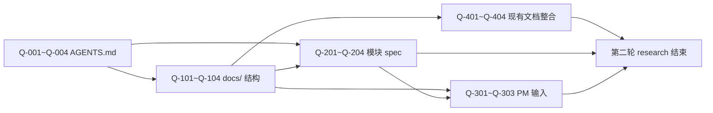

# Plan-001：下一步 docs 设计研究计划

> **日期**：2026-07-29
> **性质**：研究计划（规划下一轮 research 的方向、范围与产出）
> **前置 research**：`.trae/skills/oss-vis-gd-project-context/plans/done/research/2026-07-29-001-docs-template-structure-findings.md`（第一轮研究结论）
> **已归档参考**：`.trae/skills/oss-vis-gd-project-context/plans/done/plans/done/2026-07-29-002-docs-init-research-output.md`（第一轮产出的 docs 初始化执行规划）
> **路线图**：`.trae/skills/oss-vis-gd-project-context/plans/done/roadmap.md`

---

## 1. 为什么需要第二轮 research

第一轮 research 已经回答了：

- ✅ 模板的目录结构是怎样的
- ✅ 本项目的技术栈与业务模块概貌
- ✅ 模板哪些可直接复用结构、哪些需要重写

但**尚未回答**：

- ❌ 本项目**独有的** docs 需求是什么（大屏可视化 / BFF / 实时数据 / 第三方 iframe / mock 驱动等特性该如何表达）
- ❌ AGENTS.md 的**项目级宪法条款**该如何措辞（参考谁的口吻、保留哪些硬约束、补充哪些新约束）
- ❌ docs/ 各目录**最小可行集合**是什么（哪些省略不会损失质量、哪些必须保留）
- ❌ 4 个核心业务模块的**spec 拆分策略**该如何选择（伞形 / 独立 / 子 spec）
- ❌ PM 输入文档的**填写边界**（哪些必填、哪些可标「待补」、PM 不介入时如何兜底）
- ❌ docs 与现有散落文档（`docs-api-backend/`、`public/static/doc/`）的**整合策略**

> 上述问题若直接进入 docs 落地阶段，容易出现「文档照搬模板 → 与项目实际脱节 → 被弃用」的失败模式。
> 因此需要在动手前再做一轮**深度、聚焦本项目**的研究。

---

## 2. 研究目标（OUT）

完成本计划后，应得到以下产出（全部在 `research/` 下，作为**第二轮 research 结论**）：

| 文件                                                                                                          | 主题                                                     | 关联决策                                                |
| ------------------------------------------------------------------------------------------------------------- | -------------------------------------------------------- | ------------------------------------------------------- |
| `2026-07-29-002-agents-md-content-plan.md`                                                                    | AGENTS.md 正文写作计划（含项目定位、模块根路径、硬约束） | D-11 ~ D-14                                            |
| `2026-07-29-003-docs-mvp-structure.md`                                                                        | docs/ 最小可行目录结构（保留/省略/合并/新增）            | D-15 ~ D-18                                            |
| `2026-07-29-004-modules-spec-strategy.md`                                                                     | 4 个核心模块的 spec 拆分策略（伞形/独立/子 spec）         | D-19 ~ D-21                                            |
| `2026-07-29-005-pm-input-fallback-strategy.md`                                                                | PM 输入文档的填写边界与不介入兜底                        | D-22                                                   |
| `2026-07-29-006-existing-docs-integration.md`                                                                 | 现有散落文档（docs-api-backend/、public/static/doc/）整合 | D-23                                                   |

---

## 3. 研究问题清单（IN）

### 3.1 AGENTS.md 内容设计（D-11 ~ D-14）

| ID    | 问题                                                                                                                            | 期望结论形态                            |
| ----- | ------------------------------------------------------------------------------------------------------------------------------- | --------------------------------------- |
| Q-001 | 模板 AGENTS.md 的硬约束（不编造 API、不动业务代码等）哪些应原样保留，哪些应改写或删除？                                            | 「保留条款清单 + 改写条款清单 + 删除条款清单」 |
| Q-002 | 「项目定位」一栏（本项目类型 / 当前重点模块 / 模块根路径）应填什么？                                                             | 一段不超过 5 行的项目定位描述           |
| Q-003 | 「实现习惯」一栏（本项目栈 / 包管理器 / 公共组件 / API 请求 / 微前端 / 按钮鉴权）应保留哪些条目，措辞如何改？                       | 替换后的「实现习惯」正文草稿            |
| Q-004 | 是否新增本项目特有的硬约束（如「mock 阶段禁止提交到 main」「iframe 嵌入需评审」等）？                                            | 新增约束清单（待 PM 拍板）              |

### 3.2 docs/ 最小可行结构（D-15 ~ D-18）

| ID    | 问题                                                                                                                            | 期望结论形态                            |
| ----- | ------------------------------------------------------------------------------------------------------------------------------- | --------------------------------------- |
| Q-101 | 模板 docs/ 全部 70+ 个文件，哪些是**必保留**的（不可省略）？                                                                    | 「必保留文件清单」+ 每条理由            |
| Q-102 | 哪些是**可省略**的（如 research/antd-4.19.1/ 因 antd 5 不适用）？                                                              | 「可省略文件清单」+ 替代方案            |
| Q-103 | 哪些是**可合并**的（如 skills/common/ 与 skills/frontend/ 可合并）？                                                            | 「可合并文件清单」+ 合并后结构          |
| Q-104 | 本项目**独有的**目录需要新增吗（如 `docs/bff-contracts/`、`docs/iframe-pages/`、`docs/realtime-protocol/`）？                    | 「新增目录建议」+ 每个目录的定位        |

### 3.3 模块 spec 拆分策略（D-19 ~ D-21）

| ID    | 问题                                                                                                                            | 期望结论形态                            |
| ----- | ------------------------------------------------------------------------------------------------------------------------------- | --------------------------------------- |
| Q-201 | 4 个核心模块（emergency-support-dashboard / five-major-center / info-management-bureau / gis-entry）应各建独立 spec 还是伞形？       | 每个模块的最终 spec 组织方式 + 理由     |
| Q-202 | emergency-support-dashboard 含 7 个子模块（保障进展 / 保障任务 / 值班表 / 预警感知 / 应急资源 / 网络情况 / 乡镇受损），是否需要拆子 spec？ | 拆 / 不拆 的判断 + 阈值标准             |
| Q-203 | info-management-bureau 含 4 类子视图（开闭幕式 / 比赛日 / 首页 / 倒计时），是否拆子 spec？                                       | 拆 / 不拆 的判断                        |
| Q-204 | gis-entry 相对独立且代码量小，是否合并到 emergency-support-dashboard 的 spec 作为 §X 章节？                                       | 合并 / 独立的判断                        |

### 3.4 PM 输入兜底（D-22）

| ID    | 问题                                                                                                                            | 期望结论形态                            |
| ----- | ------------------------------------------------------------------------------------------------------------------------------- | --------------------------------------- |
| Q-301 | PM 不介入时，specs/*/pm-inputs/pm-requirements-input.md 的 §A–H 应如何处理？                                                     | 「必填项 / 可选项 / 兜底描述」三档分类  |
| Q-302 | PM 部分介入（只补 §A–D，不补 §E–H）时，哪些 spec 章节可以独立推进？                                                              | 「可独立推进章节 vs 需 PM 全补章节」矩阵 |
| Q-303 | 如何在 spec.md 中标注「待 PM 补」而不让审阅者误以为已完成？                                                                     | 标注规范（如加粗 + ⚠️ + 跳转链接）       |

### 3.5 现有文档整合（D-23）

| ID    | 问题                                                                                                                            | 期望结论形态                            |
| ----- | ------------------------------------------------------------------------------------------------------------------------------- | --------------------------------------- |
| Q-401 | `docs-api-backend/`（散落 TS 接口 + 1 个手写 MD）应迁移到 `docs/design/api/` 还是另建 `docs/design/api-backend/`？               | 整合方案 + 迁移步骤                     |
| Q-402 | `public/static/doc/指挥调度中心跳转.md`（单点说明）应保留在 public/ 还是迁到 docs/？                                            | 去留判断                                |
| Q-403 | `public/static/mock/*.json`（40+ mock 数据文件）应否在 docs/api-contracts.md 索引（标注「mock 阶段 → 待 YAPI 导出」）？         | 索引规范                                |
| Q-404 | README.md / README.Dev.md 是否需要按 docs 体系重写？                                                                             | 是否重写 + 保留信息清单                  |

---

## 4. 研究方法

每个研究问题按以下流程推进：

1. **静态摸排**：搜索代码、文档、配置文件获取事实（不允许臆造）
2. **对照模板**：在 `.local-docs/docs模板-yzf/` 中找到对应章节作为参考（仅参考结构与措辞）
3. **草拟结论**：在 `research/<NNN>-<topic>.md` 中给出**「问题 → 选项 → 推荐 → 理由」** 四段式
4. **交叉引用**：在 `roadmap.md` §3 操作日志追加一行
5. **沉淀决策**：将结论中的「推荐」项追加到 `roadmap.md` §2 决策表（编号 D-11 起）

> ⚠️ 整个研究阶段不修改任何业务代码（`src/`、`public/static/`、`build/`、`package.json`）。

---

## 5. 阶段产出与依赖关系

| 阶段     | 研究问题                                  | 阻塞关系                                       |
| -------- | ----------------------------------------- | ---------------------------------------------- |
| Stage A  | Q-001 ~ Q-004（AGENTS.md 内容设计）       | 无（最先做）                                   |
| Stage B  | Q-101 ~ Q-104（docs/ 最小可行结构）        | 依赖 Stage A 结论（AGENTS.md 措辞影响 docs/ 表述） |
| Stage C  | Q-201 ~ Q-204（模块 spec 拆分策略）        | 依赖 Stage B（docs/ 结构决定 spec 组织方式）   |
| Stage D  | Q-301 ~ Q-303（PM 输入兜底）               | 依赖 Stage C（spec 拆分决定 PM 输入粒度）       |
| Stage E  | Q-401 ~ Q-404（现有文档整合）              | 依赖 Stage B（docs/ 结构决定整合位置）          |
| Stage F  | 汇总：第二轮 research 总览                | 依赖 Stage A–E                                 |

---

## 6. 执行步骤

按上述 Stage A–E 顺序执行，每个 Stage 对应一份 research 结论文档：

| 步骤 | Stage    | 操作                                                                                          | 产出                                                                                              | 状态      |
| ---- | -------- | --------------------------------------------------------------------------------------------- | ------------------------------------------------------------------------------------------------- | --------- |
| 1    | Stage A  | 搜索模板 AGENTS.md 与本项目 package.json / config.ts / configuration.ts，整理本项目「项目定位」 | `research/2026-07-29-002-agents-md-content-plan.md`                                               | 待启动    |
| 2    | Stage B  | 比对模板 docs/ 各文件与本项目栈，列出必保留 / 可省略 / 可合并 / 需新增                           | `research/2026-07-29-003-docs-mvp-structure.md`                                                   | 待启动    |
| 3    | Stage C  | 对照 4 个核心模块的代码结构 + mock 数据，给出每个模块的 spec 组织方式                            | `research/2026-07-29-004-modules-spec-strategy.md`                                                | 待启动    |
| 4    | Stage D  | 分析模板 pm-requirements-input.md 的 §A–H，定义本项目的填写边界与兜底                            | `research/2026-07-29-005-pm-input-fallback-strategy.md`                                           | 待启动    |
| 5    | Stage E  | 摸排 docs-api-backend/、public/static/doc/、public/static/mock/、README.md，给出整合方案        | `research/2026-07-29-006-existing-docs-integration.md`                                            | 待启动    |
| 6    | Stage F  | 汇总：第二轮 research 总览 + 给 PM 的决策清单                                                  | `research/2026-07-29-007-round2-summary.md`                                                        | 待启动    |

---

## 7. 不在本计划范围内（OUT）

- ❌ 落 `/AGENTS.md`（属于研究产出的下游执行，单独的 plan）
- ❌ 落 `/docs/` 目录骨架（属于研究产出的下游执行，单独的 plan）
- ❌ 写任何 design / specs / skills 正文（属于研究产出的下游执行，单独的 plan）
- ❌ 动任何业务代码（始终遵守）
- ❌ 修改现有 `roadmap.md` 决策（仅追加，不修订）

---

## 8. 完成定义（DoD）

- [ ] 6 份 research 结论已写入 `research/`（每份对应 Stage A–F）
- [ ] `roadmap.md` §2 决策表已追加本轮所有「推荐项」（编号 D-11 起）
- [ ] `roadmap.md` §3 操作日志已记录 6 步执行
- [ ] 给 PM 的决策清单已生成（O-1 ~ O-11 + 新增 O-12 ~）
- [ ] 没有动任何业务代码
- [ ] 本计划执行完成后移入 `plans/done/`

---

## 9. 工时与依赖提示（不做时间预测，仅列依赖）

| 前置                       | 必须等其完成后才能开始的后续                                |
| -------------------------- | ----------------------------------------------------------- |
| Stage A（AGENTS.md 内容）  | Stage B（docs/ 结构）、Stage C（模块 spec 拆分）            |
| Stage B（docs/ 结构）      | Stage D（PM 兜底）、Stage E（现有文档整合）                 |
| Stage C（模块 spec 拆分）  | Stage D（PM 兜底）                                          |
| Stage D / E                | Stage F（汇总）                                             |
| Stage F                    | 下一轮 plan（docs 初始化执行规划）                          |

---

## 10. 关联文档

| 文档                                                                                                          | 说明                                                |
| ------------------------------------------------------------------------------------------------------------- | --------------------------------------------------- |
| `.trae/skills/oss-vis-gd-project-context/plans/done/roadmap.md`                                                                                  | 整体路线图                                          |
| `.trae/skills/oss-vis-gd-project-context/plans/done/research/2026-07-29-001-docs-template-structure-findings.md` | 第一轮 research 结论（模板结构 + 项目现状）         |
| `.trae/skills/oss-vis-gd-project-context/plans/done/plans/done/2026-07-29-002-docs-init-research-output.md` | 第一轮 docs 初始化执行规划（已归档为研究产出参考）  |
| `.trae/skills/oss-vis-gd-project-context/plans/.local-docs/docs模板-yzf/AGENTS.md`                              | 模板 AGENTS（仅参考结构与措辞）                    |
| `.trae/skills/oss-vis-gd-project-context/plans/.local-docs/docs模板-yzf/docs/specs/_template/pm-inputs/pm-requirements-input.md` | PM 输入模板（仅参考 §A–H 章节划分）               |

---

## 11. 立即可启动的下一步（用户决策）

| 选项 | 决策                                                                                                          | 默认值          |
| ---- | --------------------------------------------------------------------------------------------------------------- | --------------- |
| Q-A  | 是否按 Stage A → B → C → D → E → F 顺序执行？                                                                  | 推荐：是        |
| Q-B  | Stage A（AGENTS.md 内容设计）是否需要先出草稿给 PM 评审？                                                        | 推荐：先出草稿  |
| Q-C  | 是否需要在 Stage F 汇总时一并给出「AGENTS.md 正文 v0.1 草稿」？                                                | 推荐：是        |
| Q-D  | 是否需要在 Stage F 汇总时一并给出「docs/ 目录骨架草稿（含每个文件的 1–2 行说明）」？                          | 推荐：是        |

> 全部使用「推荐」值 → AI 可直接启动 Stage A
> 如调整 → 给出选项字母即可，AI 重新生成 Stage A 研究范围