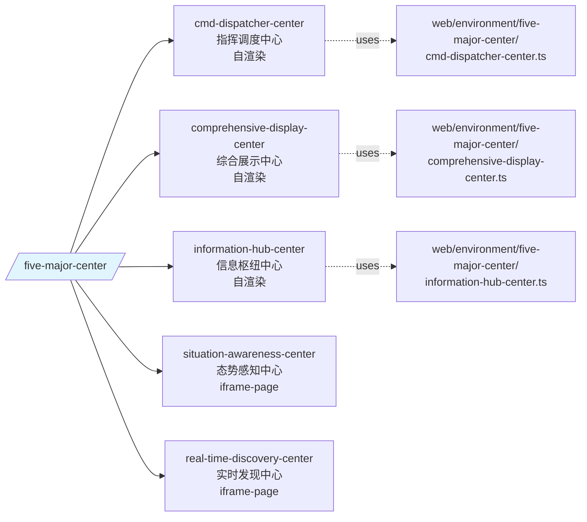

# Plan-003：five-major-center 模块 spec 七件套落地计划（v2 范围缩减版）

> **日期**：2026-07-29
> **性质**：执行计划（基于 plan-001 研究结论 + plan-002 顶层骨架，**仅针对 five-major-center 单模块**）
> **前置计划**：
> - [`2026-07-29-001-plan-next-research-step.md`](./2026-07-29-001-plan-next-research-step.md)（研究规划）
> - [`2026-07-29-002-plan-docs-foundation.md`](./2026-07-29-002-plan-docs-foundation.md)（docs 顶层骨架）
> **前置 finding**：`.trae/skills/oss-vis-gd-project-context/plans/done/research/2026-07-29-004-modules-spec-strategy.md`（模块拆分策略）
> **依赖**：docs/ 顶层骨架已落地（plan-002 已完成）
> **路线图**：`.trae/skills/oss-vis-gd-project-context/plans/done/roadmap.md`

---

## 0. 版本与范围说明（重要）

### 0.1 与原版差异

| 项 | 原 plan-003（v1）| 本版（v2）|
| --- | --- | --- |
| 覆盖模块数 | 4（emergency-support-dashboard / five-major-center / info-management-bureau / gis-entry） | **1（仅 five-major-center）** |
| 其余 3 模块 | 并行处理 | **暂缓**（emergency-support-dashboard / info-management-bureau / gis-entry 留待后续 plan-004+）|
| Q-D 决策 | 「AI 推断起草（标注待 PM 确认）」 | **严格留空，不允许 AI 推断起草业务规则**（D-A1/D-11 硬约束强化版）|
| Q-C 决策 | 分 plan（先 as-is → 再 spec）| **保留推荐值**：分 plan |
| 模块根路径 | `src/`（错） | **修正为 `web/pages/five-major-center/`**（视图）+ `src/`（BFF）|
| 子中心列表 | cmd / comprehensive / situation-awareness | **cmd / comprehensive / information-hub + iframe-page（共用）**（实际代码核实）|

### 0.2 路径修正（v2 新增）

| 路径类型 | 实际位置 | 修正说明 |
| --- | --- | --- |
| 前端视图 | `web/pages/<slug>/**` | 文档原误用 `src/views/<slug>/**`（来源：模板），改为 `web/pages/` |
| 前端组件 | `web/components/**` | 同上 |
| 前端 hooks | `web/hooks/**` | 同上 |
| 前端环境配置 | `web/environment/<slug>/**` + `public/environment.json` | 文档原误用 `public/environment.json` 单文件 |
| BFF 控制器 | `src/controller/**` | 保持不变 |
| BFF 服务 | `src/service/**` | 保持不变 |
| BFF Mock | `src/mock/**` | 保持不变 |
| BFF 类型 | `src/interface/**` | 保持不变 |
| BFF Socket | `src/socket/**` | 保持不变 |
| BFF 装配 | `src/configuration.ts` + `src/config/**` | 保持不变 |

### 0.3 docs/ 现有错误修正清单（同步进行）

> **D-A1 硬约束**：docs/ 所有事实性陈述必须基于代码现状。下列错误由本计划同步修正：

1. `docs/design/system-overview.md:220` —— 「视图层全部由 fedx-ssr external 加载——本仓库 `src/` 目录不包含 `pages/` 或 `views/`」 → **错误**：视图层实际在 `web/pages/`，由 fedx-ssr 编译加载。
2. `docs/design/tech-stack.md:150` —— 同上错误表述 → 同上修正。
3. `docs/specs/index.md:25` —— `information-hub-center` 标"路由未注册，待摸排" → **错误**：实际在 `web/pages/five-major-center/router.tsx:24-27` 已注册路由 `information-hub-center`，组件为 `InformationHubCenter`。
4. `docs/specs/index.md:21-22` —— `five-major-center` 列出 3 子 spec（cmd / comprehensive / situation-awareness） → **修正为**：3 自渲染子中心（cmd / comprehensive / information-hub）+ 1 共用 iframe-page 路由（situation-awareness / real-time-discovery）。

---

## 1. 为什么需要这个计划

plan-002 已建立 docs/ 顶层骨架（AGENTS.md + design/ + workflows/ + standards/ + skills/ + specs/ 顶层）。

**本计划是业务模块层的起点**：仅对 `five-major-center` 一个模块落地 spec 七件套，作为后续其他 3 模块的样板。

**关键原则**：

- **范围严格**：仅 five-major-center；其余 3 模块留待 plan-004+
- **事实严格**：所有事实陈述必须基于 `web/pages/five-major-center/**` 与 `src/**` 的实际代码；不允许 AI 推断业务规则（违反 D-A1 留空 + ⚠️ 标注「待 PM 补」）
- **路径严格**：前端用 `web/`，BFF 用 `src/`；不混用
- **分阶段**：先写 as-is-architecture.md → 评审 → 再写 spec.md

---

## 2. 目标（IN）

| #   | 目标                                                                              | 输出位置                                                                          |
| --- | --------------------------------------------------------------------------------- | --------------------------------------------------------------------------------- |
| M-0  | 修正 `docs/specs/index.md` 中 five-major-center 行 + 标记其余 3 模块「暂缓」      | `docs/specs/index.md`                                                            |
| M-1  | 建 `specs/five-major-center/` 子目录（含 7 件套骨架）                              | `docs/specs/five-major-center/`                                                   |
| M-2  | 写 `as-is-architecture.md`（10 节，全部基于代码事实）                              | `docs/specs/five-major-center/as-is-architecture.md`                              |
| M-3  | 写 `pm-inputs/{pm-requirements-input, code-inventory}.md`                          | `docs/specs/five-major-center/pm-inputs/`                                         |
| M-4  | 写 `spec.md`（To-Be 主规格；§1/§5 PM 不介入时严格留空）                            | `docs/specs/five-major-center/spec.md`                                            |
| M-5  | 写 `acceptance-tests.md`（含「现状」列）                                          | `docs/specs/five-major-center/acceptance-tests.md`                                |
| M-6  | 写 `plan.md`（重构切片 R1–R5）                                                    | `docs/specs/five-major-center/plan.md`                                            |
| M-7  | 写 `tasks.md`（任务分解）                                                         | `docs/specs/five-major-center/tasks.md`                                           |
| M-8  | 写 `data-model-extensions.md`（本模块数据增量）                                   | `docs/specs/five-major-center/data-model-extensions.md`                           |
| M-9  | 修正 docs/ 现有 4 处错误（见 §0.3）                                                | `docs/design/{system-overview,tech-stack}.md` + `docs/specs/index.md`           |
| M-10 | 同步更新 roadmap 操作日志与决策表                                                 | `.trae/skills/oss-vis-gd-project-context/plans/roadmap.md`                                                      |

---

## 3. 不做（OUT）

- ❌ 不动业务代码（`web/`、`src/`、`public/`、`build/`、`package.json`、`*.config.*`）
- ❌ 不引入新依赖
- ❌ 不写其他 3 模块的 spec（emergency-support-dashboard / info-management-bureau / gis-entry 留待 plan-004+）
- ❌ 不写 design/tech-stack.md / system-overview.md / architecture.md 的**整体重写**（仅修 §0.3 中 2 处错误）
- ❌ 不创建 specs/_template/ 之外的伞形 capability-map（本模块不拆子 spec，3 自渲染子中心 + iframe-page 作为 spec.md §5 章节）
- ❌ 不动 docs/specs/_template/（保持模板原样）

---

## 4. 前置条件

| #   | 条件                                                                                | 状态        |
| --- | ----------------------------------------------------------------------------------- | ----------- |
| F-1  | plan-002 已完成（docs/ 顶层骨架存在）                                                | ✅ 已完成    |
| F-2  | five-major-center 模块代码已稳定可读                                                | ✅ 已完成（`web/pages/five-major-center/router.tsx` 实际有 5 条路由）|
| F-3  | docs 现有 4 处错误已识别（见 §0.3）                                                  | ✅ 已识别    |
| F-4  | Q-D 决策已锁定（严格留空，AI 不推断）                                                | ✅ 已锁定    |

> 不依赖 PM 输入（PM 不介入时所有 §A–H 严格留空 + ⚠️ 标注；事实部分仅来自代码与 mock 数据）。

---

## 5. five-major-center 模块结构（来自 `web/pages/five-major-center/router.tsx`）



### 5.1 5 条路由详情（事实，基于 `router.tsx:17-44`）

| 路由 | 中文名 | 组件 | 渲染方式 | 环境配置 |
| --- | --- | --- | --- | --- |
| `/five-major-center/cmd-dispatcher-center` | 指挥调度中心 | `CmdDispatcherCenter` | 自渲染 React | `web/environment/five-major-center/cmd-dispatcher-center.ts` |
| `/five-major-center/comprehensive-display-center` | 综合展示中心 | `ComprehensiveDisplayCenter` | 自渲染 React | `web/environment/five-major-center/comprehensive-display-center.ts` |
| `/five-major-center/information-hub-center` | 信息枢纽中心 | `InformationHubCenter` | 自渲染 React | `web/environment/five-major-center/information-hub-center.ts` |
| `/five-major-center/situation-awareness-center` | 态势感知中心 | `IframePage` | **iframe 嵌入**（共用）| ⚠️ 第三方 URL 来源待 PM 确认 |
| `/five-major-center/real-time-discovery-center` | 实时发现中心 | `IframePage` | **iframe 嵌入**（共用）| ⚠️ 第三方 URL 来源待 PM 确认 |

> ⚠️ **D-A1 严格事实**：situation-awareness-center 与 real-time-discovery-center 在 `router.tsx` 都映射到 `IframePage` 组件；这两个路由的具体 iframe URL 来源**在 `router.tsx` 中未硬编码**，需在 as-is 阶段进一步查阅 `web/environment/five-major-center/` 的 3 个 ts 文件、`public/environment.json` 等。

### 5.2 模块文件结构（事实，基于 `web/pages/five-major-center/`）

```
web/pages/five-major-center/
├── cmd-dispatcher-center/         # 指挥调度中心（自渲染）
├── comprehensive-display-center/  # 综合展示中心（自渲染）
├── information-hub-center/        # 信息枢纽中心（自渲染）
├── iframe-page/                   # 共用 iframe 嵌入页
├── context/                       # 跨子中心共享 React Context
├── share/                         # 共享 box/content/header 组件
├── metalHumanPresets.ts
├── render$subpath.tsx
├── render.tsx
└── router.tsx
```

> ⚠️ **实际代码现状**：`information-hub-center` 路由在 `router.tsx:24-27` 已注册并实现，与 `docs/specs/index.md:25` 「路由未注册，待摸排」不符，本计划同步修正。

---

## 6. 每个文档的内容要点（七件套）

```
docs/specs/five-major-center/
├── as-is-architecture.md              # 现状架构（10 节，全部代码事实）
├── pm-inputs/
│   ├── pm-requirements-input.md       # PM 输入（A–H 严格留空 + ⚠️ 标注）
│   └── code-inventory.md             # 代码清单（A–J 全填，基于代码）
├── spec.md                           # To-Be 主规格（§1/§5 严格留空）
├── acceptance-tests.md               # 验收测试（含「现状」列）
├── plan.md                           # 重构切片（R1–R5）
├── tasks.md                          # 任务分解
├── data-model-extensions.md          # 本模块数据增量
└── assets/                           # 截图占位（README）
```

### 6.1 as-is-architecture.md（10 节，全部基于代码）

| §   | 标题            | 内容来源（事实）                                                                                          |
| --- | --------------- | --------------------------------------------------------------------------------------------------------- |
| 1   | 模块职责        | `router.tsx` 5 条路由 + 各子中心 `index.tsx` 顶部注释                                                     |
| 2   | 结构总览        | `web/pages/five-major-center/` 目录树                                                                     |
| 3   | 子视图详情      | 5 条路由表（见 §5.1）                                                                                       |
| 4   | 数据源          | `web/environment/five-major-center/` 3 个 ts + `src/mock/`（如有）+ `public/static/mock/`（如有）         |
| 5   | 数据流          | `environment.json` → `web/environment/*.ts` → 子中心组件 → mock 数据 / BFF 端点（`/api/index`、`/api/detail/:id`） |
| 6   | 状态            | valtio 1.11.2 + Context（`web/pages/five-major-center/context/`）                                          |
| 7   | 性能基线        | ⚠️ 待 PM 确认（不在 as-is 范围）                                                                            |
| 8   | 技术债务        | **基于代码客观观察**：iframe 跨域 / 缩放响应式 / 视图切换动画 / mock 数据驱动 / 错误处理分散 / 单元测试缺失 |
| 9   | 拆分建议        | **不拆子 spec**；3 自渲染子中心 + iframe-page 作为 spec.md §5 章节                                        |
| 10  | 开放问题        | O-新：situation-awareness / real-time-discovery iframe URL 来源 / O-新：5 中心 PM 决策阻塞项               |

### 6.2 pm-requirements-input.md（严格留空）

- **§A**：模块定位 ⚠️ 待 PM 补（不基于代码推断）
- **§B–§H**：全部 ⚠️ 待 PM 补
- 不允许 AI 推断起草业务规则（Q-D 锁定）

### 6.3 code-inventory.md（A–J 全填，基于代码）

| §   | 内容                  | 来源                                                                |
| --- | --------------------- | ------------------------------------------------------------------- |
| A   | 模块基本信息          | `web/pages/five-major-center/router.tsx` + 5 条路由                 |
| B   | 入口与依赖            | `config.ts` + `package.json`（fedx-ui / fedx-gis / valtio / antd 等）|
| C   | 路由                  | `router.tsx:17-44` 5 条                                            |
| D   | 页面                  | `web/pages/five-major-center/*/index.tsx`（3 自渲染）+ `iframe-page/index.tsx` |
| E   | 组件                  | `web/pages/five-major-center/*/modules/` 与 `web/pages/five-major-center/share/` |
| F   | API                   | BFF `/api/index` + `/api/detail/:id`（仅 emergency-support-dashboard 模块；five-major-center 数据来自前端 mock + iframe）|
| G   | 数据源 / Mock         | `web/environment/five-major-center/*.ts` + `public/environment.json` + `src/mock/`（emergency-support-dashboard 数据，不直接被 five-major-center 使用）|
| H   | 状态管理              | valtio 1.11.2 + Context                                            |
| I   | 样式 / 主题           | antd 5 + styled-components 6 + fedx-ui                             |
| J   | 第三方                | ECharts / fedx-gis / Socket.IO / swiper 11                         |

### 6.4 spec.md（To-Be，§1/§5 严格留空）

- **§1 业务需求**：⚠️ 待 PM 补（**不基于代码推断**；as-is 与 spec 不混写）
- **§3 接口**：BFF 端点（仅 emergency-support-dashboard 使用；five-major-center 主要走前端 mock）+ 3 个 `web/environment/` ts 配置驱动 URL
- **§4 界面拆解**：5 条路由对应 3 类组件（3 自渲染 + 1 iframe 共用）
- **§5 数据模型**：⚠️ 待 PM 补（数据来源含 BFF mock + 前端 mock + 第三方 iframe，业务规则由 PM 拍板）
- **§8 As-Is → To-Be 差异**：每行引用 `as-is-architecture.md §X`
- **§10 开放问题**：iframe URL 来源 / 错误处理策略 / 视图切换动画 / mock → 真实接口迁移

### 6.5 acceptance-tests.md（含「现状」列）

- 至少 1 条 S* per 子视图（5 条路由 = 5+ 条）
- 每条含「现状」列：已实现 / 部分 / 未实现 / 与业务不符
- §「与其它 artefact 的对应」表格至少填 1 行

### 6.6 plan.md（R1–R5 重构切片）

- **R1**：类型/枚举与 data-model 对齐（无行为变更）
- **R2**：环境配置抽取（`web/environment/five-major-center/` 收敛）
- **R3**：状态机显式化（Context / valtio store 拆分）
- **R4**：组件拆分（iframe-page 与 3 自渲染子中心独立 component 目录）
- **R5**：边界与错误处理（iframe 跨域、缩放响应式）

### 6.7 tasks.md（任务分解）

- 每模块 tasks.md 控制在 30–50 条
- R1–R5 切片粗粒度

### 6.8 data-model-extensions.md（本模块数据增量）

- §2 字段增量：3 个 `web/environment/` ts 中的配置字段 + 5 条路由的 URL 模板 + iframe URL（⚠️ 来源待 PM 补）
- §3 合并回 `design/data-models.md` 的约定：标注「本模块无新增共享实体；全部为模块内配置」

---

## 7. 执行步骤（顺序）

| 步骤 | 任务                                                                                  | 产物                                                                  | 阻塞    |
| ---- | ------------------------------------------------------------------------------------- | --------------------------------------------------------------------- | ------- |
| M-0  | 修正 `docs/specs/index.md` 中 five-major-center 行 + 标记其余 3 模块「暂缓」           | `docs/specs/index.md`                                                | F-1     |
| M-1  | 建 `docs/specs/five-major-center/` 子目录 + 拷贝 `_template/` 骨架                     | `docs/specs/five-major-center/{as-is, spec, plan, tasks, acceptance-tests, data-model-extensions, pm-inputs/{pm-requirements-input, code-inventory}}.md` 占位 | F-1 |
| M-2  | 写 `as-is-architecture.md`（10 节，全部代码事实）                                       | `docs/specs/five-major-center/as-is-architecture.md`                  | M-1     |
| M-3  | 写 `code-inventory.md`（A–J 全填）                                                    | `docs/specs/five-major-center/pm-inputs/code-inventory.md`           | M-1     |
| 评审 | 暂停，等待用户评审 M-2/M-3                                                            | —                                                                     | M-2/M-3 |
| M-4  | 写 `pm-requirements-input.md`（A–H 严格留空 + ⚠️）                                      | `docs/specs/five-major-center/pm-inputs/pm-requirements-input.md`    | 评审通过 |
| M-5  | 写 `spec.md`（To-Be；§1/§5 严格留空）                                                  | `docs/specs/five-major-center/spec.md`                                | 评审通过 |
| M-6  | 写 `acceptance-tests.md`（含「现状」列）                                                | `docs/specs/five-major-center/acceptance-tests.md`                    | M-5     |
| M-7  | 写 `plan.md`（R1–R5）                                                                  | `docs/specs/five-major-center/plan.md`                                | M-5     |
| M-8  | 写 `tasks.md`                                                                          | `docs/specs/five-major-center/tasks.md`                               | M-7     |
| M-9  | 写 `data-model-extensions.md`                                                          | `docs/specs/five-major-center/data-model-extensions.md`               | M-5     |
| M-10 | 修正 docs/ 现有 4 处错误（见 §0.3）                                                    | `docs/design/{system-overview,tech-stack}.md` + `docs/specs/index.md` | F-3     |
| M-11 | 同步更新 roadmap.md（§3 操作日志 + §2 决策表追加 D-新决策）                             | `.trae/skills/oss-vis-gd-project-context/plans/roadmap.md`                                          | 全部    |

> 注：**不在本计划范围**：整合 `design/{data-models,api-contracts,glossary}.md` 三件套（M-6/M-7/M-8 原 v1 目标）—— 因只做 1 个模块，无共享实体可整合，留待 plan-004+ 多模块时再做。

---

## 8. 风险与缓解

| #   | 风险                                                                                                       | 缓解                                                                                                  |
| --- | ---------------------------------------------------------------------------------------------------------- | ----------------------------------------------------------------------------------------------------- |
| R-1 | 仅靠代码无法获取 §A–§H PM 输入（业务规则、权限、字典）                                                    | 严格留空 + ⚠️ 标注「待 PM 补」；spec.md 不臆造                                                         |
| R-2 | `situation-awareness-center` / `real-time-discovery-center` 的 iframe URL 来源在代码中未硬编码             | as-is §10 开放问题列出；不臆造 URL                                                                      |
| R-3 | as-is 与 spec 内容可能不一致                                                                                | spec.md §8 显式引用 as-is §X；不一致时以 as-is 为准                                                    |
| R-4 | acceptance-tests.md 「现状」列需逐条核实                                                                    | 评审 M-2/M-3 后再写 acceptance（避免与 as-is 不一致）                                                  |
| R-5 | docs 现有 4 处错误涉及多个文件（system-overview / tech-stack / specs/index）                                | M-10 集中处理；用 grep 验证修改结果                                                                     |
| R-6 | 重写 plan-003 后，原 v1 内容需保留作为历史                                                                  | 将原 v1 内容归档到 `plans/done/2026-07-29-003-plan-modules-specs-v1.md`（待评审通过后执行）              |

---

## 9. 评审检查点

### 9.1 as-is 评审（M-2/M-3 后暂停）

- [ ] `as-is-architecture.md` 10 节齐全
- [ ] 5 条路由与 `router.tsx:17-44` 一致
- [ ] 3 个 `web/environment/five-major-center/*.ts` 配置字段已记录
- [ ] 技术债务仅基于代码客观观察，不臆造
- [ ] `code-inventory.md` A–J 全填，每项有代码引用

### 9.2 spec 评审（M-4/M-5 后暂停）

- [ ] `spec.md` §1 严格留空 + ⚠️ 「待 PM 补」
- [ ] `spec.md` §5 严格留空 + ⚠️ 「待 PM 补」
- [ ] `spec.md` §8 每行引用 as-is §X
- [ ] `spec.md` §10 开放问题含 iframe URL 来源 / 视图切换 / 错误处理

### 9.3 完成定义（DoD）

- [ ] M-0 ~ M-11 全部完成
- [ ] 7 件套齐全（as-is / pm / code / spec / acceptance / plan / tasks / data-model-extensions）
- [ ] docs/ 现有 4 处错误已修正
- [ ] roadmap.md 同步更新
- [ ] 没有动任何业务代码（`web/`、`src/`、`public/`、`package.json` 等）
- [ ] 没有动 plan-002 已落地的顶层文档（除 §0.3 列出的 3 处修正）
- [ ] 本计划执行完成后移入 `plans/done/`

---

## 10. 关联文档

| 文档                                                                                                          | 说明                                                |
| ------------------------------------------------------------------------------------------------------------- | --------------------------------------------------- |
| `.trae/skills/oss-vis-gd-project-context/plans/done/roadmap.md`                                                                              | 整体路线图                                          |
| [`./2026-07-29-001-plan-next-research-step.md`](./2026-07-29-001-plan-next-research-step.md)                  | 上游上游：研究计划                                  |
| [`./2026-07-29-002-plan-docs-foundation.md`](./2026-07-29-002-plan-docs-foundation.md)                        | 上游：docs 顶层骨架                                 |
| `.trae/skills/oss-vis-gd-project-context/plans/done/research/2026-07-29-001-docs-template-structure-findings.md` | 第一轮 research 结论                                 |
| `.trae/skills/oss-vis-gd-project-context/plans/done/research/2026-07-29-004-modules-spec-strategy.md` | 模块拆分策略（v1 范围 4 模块）                      |
| `.trae/skills/oss-vis-gd-project-context/plans/.local-docs/docs模板-yzf/docs/specs/_template`      | 七件套 + pm-inputs 模板                             |
| `.trae/skills/oss-vis-gd-project-context/plans/.local-docs/docs模板-yzf/docs/specs/fault-report` | 示例模块（仅参考结构与措辞）                       |
| `.trae/skills/oss-vis-gd-project-context/plans/.local-docs/docs模板-yzf/docs/workflows/as-is-to-be-guide.md` | as-is/To-Be 模式                                    |

---

## 11. 后续 plan 提示

| plan       | 范围                                                              |
| ---------- | ----------------------------------------------------------------- |
| plan-003   | **本计划：仅 five-major-center**                                    |
| plan-004   | emergency-support-dashboard（参考本计划的 Q-D 严格留空策略）        |
| plan-005   | info-management-bureau（参考本计划）                                |
| plan-006   | gis-entry（参考本计划）                                              |
| plan-007   | 整合 `design/{data-models,api-contracts,glossary}.md` 三件套（4 模块都完成后） |

---

## 12. 用户决策（已锁定）

| 选项 | 决策                                                                                                          | 值                |
| ---- | --------------------------------------------------------------------------------------------------------------- | ----------------- |
| Q-A  | plan-002 与本计划关系                                                                                          | ✅ plan-002 已完成，可直接启动本计划 |
| Q-B  | 4 模块顺序                                                                                                      | ⏸️ 仅做 1 模块，Q-B 不适用 |
| Q-C  | as-is 与 spec 关系                                                                                              | ✅ 分 plan：先 as-is（M-2/M-3）→ 评审 → 再 spec（M-4/M-5） |
| Q-D  | PM 不介入时 spec.md §1/§5 起草方式                                                                              | ✅ **严格留空，不允许 AI 推断**（D-A1 强化版）；⚠️ 标注「待 PM 补」 |
| Q-E  | docs/ 现有 src/ 路径修正                                                                                        | ✅ **本次同步修正**所有 4 处错误（见 §0.3）|
