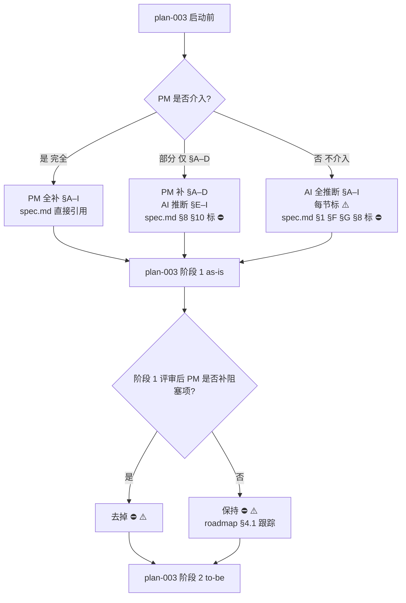

# Finding-005：PM 输入兜底策略（D-22）

> **日期**：2026-07-29
> **性质**：第二轮 research Stage D 结论
> **作用范围**：当 PM 不介入 / 部分介入时，`pm-requirements-input.md` §A–I 章节的填写边界与兜底描述
> **前置 finding**：[`2026-07-29-001-docs-template-structure-findings.md`](./2026-07-29-001-docs-template-structure-findings.md) §5.2（内容待补）
> **关联 finding**：[`2026-07-29-002-agents-md-content-plan.md`](./2026-07-29-002-agents-md-content-plan.md)（AGENTS.md 「本项目特有硬约束」）
> **规则约束**：`.trae/rules/docs-authoring-rules.md` Rule 1（事实优先；改进建议必须标注）
> **路线图**：`.trae/skills/oss-vis-gd-project-context/plans/roadmap.md` §2 决策表 D-22

---

## 0. TL;DR

| PM 介入度                    | pm-requirements-input.md §A–I 填写策略                                                                          | spec.md 引用策略                                                                          |
| ---------------------------- | ------------------------------------------------------------------------------------------------------------ | ----------------------------------------------------------------------------------------- |
| **完全介入**（PM 全补）      | PM 直接填写 §A–I                                                                                              | spec.md 直接引用；不带 ⚠️                                                                |
| **部分介入**（PM 补 §A–D）   | PM 补 §A–D；AI 基于代码推断 §E–I 并标「⚠️ AI 推断 / 待 PM 评审」                                              | spec.md 引用 PM 已补章节；引用 AI 推断章节时带 ⚠️；§F 验收标准 / §G 明确不做标「⛔ 阻塞」     |
| **不介入**（PM 不补任何章节）| AI 基于代码推断 §A–I 全部内容，每节首行标注「⚠️ AI 推断 / 待 PM 评审」                                          | spec.md 全部引用带 ⚠️；roadmap §4.1 跟踪所有未评审条目                                     |

**三档分类**：

| 分类        | 章节                          | 必填方  | 兜底策略                                                  |
| ----------- | ----------------------------- | ------- | --------------------------------------------------------- |
| **必填**    | §A 功能名片 / §F 验收标准 / §G 明确不做 | PM     | 无 PM 输入则「⛔ 阻塞 spec.md 阶段 2 评审」               |
| **可选项**  | §B 用户旅程 / §C 用户与权限 / §D 界面清单 / §E 数据与业务规则 / §H 开放问题 / §I 参考资料 | PM 或 AI | AI 基于代码推断；首行标注「⚠️ AI 推断」；PM 评审后改去 ⚠️  |

---

## 1. Q-301 PM 不介入时的 §A–I 兜底描述

### 1.1 模板 §A–I 章节回顾

> 来源：模板 `.trae/.local-docs/docs模板-yzf/docs/specs/_template/pm-inputs/pm-requirements-input.md`

| 章节  | 标题       | 内容形式            | 必填字段数 | 涉及业务视角                                       |
| ----- | ---------- | ------------------- | ---------- | -------------------------------------------------- |
| §A    | 功能名片   | 表格                | 5          | 入口 / 优先级 / 一句话价值                         |
| §B    | 用户旅程   | 步骤列表            | 5–10 步    | **业务动作**（必须 PM 视角）                       |
| §C    | 用户与权限 | 表格                | 角色数     | 角色能力（**PM 视角 + 安全合规**）                  |
| §D    | 界面清单   | 表格                | 页面数     | 页面 / 弹窗的主要操作                              |
| §E    | 数据与业务规则 | 列表            | 多         | 状态 / 必填 / 字典项                                |
| §F    | 验收标准   | 表格                | S1–S∞      | **业务验收**（PM 视角）                            |
| §G    | 明确不做   | 表格                | 多         | **范围控制**（PM 决策）                             |
| §H    | 开放问题   | 列表                | 多         | 跨部门争议 / 待 PM 决策                             |
| §I    | 参考资料   | 链接列表            | 多         | 产品稿 / 接口文档 / 截图                            |

### 1.2 三档分类（必填 / 可选 / 兜底）

| 分类      | 章节             | 不介入时的兜底                                                                                                                                | 兜底风险等级 |
| --------- | ---------------- | ------------------------------------------------------------------------------------------------------------------------------------------- | ------------ |
| **必填**  | §A 功能名片      | AI **不能编造**优先级与价值声明；建议标「⛔ 阻塞：PM 未提供优先级与价值，spec.md §1 不写最终版本」                                                | **高**（阻塞 spec.md §1） |
| **必填**  | §F 验收标准      | AI **不能编造**验收条目；建议标「⛔ 阻塞：PM 未提供验收标准，acceptance-tests.md 不写最终版」                                                    | **高**（阻塞 acceptance-tests.md） |
| **必填**  | §G 明确不做      | AI **不能编造**「不做」声明；建议标「⛔ 阻塞：PM 未提供范围声明，spec.md §8 Gap 无法收敛」                                                       | **高**（阻塞 spec.md §8） |
| **可选**  | §B 用户旅程      | AI 基于路由 + mock + environment.json 推断 5–10 步；标「⚠️ AI 推断 / 待 PM 评审」                                                                | **中**       |
| **可选**  | §C 用户与权限    | AI 推断：仅当代码中发现 auth / role / permission 关键字才填写；否则标「⛔ 项目无角色控制模块」                                                  | **中**       |
| **可选**  | §D 界面清单      | AI 基于路由层 + mock 目录推断；标「⚠️ AI 推断 / 待 PM 评审」                                                                                     | **低**       |
| **可选**  | §E 数据与业务规则 | AI 基于 environment.json 字典 + mock 数据结构推断；标「⚠️ AI 推断 / 待 PM 评审」                                                                | **中**       |
| **可选**  | §H 开放问题      | AI 基于「PM 必填章节缺失」+「O-1 ~ O-11 未决策项」自动列出；标「⚠️ AI 推断 / 待 PM 评审」                                                       | **低**       |
| **可选**  | §I 参考资料      | AI 自动从仓库内收集：src/ 入口 + README.md + docs-api-backend/ + public/static/doc/ + public/static/mock/*.json                                  | **低**       |

### 1.3 必填项的「⛔ 阻塞」处理流程

```
PM 未介入 §A / §F / §G
    ↓
AI 在 pm-requirements-input.md 对应章节首行写「⛔ 阻塞：PM 未提供 <字段>」
    ↓
AI 不写 spec.md §1 / acceptance-tests.md / spec.md §8 Gap 的最终版
    ↓
spec.md 对应章节写「⛔ 待 PM 补」+ 跳转链接到 pm-requirements-input.md
    ↓
roadmap §3 操作日志记录「PM 输入阻塞 N 项」
    ↓
PM 介入后逐项去掉 ⛔，改去 ⚠️ 或 ✅
```

### 1.4 可选项的「⚠️ AI 推断」标注规范

每个可选项章节首行必须包含：

```markdown
# §X 标题

> ⚠️ **AI 推断 / 待 PM 评审**：本节内容由 AI 基于代码事实（src/、public/、environment.json、mock）推断；PM 评审后改去本标注。
>
> **推断来源**：
> - src/controller/index.ts
> - public/environment.json
> - public/static/mock/<module>/*.json
> - docs-api-backend/<relevant>.md
```

---

## 2. Q-302 PM 部分介入时（只补 §A–D）的可独立推进章节矩阵

### 2.1 场景

PM 提供了 §A 功能名片 + §B 用户旅程 + §C 用户与权限 + §D 界面清单，但 §E–I 未提供。

### 2.2 spec.md 各章节推进可行性矩阵

| spec.md 章节         | 是否可独立推进 | 阻塞项                                  | 推进时的标注                                   |
| -------------------- | -------------- | --------------------------------------- | ---------------------------------------------- |
| §1 总览              | ✅ 可           | —                                       | 引用 §A + ⚠️「价值/优先级待 PM 拍板」           |
| §2 用户旅程          | ✅ 可           | —                                       | 引用 §B                                        |
| §3 用户与权限        | ✅ 可           | —                                       | 引用 §C                                        |
| §4 界面清单          | ✅ 可           | —                                       | 引用 §D                                        |
| §5 数据模型          | ✅ 可           | —                                       | AI 推断（基于 src/interface + mock）             |
| §6 视图层            | ✅ 可           | —                                       | AI 推断（基于路由 + mock + environment.json）  |
| §7 配置              | ✅ 可           | —                                       | AI 推断（基于 environment.json）               |
| §8 Gap（as-is→to-be）| ⛔ 阻塞        | **§G 明确不做未提供**                     | 标「⛔ 待 §G」                                   |
| §9 子 spec 索引       | ✅ 可           | —                                       | —                                              |
| §10 开放问题         | ⚠️ 部分可       | **§F 验收标准未提供时无法收敛**            | AI 列出已知开放问题；标「⛔ §F 待补」            |

### 2.3 acceptance-tests.md 推进可行性

| acceptance-tests.md 内容            | 是否可独立推进 | 阻塞项                                  |
| ----------------------------------- | -------------- | --------------------------------------- |
| 「已实现 / 部分实现 / 未实现」分类   | ✅ 可           | —                                       |
| 验收标准描述（S1 / S2 / …）          | ⛔ 阻塞        | **§F 未提供**                            |

### 2.4 plan.md / tasks.md 推进可行性

| 切片                   | 是否可独立推进 | 阻塞项                                    |
| ---------------------- | -------------- | ----------------------------------------- |
| R1 类型/枚举对齐       | ✅ 可           | —                                         |
| R2 API 封装收敛        | ✅ 可           | —                                         |
| R3 状态机显式化        | ⚠️ 部分可       | **§B 用户旅程未完全到位**                  |
| R4 组件拆分            | ✅ 可           | —                                         |
| R5 边界与错误处理      | ✅ 可           | —                                         |

### 2.5 PM 部分介入的推荐路径

1. **阶段 0**：PM 补 §A–D
2. **阶段 1（as-is）**：AI 独立完成 `as-is-architecture.md` + `code-inventory.md`
3. **阶段 2（to-be）**：AI 完成 spec.md §1–§7 + §9；§8 / §10 标 ⛔「待 PM 补 §F §G」
4. **阶段 3（评审）**：PM 评审 §8 / §10 时同步补 §F §G
5. **阶段 4（重构）**：按 plan.md / tasks.md 切片执行

---

## 3. Q-303 spec.md 中「待 PM 补」的标注规范

### 3.1 三档标注符号

| 符号 | 含义       | 使用场景                                                            | 颜色（建议） |
| ---- | ---------- | ------------------------------------------------------------------- | ------------ |
| ⛔    | 阻塞       | spec.md / acceptance-tests.md / spec.md §8 Gap 必须 PM 决策才能定稿 | 红色 + 加粗  |
| ⚠️    | AI 推断    | 内容由 AI 基于代码推断；PM 评审后可去标                              | 黄色 + 加粗  |
| 🟡   | 待 PM 补   | 章节存在但 PM 未补充；可推进但有风险                                 | 黄色         |
| ✅    | 已 PM 评审 | PM 评审通过；可作为最终版                                            | 绿色         |

### 3.2 spec.md 中的标注模板

```markdown
## §8 Gap（as-is → to-be）

> ⛔ **阻塞 / 待 PM 补 §G 明确不做**：本节需 PM 提供「明确不做」清单后才能定稿。
>
> **当前临时版本**（基于 AI 推断）：
>
> | as-is 行为                          | to-be 目标               | 阻塞项            |
> | ----------------------------------- | ------------------------ | ----------------- |
> | （AI 推断）                         | （AI 推断）              | §G 明确不做未补  |
>
> 📎 **跳转**：`.trae/documents/specs/<slug>/pm-inputs/pm-requirements-input.md#g`
```

### 3.3 acceptance-tests.md 中的标注模板

```markdown
# Acceptance Tests — <模块名>

> ⛔ **阻塞 / 待 PM 补 §F 验收标准**：本节验收条目由 PM 决定。
>
> **当前临时分类**（基于 AI 推断）：
>
> | #   | 验收条目       | 实现状态          | 阻塞项            |
> | --- | -------------- | ----------------- | ----------------- |
> | S1  | （AI 推断）    | 已实现 / 部分 / 未 | §F 验收标准未补  |
```

### 3.4 pm-requirements-input.md 中的标注模板

```markdown
# §A 功能名片

> ✅ **已 PM 评审**（PM 2026-XX-XX 评审通过）
>
> 或
>
> ⚠️ **AI 推断 / 待 PM 评审**：本节由 AI 基于代码推断。
>
> 或
>
> ⛔ **阻塞 / 待 PM 补**：本节无任何输入；spec.md §1 不写最终版本。

| 项                   | 填写         |
| -------------------- | ------------ |
| 功能中文名           | <AI 推断 / PM 填> |
| 一句话价值           | <AI 推断 / PM 填> |
| 入口（菜单路径）     | <从 src/controller/index.ts 推断> |
| 代码根路径（若已知） | <src/ 推断>     |
| 优先级               | ⛔ PM 未提供 |
```

### 3.5 roadmap §4.1 跟踪规范

每次 plan-003 阶段产出后，更新 roadmap §4.1：

```markdown
| PM 输入待办 | 阻塞项数 | 来源 |
| ----------- | -------- | ---- |
| ⛔ §A 优先级（5 模块） | 5 | pm-requirements-input.md §A |
| ⛔ §F 验收标准（5 模块） | 5 | pm-requirements-input.md §F |
| ⛔ §G 明确不做（5 模块） | 5 | pm-requirements-input.md §G |
| ⚠️ §B 用户旅程（3 模块已 AI 推断） | 2 待评审 | pm-requirements-input.md §B |
```

---

## 4. PM 介入度判定流程（plan-003 阶段 0 前置）



---

## 5. 沉淀决策（追加 roadmap §2）

| 决策编号 | 决策内容                                                                                                                                                                | 来源 |
| -------- | ----------------------------------------------------------------------------------------------------------------------------------------------------------------------- | ---- |
| D-22     | **PM 输入兜底三档分类**：必填（§A §F §G）/ 可选（§B §C §D §E §H §I）；标注符号三档（⛔ 阻塞 / ⚠️ AI 推断 / ✅ 已 PM 评审）；PM 部分介入（仅 §A–D）时 spec.md §8 §10 阻塞     | Stage D §1 + §2 + §3 |

---

## 6. 完成定义（DoD）

- [x] Q-301 §A–I 三档分类（必填 / 可选 / 兜底）
- [x] Q-302 PM 部分介入时 spec.md / acceptance-tests.md / plan.md 推进可行性矩阵
- [x] Q-303 三档标注符号（⛔ ⚠️ ✅）+ 在 spec.md / pm-requirements-input.md / roadmap §4.1 的具体模板
- [x] PM 介入度判定流程（mermaid）
- [x] 沉淀决策 D-22 待 roadmap §2 追加
- [x] 未动业务代码
- [x] 未引用 `.trae/` 与 `.local-docs/`（Rule 2）

---

## 7. 不在本文件范围内（OUT）

- ❌ 实际填写各模块 pm-requirements-input.md（属 plan-003 阶段 1）
- ❌ PM 评审流程（属 plan-003 阶段 1 评审环节）
- ❌ roadmap §4.1 跟踪项初始化（属 plan-003 阶段 2 完成后）

---

## 8. 关联文档

| 文档                                                                                                            | 说明                                                |
| --------------------------------------------------------------------------------------------------------------- | --------------------------------------------------- |
| `.trae/skills/oss-vis-gd-project-context/plans/roadmap.md`                                                                                | 整体路线图                                          |
| [`./2026-07-29-002-agents-md-content-plan.md`](./2026-07-29-002-agents-md-content-plan.md)                     | 上游 Stage A：本项目特有硬约束                     |
| [`./2026-07-29-003-docs-mvp-structure.md`](./2026-07-29-003-docs-mvp-structure.md)                             | 上游 Stage B：pm-inputs/ 是 _template 子目录        |
| [`./2026-07-29-004-modules-spec-strategy.md`](./2026-07-29-004-modules-spec-strategy.md)                       | 上游 Stage C：spec.md §8 §10 是 PM 输入承接位        |
| `.trae/skills/oss-vis-gd-project-context/plans/2026-07-29-003-plan-modules-specs.md`                | 下游：plan-003 业务模块 spec 落地计划               |
| `.trae/.local-docs/docs模板-yzf/docs/specs/_template/pm-inputs/pm-requirements-input.md` | 模板 pm-requirements-input.md §A–I                  |