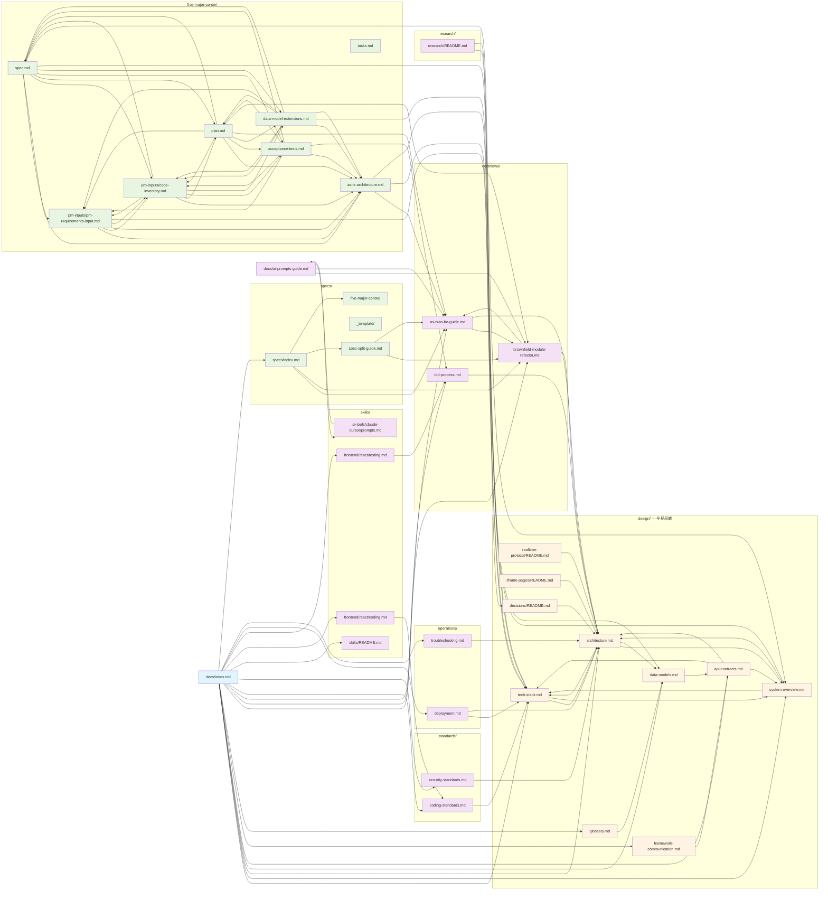
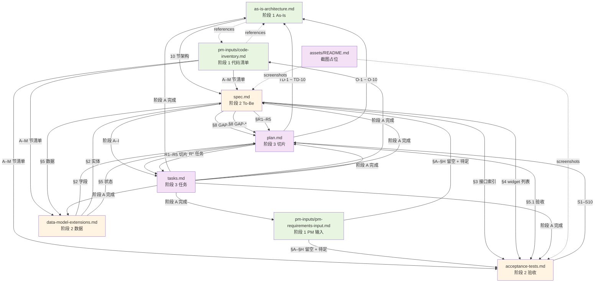

# docs-link：docs/ 文档内部互链结构索引

> 迁移自 `.trae/documents/docs-link/README.md`（2026-10-08，task-2026-10-08-001）；该源文件已随迁移删除。
>
> **作用**：记录 `/docs/` 下所有文档的**内部互链结构**（cross-reference graph），用于：
> 1. 评审文档完整性（缺链 / 死链检查）
> 2. 验证 D-12 规则（docs/ 不得引用 `.trae/` 与 `.local-docs/`）
> 3. 排查文档间依赖关系（重构 / 整合时的影响面分析）
>
> 本文件位于 skill `oss-vis-gd-project-context/references/docs-link/`，**不属于** `/docs/` 交付物；不受 D-12 路径隔离约束。
> **本文档是 plan-003 v2 步骤 M-11 之后的产物**，于 2026-07-29 由 user 决策建立。

---

## 1. docs/ 目录结构

```
docs/
├── index.md                              # 文档总站
├── ai-prompts-guide.md                   # AI 协作提示词（拷贝）
├── design/                               # 顶层设计（**全局权威**）
│   ├── README.md
│   ├── tech-stack.md                     # 技术栈详细版本 + npm 脚本
│   ├── system-overview.md                # IA / 路由 / 壳层 / 配置
│   ├── architecture.md                   # 整体架构
│   ├── data-models.md                    # 全局数据模型
│   ├── api-contracts.md                  # HTTP 契约索引
│   ├── framework-communication.md        # 框架间通信
│   ├── glossary.md                       # 术语表
│   ├── decisions/                        # ADR 模板
│   │   ├── README.md
│   │   └── adr-template.md
│   ├── realtime-protocol/                # Socket.IO 实时数据契约（占位）
│   │   └── README.md
│   └── iframe-pages/                     # 第三方 iframe 嵌入清单（占位）
│       └── README.md
├── workflows/                            # 工作流程
│   ├── README.md
│   ├── as-is-to-be-guide.md              # As-Is → To-Be 模式
│   ├── brownfield-module-refactor.md     # Brownfield 重构流程
│   └── tdd-process.md                    # TDD 流程
├── standards/                            # 项目规范
│   ├── README.md
│   ├── coding-standards.md
│   └── security-standards.md
├── skills/                               # 工程习惯
│   ├── README.md
│   ├── common/
│   │   └── git-workflow.md
│   ├── frontend/
│   │   ├── README.md
│   │   └── react/
│   │       ├── coding.md                 # 占位
│   │       └── testing.md                # 占位
│   └── ai-tools/
│       └── claude-cursor/
│           ├── README.md
│           └── prompts.md
├── research/                             # 调研备忘（仅 README）
│   └── README.md
├── operations/                           # 运维
│   ├── README.md
│   ├── deployment.md                     # 占位
│   └── troubleshooting.md                # 占位
└── specs/                                # 业务模块 spec
    ├── index.md                          # 模块索引（plan-003 v2 已修正）
    ├── spec-split-guide.md               # 复杂模块拆分指南
    ├── _template/                        # 五件套模板
    │   ├── spec.md
    │   ├── plan.md
    │   ├── tasks.md
    │   ├── acceptance-tests.md
    │   ├── data-model-extensions.md
    │   └── pm-inputs/
    │       ├── pm-requirements-input.md
    │       ├── code-inventory.md
    │       └── assets/
    │           └── README.md
    └── five-major-center/                # plan-003 v2 唯一目标模块（已完成）
        ├── as-is-architecture.md
        ├── spec.md
        ├── plan.md
        ├── tasks.md
        ├── acceptance-tests.md
        ├── data-model-extensions.md
        ├── assets/
        │   └── README.md
        └── pm-inputs/
            ├── pm-requirements-input.md
            └── code-inventory.md
```

**统计**（截至 2026-07-29）：

| 类型 | 数量 |
| --- | --- |
| docs/ 顶层 .md 文件 | 27 |
| specs/<module>/ 完成数 | 1 / 4（five-major-center 已完成；其余 3 模块 plan-004+） |
| docs/ 中 `docs-specs` 内部互链数 | ≈ 175 条（grep `](.\|../\|../../\)` 含同名 / 跨级 / 代码引用） |

---

## 2. 互链规则（D-12 / D-C1）

### 2.1 允许的引用

| 来源 | 目标 | 路径前缀 |
| --- | --- | --- |
| `docs/**.md` | `docs/**.md`（同目录） | `./` |
| `docs/**.md` | `docs/**.md`（跨目录） | `../` / `../../` |
| `docs/**.md` | `src/**`（BFF） | `../../src/` |
| `docs/**.md` | `web/**`（前端） | `../../web/` |
| `docs/**.md` | `public/**`（静态资源） | `../../public/` |
| `docs/**.md` | `config.ts` / `package.json` / `*.config.*` | `../../` |
| `docs/**.md` | `/AGENTS.md` | `../AGENTS.md` |

### 2.2 禁止的引用（D-12 硬约束）

| 路径 | 原因 |
| --- | --- |
| `.trae/documents/**`（已迁移：现位于 skill 内） | 工作区文档，非项目交付物 |
| `.local-docs/**` | 模板来源，不应对项目用户暴露 |

### 2.3 验证命令

```bash
# 验证 docs/ 不引用禁区路径
grep -rn "\.trae" docs/ && echo "违规" || echo "通过"
grep -rn "\.local-docs" docs/ && echo "违规" || echo "通过"

# 验证 AGENTS.md 不引用 Trae 工作区路径
grep -n "\.trae" AGENTS.md && echo "违规" || echo "通过"
```

> **当前验证结果（2026-07-29）**：全部通过

---

## 3. docs/ 整体互链结构（mermaid）



---

## 4. five-major-center 模块内部互链结构（重点）

> **plan-003 v2 唯一目标模块**；9 个文档内部高度互链。

### 4.1 文件清单（9 个）

| 文件 | 路径 | 行数（近似） |
| --- | --- | --- |
| as-is-architecture.md | `docs/specs/five-major-center/` | 288 |
| spec.md | `docs/specs/five-major-center/` | 228 |
| plan.md | `docs/specs/five-major-center/` | 147 |
| tasks.md | `docs/specs/five-major-center/` | 165 |
| acceptance-tests.md | `docs/specs/five-major-center/` | 154 |
| data-model-extensions.md | `docs/specs/five-major-center/` | 158 |
| pm-requirements-input.md | `docs/specs/five-major-center/pm-inputs/` | 110 |
| code-inventory.md | `docs/specs/five-major-center/pm-inputs/` | 274 |
| assets/README.md | `docs/specs/five-major-center/assets/` | 12 |

### 4.2 内部互链图（mermaid）



### 4.3 互链统计

| 文档 | 内部链出 | 链入 | 主要链接目标 |
| --- | --- | --- | --- |
| `as-is-architecture.md` | 30+ | 9 | router.tsx / environment.json / render$subpath.tsx / 各 .ts |
| `spec.md` | 25+ | 8 | as-is / code-inventory / plan / acceptance / data-model-extensions |
| `plan.md` | 15+ | 7 | as-is / spec / acceptance / tasks |
| `acceptance-tests.md` | 15+ | 6 | as-is / spec / plan / code-inventory / pm-inputs |
| `data-model-extensions.md` | 10+ | 5 | as-is / code-inventory / spec / plan / design/data-models.md |
| `pm-inputs/pm-requirements-input.md` | 8+ | 4 | as-is / code-inventory / spec / acceptance |
| `pm-inputs/code-inventory.md` | 35+ | 7 | as-is / spec / plan / acceptance / data-model-extensions |

> **特点**：as-is 与 code-inventory 是"被引用最多"的源文档；spec / plan 是"引用最多"的目标文档。

### 4.4 TD-* / GAP-* / O-* 交叉引用编号体系

| 编号 | 命名空间 | 定义于 | 引用方 |
| --- | --- | --- | --- |
| **TD-1 ~ TD-10** | 技术债务 | `docs/specs/five-major-center/as-is-architecture.md` §8 | spec §8 / plan R* / tasks / code-inventory K |
| **O-1 ~ O-10** | 开放问题 | `docs/specs/five-major-center/as-is-architecture.md` §10 | spec §9 / pm-requirements-input §H / plan R* / data-model-extensions §4 |
| **GAP-1 ~ GAP-9** | As-Is → To-Be 差异 | `docs/specs/five-major-center/spec.md` §8.1 | plan R* / tasks |
| **R1 ~ R5** | 重构切片 | `docs/specs/five-major-center/plan.md` §3 | tasks / spec §8.2 / acceptance §补充验收 |
| **S1 ~ S10** | 验收场景 | `docs/specs/five-major-center/acceptance-tests.md` | spec §4 / plan §5 / tasks 阶段 F |

---

## 5. docs/ → 仓库代码 互链（仅 BFF / 前端代码）

> docs/ 中对仓库代码的引用必须符合 **D-C1** 路径修正规则：
> - 前端：引用 `web/pages/` / `web/components/` / `web/hooks/` / `web/environment/`
> - BFF：引用 `src/controller/` / `src/service/` / `src/mock/` / `src/interface/` / `src/socket/` / `src/modules/` / `src/configuration.ts`

### 5.1 引用 `src/` 的文档（plan-002 阶段产出）

> **范围**：仅 BFF 代码路径；这些引用是**正确**的，无需修正。

| docs 文件 | 引用数 | 引用路径示例 |
| --- | --- | --- |
| `docs/design/architecture.md` | 15+ | `src/configuration.ts` / `src/controller/` / `src/service/` / `src/mock/` / `src/interface/` / `src/socket/` / `src/modules/` |
| `docs/design/api-contracts.md` | 8+ | `src/interface/` / `src/controller/` / `src/service/` / `src/mock/` |
| `docs/design/system-overview.md` | 8+ | `src/controller/` / `src/mock/` / `src/interface/` / `src/socket/` / `src/configuration.ts` |
| `docs/design/tech-stack.md` | 8+ | `src/configuration.ts` / `src/controller/` / `src/interface/` |
| `docs/design/framework-communication.md` | 4+ | `src/controller/` / `src/interface/` / `src/configuration.ts` / `src/mock/` |
| `docs/operations/deployment.md` | 4+ | `src/configuration.ts` / `config.ts` |
| `docs/operations/troubleshooting.md` | 6+ | `src/configuration.ts` / `src/controller/` / `src/socket/` |
| `docs/design/realtime-protocol/README.md` | 2+ | `src/configuration.ts` / `src/socket/Socket.ts` |

### 5.2 引用 `web/` 的文档（plan-003 v2 起新增）

> **范围**：前端代码路径；plan-002 阶段的 docs **未引用** web/（因 plan-002 误以为视图层在 fedx-ssr external），由 plan-003 v2 修正。

| docs 文件 | 引用数 | 引用路径示例 |
| --- | --- | --- |
| `docs/specs/five-major-center/as-is-architecture.md` | 30+ | `web/pages/five-major-center/` / `web/environment/five-major-center/` / `web/components/` |
| `docs/specs/five-major-center/spec.md` | 25+ | 同上 |
| `docs/specs/five-major-center/pm-inputs/code-inventory.md` | 20+ | 同上 |
| `docs/specs/five-major-center/plan.md` | 5+ | 同上 |

### 5.3 引用 `public/` 的文档

| docs 文件 | 引用路径 |
| --- | --- |
| `docs/design/architecture.md` | `public/static/mock/screen-list.json` / `public/environment.json` |
| `docs/design/api-contracts.md` | `public/environment.json` / `public/static/mock/*` |
| `docs/design/system-overview.md` | `public/environment.json` |
| `docs/operations/deployment.md` | `public/environment.json` |
| `docs/specs/five-major-center/*` | `public/environment.json` `five-major-center.*` 段 |

---

## 6. 互链自动化

> **改进建议（待评审）**：未来可加 Node.js 脚本自动扫描 docs/ 中的 markdown 链接并生成此 graph。**已于 2026-07-29 实现**，见 `oss-vis-gd-project-context/scripts/scan-docs-links.js`。

**用法**：

```bash
# 验证（D-12 + 死链检测）
node oss-vis-gd-project-context/scripts/scan-docs-links.js

# 输出 mermaid graph（stdout）
node oss-vis-gd-project-context/scripts/scan-docs-links.js --graph

# 输出 JSON
node oss-vis-gd-project-context/scripts/scan-docs-links.js --json oss-vis-gd-project-context/references/docs-link/graph.json

# 帮助
node oss-vis-gd-project-context/scripts/scan-docs-links.js --help
```

**实际输出**（2026-07-29 plan-003 v2 后）：

- 51 个 .md 文件（含 `docs/specs/five-major-center/` 9 件套）
- 654 条链接（621 条 relative + 33 条 unknown / 第三方）
- 0 处 D-12 违规
- 36 处死链（**全部为 plan-002 阶段遗留**，不在 plan-003 v2 范围；详见 §7）

### 6.1 实际脚本清单

| 脚本 | 用途 |
| --- | --- |
| `oss-vis-gd-project-context/scripts/scan-docs-links.js` | 扫描 docs/ 链接 + D-12 验证 + 死链检测 + mermaid graph + JSON 输出 |
| `oss-vis-gd-project-context/scripts/2026-07-29-bootstrap-five-major-center-spec.js` | plan-003 v2 M-1：建 five-major-center 子目录 + 拷贝模板 |
| `oss-vis-gd-project-context/scripts/2026-07-29-fix-five-major-center-doc-paths.js` | plan-003 v2 修正：`../as-is-architecture.md` 等同级错位（55 处） |
| `oss-vis-gd-project-context/scripts/2026-07-29-fix-five-major-center-code-paths.js` | plan-003 v2 修正：`../../../../web/` 等代码路径多 1 层 `../`（55 处） |

---

## 7. 已知断链与待补链

> **当前（2026-07-29）扫描结果**（基于 `scan-docs-links.js` 自动扫描）：

| # | 状态 | 说明 |
| --- | --- | --- |
| 1 | 已知占位 | `docs/design/realtime-protocol/README.md` 引用 `src/socket/Socket.ts` 业务实现 + `socket-events.md`（plan-002 阶段占位） |
| 2 | 已知占位 | `docs/design/iframe-pages/README.md` 引用 `iframe-registry.md` + `cmd-dispatcher-center/assets/iframe-ticket-mechanism.md`（plan-002 阶段占位） |
| 3 | 已知占位 | `docs/design/architecture.md` 引用 `realtime-protocol/socket-events.md`（plan-002 阶段占位） |
| 4 | 已知占位 | `docs/design/api-contracts.md` 引用 `emergency-support-dashboard/`（plan-004+ 暂缓） |
| 5 | 已知占位 | `docs/design/data-models.md` 引用 `emergency-support-dashboard/emergency-resources/data-model-extensions.md`（plan-004+ 暂缓） |
| 6 | 已知占位 | `docs/design/system-overview.md` 引用 `emergency-support-dashboard/` + `info-management-bureau/` + `gis-entry/`（plan-004+ 暂缓） |
| 7 | 已知占位 | `docs/skills/frontend/README.md` 引用 `fault-report/acceptance-tests.md`（plan-002 模板演示模块） |
| 8 | 已知占位 | `docs/skills/frontend/react/{coding,testing}.md` — 占位（待补） |
| 9 | 已知占位 | `docs/operations/{deployment,troubleshooting}.md` — 占位（待补） |
| 10 | 已补 | `docs/specs/five-major-center/` — 9 件套完整（plan-003 v2 完成；路径错误已修正 110 处） |
| 11 | D-12 隔离预期 | `docs/specs/index.md` 引用 `../research/2026-07-29-004-modules-spec-strategy.md`（research 已迁入 skill `plans/research/`，**D-12 隔离预期**） |

### 7.1 plan-003 v2 引入 + 已修正

| 错误 | 涉及文件 | 修正方式 |
| --- | --- | --- |
| `../as-is-architecture.md` 应为 `./as-is-architecture.md`（同级错位） | 5 个 | 2026-07-29-fix-five-major-center-doc-paths.js（55 处） |
| `../../workflows/` 应为 `../../../workflows/`（缺 1 层） | 1 个 | 同上（3 处） |
| `../../../../web/` 应为 `../../../web/`（多 1 层） | 5 个 | 2026-07-29-fix-five-major-center-code-paths.js（52 处） |
| 5 顶级 `.md` 互链 `../X.md` 应为 `./X.md` | 1 个 | 同上（4 处） |

**总计**：110 处路径错误已修正（plan-003 v2 闭环）

---

## 8. 关联文档

- `.trae/rules/docs-authoring-rules.md`（D-12 规则原文）
- `.trae/rules/script-first-rule.md`（D-13 Node.js 脚本优先）
- `oss-vis-gd-project-context/plans/roadmap.md`（§2.3 D-C 系列决策）
- `oss-vis-gd-project-context/plans/done/2026-07/2026-07-29-003-plan-modules-specs.md`（plan-003 v2）
- `docs/specs/five-major-center/`（本图重点反映的模块）

---

## 9. 修订记录

| 日期 | 修订内容 | 出处 |
| --- | --- | --- |
| 2026-07-29 | 初版：建立 docs-link 索引；记录 docs/ 整体互链结构 + five-major-center 模块内部互链图 | user 决策（plan-003 v2 之后） |
| 2026-10-08 | 迁入 skill references/；路径引用改为仓库根相对 / skill 内路径 | task-2026-10-08-001 |
